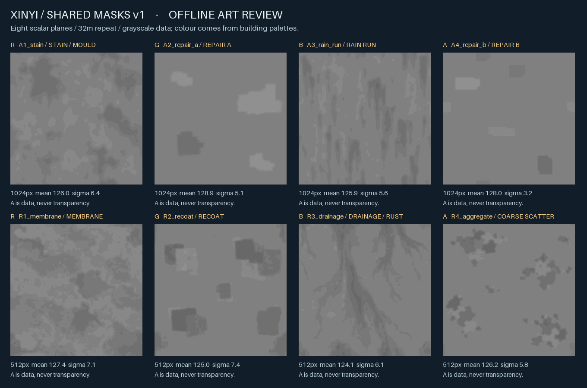
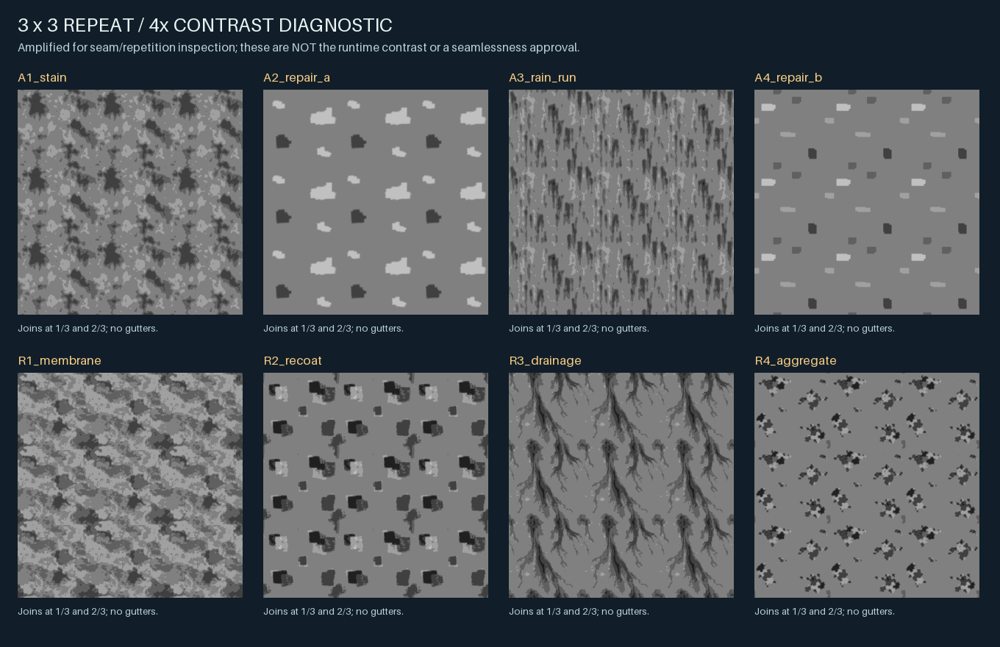
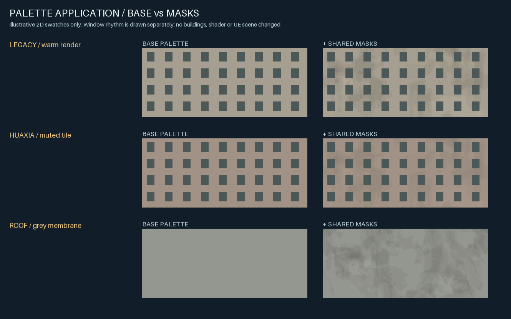
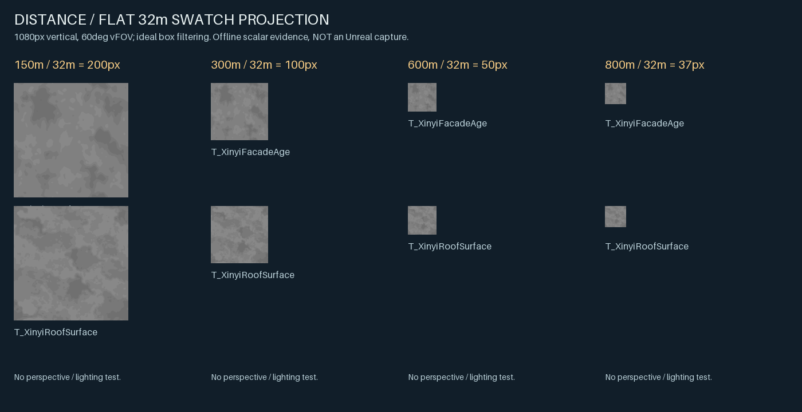

# Xinyi 共用遮罩 v1：立面老化與屋頂表面

**第一批實際離線資產，等待美術審核；尚未導入 Unreal。** 不是純噪聲測試圖，也不代表正式 Shader、ASTC 壓縮、飛行穩定性或美術品質已驗收。



## 最新狀態核對與工作基準

- 開工時查證：正式視覺分支 `feat/opus55-xinyi-visual-quality` 最新為 `ede7960d8ec05b2aa521b1e4c65b5bbd667c456d`，材質圖鑑仍為規格，正式 Shader 的老化／屋頂變化仍為程序式。
- **PR #14 已有可沿用來源**：`spike/xinyi-material-imagegen-batch1` 最新 `6c2feb1611a3d07436c8222c3b67246a9b1ad8cd`，r2 六張候選圖、九張原圖，但零張 runtime 打包貼圖、零次 Unreal 導入。本輪從這個 HEAD 建獨立 `art/xinyi-shared-masks-v1`，以它為 stacked Draft PR base。
- 先執行 PR #14 的驗證，沿用 B1 風化、B2 r2 稀疏補漆、B3 雨痕；不重做陶瓷、石材、抿石子等這次不需要的來源。舊圖、舊 manifest、舊產生腳本全部保留。
- 依 `docs/xinyi-custom-material-library-spec-v0.md`、立面 pilot、facade grammar v0A、roofscape v2、blank-wall v0B 的分工製作；既有窗格、樓層、色盤、屋頂物件、鐵皮接縫與建築幾何都不由這批圖取代。

## 交付檔案

| 路徑 | 內容 |
|---|---|
| `sources/` | 原生屋頂四面板圖、原創補漆 B SVG；其他三張原圖以 `inputs.json` 指向 PR #14，避免重複提交 |
| `planes/` | 八張嚴格 L 灰階通道圖：四張立面 1024²、四張屋頂 512²；全部可獨立檢視 |
| `textures/T_XinyiFacadeAge.png` | **512² RGBA8** 手機候選 |
| `textures/T_XinyiRoofSurface.png` | **512² RGBA8** 手機候選 |
| `authoring/T_XinyiFacadeAge_1024.png` | 1024² RGBA8 美術母版，不是第三張手機 runtime 貼圖 |
| `generation.json`、`inputs.json`、`manifest.json` | prompt／實際尺寸／來源與輸出 hash／通道／處理／量測／限制 |
| [SOURCES.md](SOURCES.md) | 來源與使用條件，不把 AI 圖冒充 CC0 照片 |
| `review/` | 通道、3×3 重複、RGBA 假色／Alpha、距離、舊公寓／華廈／屋頂色盤示意五張預覽 |

總計：**8 個用途明確的控制平面、2 張 runtime pack、1 張母版、5 張預覽**。新生成為一張四面板 AI 原圖，另有一張原創向量圖；三張 AI 來源沿用 PR #14。衍生平面不是額外獨立 AI 原圖。

## 固定通道契約

| 貼圖 | R | G | B | A |
|---|---|---|---|---|
| `T_XinyiFacadeAge` | A1 濕氣風化／黴斑場 | A2 稀疏補漆 A | A3 垂直雨痕 | A4 階梯、橫帶修補 B |
| `T_XinyiRoofSurface` | R1 防水膜宏觀補片 | R2 不規則重塗區 | R3 排水／氧化流痕 | R4 粗尺度漆片／骨材簇 |

- **Alpha 是第四個資料通道，不能丟棄或當透明度。** 直接預覽 RGBA PNG 可能半透明；請看分離通道圖／`review/packed.png`。它不是一張 Albedo。
- 每張共用圖對應 **32×32m**，手機密度 16 texels/m；窗框、磁磚縫、鐵皮接縫、裂紋與小型設備不畫進圖中。主要形狀是維修補片、濕斑與流痕；AI 原生圖的公尺尺度是美術目標，不是實測場景分布。
- 數值中心 **128/255**，不是 PNG 透明度；每張母平面使用 5–6 個實際灰階值（允許七階 104…152）。512 立面縮圖含濾波的中間值。
- 建議後續解碼 `d = (sample * 255 - 128) / 24`。R/B 的負值代表較深污痕；補漆 G/A 保留正負調色差。示意圖的最終明度倍率限制在 **0.75…1.12**，華廈權重為舊公寓的 0.6；這只是預覽配方，不是對正式 Shader 的修改。
- 立面 B 的 PNG +V 朝下；未來接 `(u,h)` 時須確認高度與影像 V 的符號，讓雨痕順重力。先沿用每棟位移／水平鏡像策略；不要把立面雨痕轉 90° 或上下顛倒。屋頂圖不包含真實排水口位置，不能代替坡向／設備配置。

## 產生與驗證

在 repo 根目錄：

```bash
python -m pip install -r requirements-xinyi-material-masks.txt
python tools/materials/build_xinyi_shared_masks.py
python tools/materials/build_xinyi_shared_masks.py --validate --reproduce
python tools/materials/test_xinyi_shared_masks.py
python assets/materials/xinyi/imagegen/batch1/build_revision_r2.py --validate
```

原生 AI 圖不會重新生成；產生腳本只讀取固定來源，離線整理、重建遮罩、打包與預覽。可用 `--output /tmp/xinyi-masks-review` 避免寫入資產目錄。來源 hash 改變就失敗，必須另行檢視而非默默重抓。重現驗證比較全部 16 張衍生 PNG 的**解碼像素**；PNG 壓縮位元組仍受 Pillow／zlib 版本影響，來源與已提交檔案本身則以 SHA-256 精確稽核。

處理步驟：轉 L 灰階、數值中位數回到 128、裁切在 104…152；0.16m sigma 的環繞低通移除細粒；1m 範圍的對向邊界 smoothstep 修正；七階量化後閉合兩軸；立面母版 BOX 縮為 512，再耦合對向邊緣。這些步驟保留來源形狀，沒有加入隨機噪聲。

| 離線檢查 | 本批結果／標準 |
|---|---|
| 來源與輸出 | SHA-256、PNG 解碼、8-bit、尺寸、L／RGBA 模式通過 |
| 邊界 | 八個平面與兩個 pack 的上下／左右對應像素最大差 **0** |
| 接縫斜率 | 母平面邊界一階差最大 **0–16/255**；此項與 3×3 放大圖一併審查，不把邊緣相等當成不可見接縫的保證 |
| 通道 | 解包 R/G/B/A 與對應平面逐像素相等；另測試錯換 R/G、丟 Alpha、改不透明 Alpha、破壞邊界都會被拒絕 |
| 色彩解讀 | 衍生 PNG 無 sRGB／gamma／ICC／透明度 metadata；Unreal 匯入仍須手動設 sRGB OFF |
| 明度／遠距 | 平面平均約 **124.1–128.9/255**；BOX ×8、×16 的標準差均 **<8/255**，實際值在 manifest；不宣稱有細節消失就代表無飛行閃爍 |
| 修補差異 | A2／A4 相關係數約 **−0.018**，不是換色複製；重複仍可辨識 |

## 預覽怎麼看



重複圖刻意放大對比四倍，方便找接縫、圖章與長條週期。補漆區與 R3 流痕有可辨識的 32m 重複；沒有以模糊或假裝每棟獨立貼圖隱藏這個限制。v1 先採每棟偏移／水平鏡像及降低權重，是否需要第二組真正不同圖案留待美術審核。





色盤圖只示意舊公寓、華廈及灰色防水層的表面語彙，窗格由預覽程式另畫；不是重新製作建築。距離圖以 1080px 高、60° 垂直 FOV 計算 150／300／600／800m 的 32m 平面投影，只做理想 BOX 濾波，**不是 Unreal 截圖、斜視、動態或手機 GPU 證據**。

## 下一階段匯入需求與美術審核

1. 只匯入 `textures/` 兩張：**sRGB OFF、Compression Masks、保留 Alpha、Wrap U/V、原生 mip chain**；不要當 Normal、Opacity 或 Albedo。來源 1024 母版保留於美術目錄。
2. ASTC 6×6 含完整 mips，兩張 512² 的純 block 理論量共 **316,864 bytes（約 0.302 MiB）**，未包含引擎對齊／常駐開銷；不是已量測顯存。若漸層壓縮不佳，再比 ASTC 4×4，不先加大圖。
3. 正式整合仍應各表面類別 **一次 RGBA sample**，不要每通道各取樣。材質、色盤、窗格、屋頂接縫、設備及幾何維持原分工；不新增 decal pass。
4. 美術先審來源形狀、髒污／補漆密度、臺北舊公寓／華廈語彙及 32m 圖章感；再以既有引擎 capture harness 做四距離、日／暮、移動和同場 A/B。只有那一階段才能判定收益、ASTC 品質、閃爍及 GPU 成本。

**本輪沒有修改既有建築／樹木／正式 Unreal Shader 或場景，也沒有把離線數值通過當成最終美術通過。保持 Draft，等待美術審核。**
