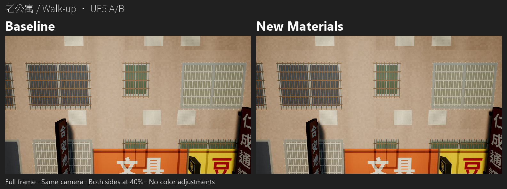
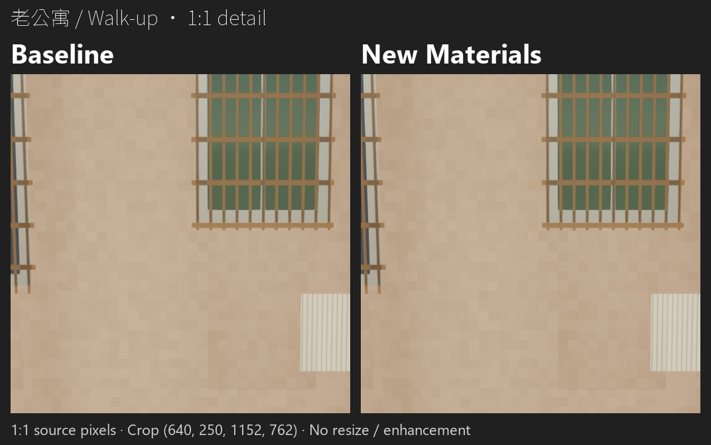
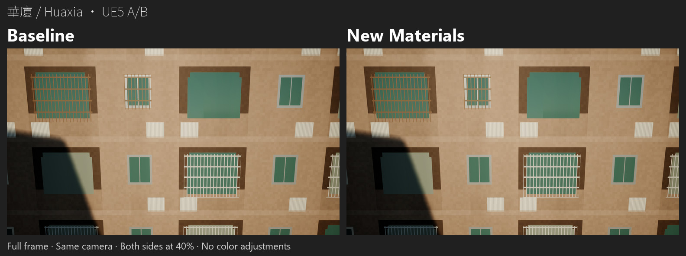
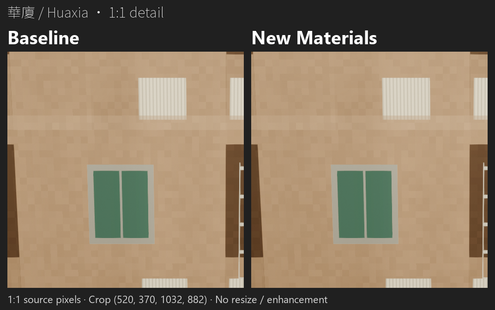
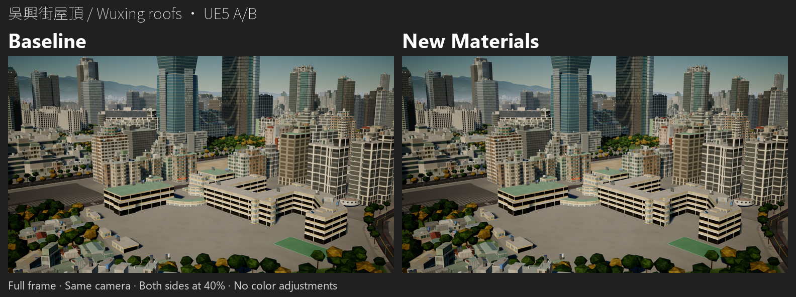
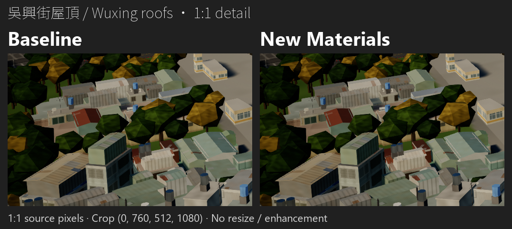

# 信義區材質 A/B：手機審圖版

**左：Baseline；右：New Materials。** 三張 JPEG 使用已提交的 UE 原圖主鏡位，左右均保留全幅，從 1920×1080 等比例縮至 768×432；合成圖為 1584×592。相機、光照及畫質沿用原始截圖，不重新執行 UE，不修改材質。

沒有調色、提亮、對比調整或銳化。JPEG 僅供快速檢視；細微風化、補漆與屋頂斑紋請開啟下方 **1:1 無損 PNG**。細節圖左右使用完全相同的裁切座標、不縮放，每個來源像素對應一個輸出影像區域像素，已逐 RGB 核對一致。手機網頁可能自動縮圖，請下載或開啟原尺寸確認細節。

## 老公寓

[開啟 JPEG（189,050 bytes）](walkup-ab.jpg) · [1:1 牆面風化／補漆細節](walkup-detail-1to1.png) · 原圖：[Baseline](../captures/baseline/walkup__day.png) / [New Materials](../captures/candidate/walkup__day.png)

展開老公寓 1:1 細節

## 華廈

[開啟 JPEG（147,228 bytes）](huaxia-ab.jpg) · [1:1 牆面風化／補漆細節](huaxia-detail-1to1.png) · 原圖：[Baseline](../captures/baseline/huaxia__day.png) / [New Materials](../captures/candidate/huaxia__day.png)

展開華廈 1:1 細節

## 吳興街屋頂

[開啟 JPEG（302,063 bytes）](wuxing_roofs-ab.jpg) · [1:1 街屋屋頂斑紋細節](wuxing_roofs-detail-1to1.png) · 原圖：[Baseline](../captures/baseline/wuxing_roofs__day.png) / [New Materials](../captures/candidate/wuxing_roofs__day.png)

裁切位於全幅左下的街屋屋頂；畫面中央的學校不受本輪遮罩影響。現有截圖中的屋頂差異偏弱，未另行強化。

展開吳興街屋頂 1:1 細節

## 製作與核對

| 對象 | 同一組來源裁切座標 `(left, top, right, bottom)` | 每側細節尺寸 | 無損合成圖大小 |
|---|---|---|---:|
| 老公寓 | `(640, 250, 1152, 762)` | 512×512 | 393,876 bytes |
| 華廈 | `(520, 370, 1032, 882)` | 512×512 | 381,530 bytes |
| 吳興街屋頂 | `(0, 760, 512, 1080)` | 512×320 | 275,617 bytes |

座標原點為原圖左上，右／下界不含。標題與標籤放在影像區域之外。全幅左右使用相同 LANCZOS 縮圖，再以同一次 JPEG 編碼輸出（quality 90、4:4:4、progressive）；每張均小於 1,000,000 bytes。

來源固定為提交 `0b220f6fed7849ab8fe6bd8a0eede1891ec2a878` 中的三個主鏡位配對。全部 **14 張 A/B 原始 PNG、額外的 baseline-smoke PNG** 皆與該提交逐位元組一致，製作前後 SHA-256 不變；兩份 capture metadata 亦未改動，Git 文字換行差異另行記錄。其餘四組屋頂位移原圖仍可在 [captures](../captures/) 檢視。

[manifest：來源與輸出雜湊、裁切、尺寸及核對結果](manifest.json) · [完整實機測試報告與限制](../../../xinyi-material-ue58-round1-result.md)

重製僅需在 Windows 使用 Pillow 12.3.0 執行 `python tools/lookdev/build_xinyi_material_review_previews.py`；字型與雜湊記錄於 manifest。此工具只讀 committed captures、寫入此 review 目錄，不啟動 Unreal。此版沒有新增效能量測，原有 Windows 量測與未驗證事項不變。
