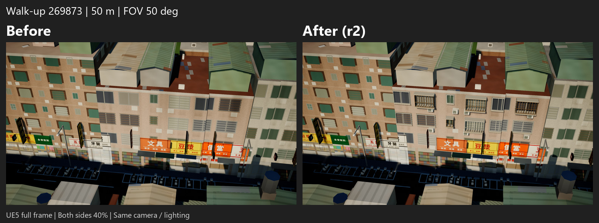
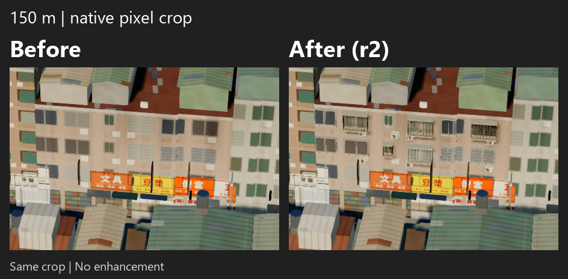
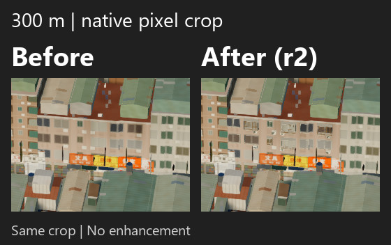

# 老公寓 269873：手機 A/B 審圖

**左 Before，右 After（R2）。** 50／150／300 m 是相機至同一立面觀察點的直線距離，全組 FOV 50°、相同白天與畫質。只增加可關閉的窗框／鐵窗及冷氣套件，原始 UE PNG 未調整。

結論：50–150 m 有可見層次改善，**300 m 全幅效果仍偏弱，尚未完整通過遠距成功標準**。R1 後只修正一次，已停止迭代；建議先審此棟，再決定第二棟華廈。

## 50 m

[完整 JPEG，243 KB](review/050m-full-ab.jpg) · [立面原像素裁切，403 KB](review/050m-detail-ab.jpg) · 原始 UE PNG：[Before](captures/before/distance_050m__day.png) / [R2](captures/r2/distance_050m__day.png) / [R1](captures/r1/distance_050m__day.png)

## 150 m

[全幅 JPEG，297 KB](review/150m-full-ab.jpg) · [立面裁切，107 KB](review/150m-detail-ab.jpg) · 原始 UE PNG：[Before](captures/before/distance_150m__day.png) / [R2](captures/r2/distance_150m__day.png) / [R1](captures/r1/distance_150m__day.png)

## 300 m

[全幅 JPEG，350 KB](review/300m-full-ab.jpg) · [立面裁切，51 KB](review/300m-detail-ab.jpg) · 原始 UE PNG：[Before](captures/before/distance_300m__day.png) / [R2](captures/r2/distance_300m__day.png) / [R1](captures/r1/distance_300m__day.png)

全幅 JPEG 左右同為 768×432（原圖 40%）；細節使用同一來源座標裁切，不另行縮放或強化，JPEG quality 90 / 4:4:4 / progressive。手機網頁可能自動縮圖，請開啟原尺寸；裁切方便觀察，沒有增加遠距資訊。9 張原始 PNG、三個 variant 的完整相機／設定／performance receipts 皆保留。

[完整研究、成本、限制與回放方式](../../xinyi-walkup-exemplar-269873-result.md) · [原圖雜湊與量測](summary.json) · [一次修正紀錄](iteration-plan.json) · [凍結來源不變核對](source-immutability.json)

最終新增 2,940 個 triangles、1 個 mesh／material section，無 image texture。Draw Calls 為每可見 raster pass +1 的估計，總 RHI 未量測；時間 proxy 區間重疊，沒有可信的效能差異，也不是手機驗證。
