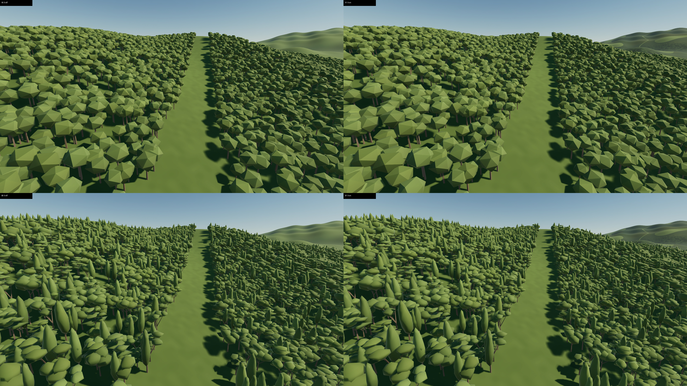
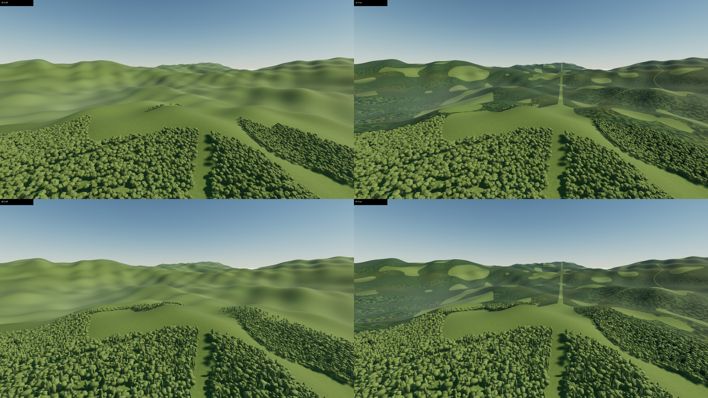
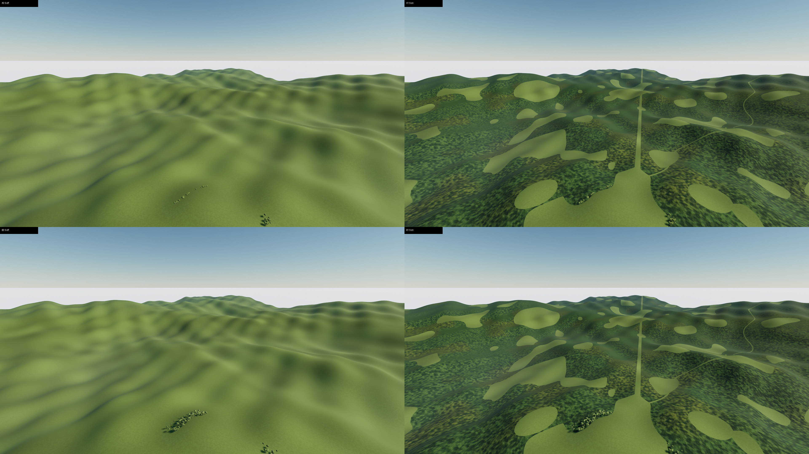
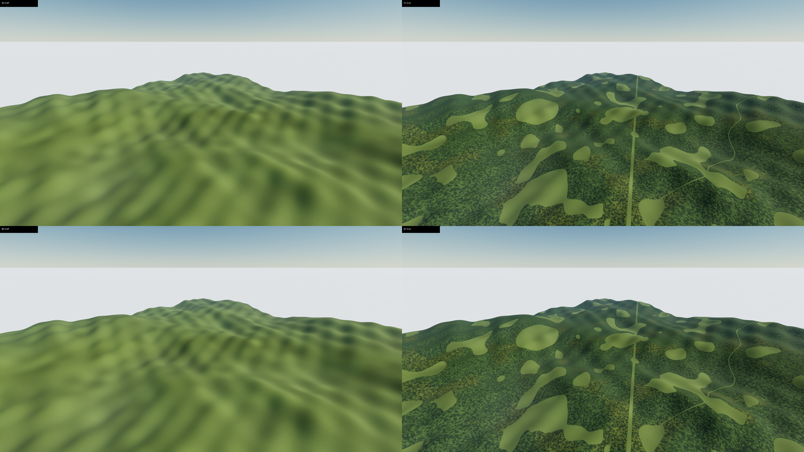
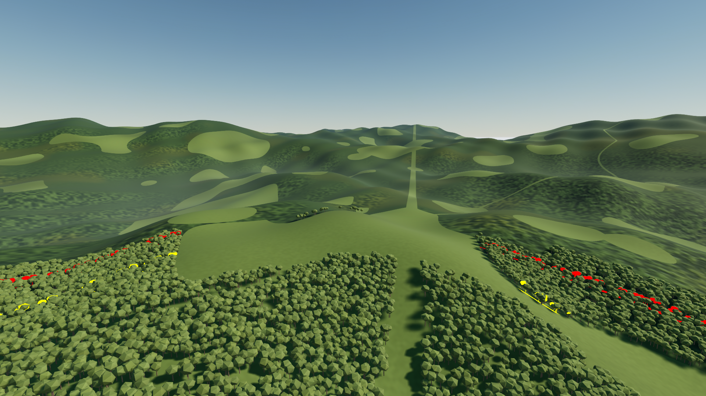

# ForestSpike B1a — 四組 factorial baseline（Intel UHD 770 only）

**結論：B1a 四組資料收集完成，支持先做受控的森林材質／N→S 切換修復，不支持直接展開 B1b。** B 在50m增加近景形態辨識，但無法補足遠景森林；S 明顯恢復遠景森林量感，仍有可見的高度／明暗／紋理接縫。F10 FAIL；F9、F11 的完整品質驗收尚未成立，不能因局部數值較低就宣稱 PASS。

本實驗依 [PR #24 Review 5498257180](https://github.com/eddy121384-ui/air-combat-world/pull/24#pullrequestreview-5498257180) 與 [Issue #19 決策](https://github.com/eddy121384-ui/air-combat-world/issues/19#issuecomment-6137207001)，從 `a1d723879ac25ba330a771ed1eefbcd54258b249` 建立 `spike/ac7-forest-b1a-factorial`。本 PR base 為 `spike/ac7-forest-b0-preflight`；PR #24 維持原樣。量測 plan／harness 在 commit `ea36b5632d72fbba6f5609c779dd343803b38f61` 凍結，80 筆靜態正式 capture 期間未變更。後續視覺工具的變更與窗口理由另記於 `visual_protocol_v2.json`。

## 環境與四組固定條件

Windows 11 25H2、Unreal Engine 5.8.0 CL55116800、D3D12 SM5、Intel UHD 770 driver 31.0.101.4502、i7-12700／16GB RAM。所有效能結論 **Intel UHD 770 only**；不得推論 PS5、獨顯 PC 或手機。

| 組別 | N 樹木 | S 遠景 |
|---|---|---|
| A0 | 信義區來源 28-triangle 樹的隔離 policy copy，30,200 棵 | OFF |
| A1 | 同 A0 | ON |
| B0 | PR #18 四種新樹的隔離 policy copies，30,100 棵 | OFF |
| B1 | 同 B0 | ON |

這裡 B0 是實驗組名，不是 B0 Preflight。只有四個 factor arms；24 個正式 fixture maps 是四組 ×（四靜態鏡頭＋V3＋V5）。後續另存16個 NativeStatic 副本，只統一畫質擷取管線，沒有新增 factor arms；兩者都不是 B1b 24組實驗。

新資產只在 `/Game/ForestSpike/B1a_20261013a/`。共同核心 1km×1km、共同遠景 6km×6km、seed `20261012`、`d_S=500m`、`w_S=100m`、U=0；共同自動 LOD screens `1.0 / 0.08 / 0.03`，global forces=-1、component forced model=0、LOD distance scales=1、random LOD range=0、HISM end cull=500m。同一地形、光源、曝光、樹木材質程式與參數、1920×1080、screen percentage=100、TAA、CSM 陰影；VSync／motion blur／ray tracing／Nanite／GI 關閉。Sun intensity=3.7，CSM 4 cascades／2500m／distribution exponent=3。ReflectionMethod=2（SSR）；Config 中較舊的「no reflection systems」註解不能取代實際設定。

S-off/on 只切換新 ground MIC 的 SCore／SCtx；沒有修改 shader、fade、各組調色或陰影來美化比較。`fs_tree` 為共同 opaque vertex-color shader，沒有 per-instance fade。N 因子包含來源模型形狀、法線與 vertex color，也有不同實際 LOD／遮擋；不是單獨 triangle-count microbenchmark。原 PR #18 GLB 不變。

## 預檢與覆蓋率

既有 B0.1 在 fresh UE process close/reopen 後 camera bindings／policy readback PASS；原 A/B smoke CSV 完整路徑 recheck PASS，81-case LOD 控制證據的 SHA／native log／color recheck PASS。後兩者是原實測資料的重新驗證，不是聲稱重跑 81 次引擎測試。新 24 個 fixture 另經 fresh close/reopen，所有 bindings、counts、material scalars、screens、forces、cull、FOV、light/shadow readback PASS。

新共同 LOD 下重新做 UE 原生 2048²／1km orthographic 正上方 ID capture；native primary draw 日誌確認 **A、B 都選 LOD2**。共同 analytic forest mask 分母 3,140,226 pixels：

| 樹組 | 實例數 | 遮罩內樹冠 pixels | 覆蓋率 | 遮罩外樹冠 pixels |
|---|---:|---:|---:|---:|
| A | 30,200 | 2,185,677 | 69.6025% | 16,887 |
| B | 30,100 | 2,190,838 | 69.7669% | 20,045 |

兩組均落在 70%±1pp，差 0.16435pp，小於預先註冊的 0.5pp；凍結原棵數，不必重新校準。ID code exact=100%。**分母是森林遮罩，不含核心內保留空地**；森林遮罩約占核心 74.87%，不能把結果說成整個 1km² 都有 70% 樹冠。校準時為量物理密度而暫時移除 end culling（20km）；所有透視靜態、動態與影片仍採正常 500m cull。此 top-down LOD2 parity 不代表各透視視角的 visible cover parity；實際 projected-core／樹像素／LOD 數據另外列出。

A actual LOD triangles=`28 / 28 / 28`；B dense-rounded=`120 / 36 / 20`、horizontal-tiered=`112 / 38 / 20`、open-vase=`102 / 40 / 20`、tall-columnar=`108 / 38 / 20`。不能將 B 正式結果一律稱為「120 面樹」。

## 量測與可信度

靜態共 5 rounds ×4 views ×4 groups=80 captures，全部正常 exit=0。前四輪為 balanced Williams order，第五輪為第一輪反序，各 altitude 順序逐輪旋轉；完整順序見 schedule。每次 601 CSV rows，排除 invalid boot row＋120 valid warm samples，分析 CSV 121..600 共 480 samples。每次都核對 fresh run ID、tag、來源 world、CSV metadata、必要 timing 欄位、幀數、正常結束與完整位置／朝向。CSV 存在本身不代表 PASS。

所有效能估計以 **五個配對 rounds** 為樣本單位。median／linear p95 有獨立排序／statistics 計算交叉核對；paired effect／interaction 在同 round／同 view 內計算。CPUThreadMax 是逐幀 max(GameThread, RenderThread, RHIThread)，含等待，不能當成 exclusive CPU work，也不能把 threads 相加。小樣本 CI、跨輪熱狀態／背景負載／iGPU shared-memory 變異限制結論；CI 跨零不是證明等價。

50／200m 的 N 效應須與實際可見樹像素與 submitted tiers 一起看。500／1000m 僅 S 效應可識別；沒有計算 N contrast。Moving GPU 全部只作診斷，未用來排名。1920×1080 CSV metadata 另以同 launch settings 的 fresh 1× game viewport PNG 尺寸查核；這次輔助 screenshot 中斷 profiling、CSV gate FAIL，保留原失敗，只接受其獨立尺寸證據。

## 動態與原生畫質證據的範圍

V3 每組 game CSV 含 120 valid 固定暖機 samples、完整 1080 飛行 intervals／18.0 sequence seconds，實際約 546.78754m，另驗證終點 hold。V5 每組完整 840 intervals／14.0 sequence seconds，radius 330m 的 12 段閉合朝內 orbit、pitch −25°、unwrapped yaw，量測折線路徑約 2059.7037m（實際平均 147.12m/s，名義設計速度150m/s）；半徑 315..331m、inward dot>0.95，位置／forward／up／endpoint 逐幀核對。這是 fixed-step sequence time，**不是達到即時 60 FPS**。重新以 actual camera／forward 與 analytic terrain centre-ray 核對：V3 的 camera 和 centre-ray ground 同在核心的窗口為 t23.5833..32，共505 intervals／8.4167s；V5完整14s都符合。這也支持下述 V3 t24..30 的主要比較窗口。

所有四組 V3 保留 0..1200 的完整 1201 原生 1080p PNG；主要配對短片取 frame720..1080，即 path t24..30，6.0s trajectory（361 encoded frames=6.0167s）。此窗口依「camera 與 centre-ray ground 都進核心」選取，修正先前 t14..20 的 outside-core 窗口；全路徑未刪除。V5 原生影片取 0..400，配對短片為120..400，即 azimuth0..120°／4.6667s trajectory（281 encoded frames=4.6833s）；**完整 V5 orbit 有 game CSV 驗證，影片只涵蓋這120°**。不可宣稱所有方向都有完整原生 movie 品質驗收。

MRQ 只啟用原生 deferred pass，1920×1080／1 spatial sample／1 temporal sample、不覆寫 AA，明確停用 GameOverride／CinematicQuality／ForceLOD0。獨立 companion project descriptor 僅啟用 MovieRenderPipeline，原 project descriptor／Config 不變。影片每幀須連續、fresh、完整 PNG EOF、尺寸正確、MRQ finalize 與正常 exit 全部通過，才接受。MP4 為 CRF18 有損 review copy；量化使用原始 PNG。

原始 SceneCapture batch 的148張影像／1024幀 temporal 都保留。ID／RGB-LOD 是有效獨立診斷；但同鏡頭 shaded export 明顯比 native MRQ 偏暗，沒有證明跨管線色彩／曝光等價，因此**不作主要畫質或 F11 結論**。沒有對其中一組做 gamma 或材質修飾。

為補足此缺口，另存 `/NativeStatic/` 的16個關卡副本及固定相機 Sequence，經儲存／關閉／fresh reopen binding 查核，再以**同一 native MRQ 管線**各輸出184幀。前120幀固定暖機，frame120為主要原生截圖，frame120..183為64個連續 F11幀。所有16組都 normal exit=0、output gate PASS。MRQ 8-bit PNG 使用 sRGB quantization（安裝原始碼 `MoviePipelineImageSequenceOutput.cpp:257`），無 OCIO override；L* 轉換另與獨立向量算法逐像素核對。原 static CSV 的相機軌跡仍屬正式 fixture；NativeStatic copy 的相機可信度來自新 saved binding／固定 transform／fresh reopen，沒有宣稱另取得 MRQ 逐幀 view CSV。

跨80靜態＋8動態＋8LOD diagnostics＋24 accepted MRQ＋1 SceneCapture，共121份log的有效 AA／shadow 初始化一致：AA method2、TemporalAA.Quality2、ShadowQuality5、CSM cap10（sun實際4 cascades）、ShadowDistanceScale1。原 SceneCapture receipt 的 `r.PostProcessAAQuality=0` 是已不存在 CVar 的無效 lookup（Kismet 回傳0並警告），不是關閉 TAA；原 receipt 不改寫，更正見 render_settings_final.json。所有 Shader／材質／fade／光照／陰影參數仍維持 baseline。

## 四組畫質與效能的判讀

| 組別 | 原生畫質觀察 | Intel UHD 770 only 的效能判讀 |
|---|---|---|
| A0 | 近景為重複多面體冠形；500m之外變成裸地式遠景，缺少森林量感 | 50／200m GPU run-median 的跨輪中位數30.968／31.003ms；S-off是缺遠景森林的負控制，不是完整產品方案 |
| A1 | 近景同A0；S補回遠山森林斑塊及林地／空地對比，N→S的高度與亮度質感仍不連續 | 50／200m30.864／31.061ms；S成本在50m未解析出明確差異，200m不確定性較大 |
| B0 | 50m四種冠形／層次／柱狀輪廓更容易辨識；200m以LOD1/2為主，較多細小樹形；遠景缺失仍在 | 50／200m32.535／31.336ms；top-down parity不等於同一透視遮擋率或相同submitted instances |
| B1 | B的近景形態加上S的遠景量感；仍不能消除表示接縫、塑膠般表面與規則邊緣 | 50／200m32.650／31.754ms；不是因外觀較完整就自動接受成本或切換品質 |

五輪配對後，N主效應（B−A，兩種S狀態平均）的 GPU median Δ：50m **+1.793ms [1.484,2.101]**、200m **+0.464ms [0.095,0.833]**；CPUThreadMax 分別 **+1.846ms [1.350,2.342]**、**+0.462ms [0.063,0.860]**。50m的成本方向較穩定；200m較小且受樣本／變異限制。200m N_Soff CI跨零，不能把主效應當作所有個別條件都已被強力證明。CPU proxy含GPU相關等待，不宣稱獨立CPU工作增加同樣毫秒。

S主效應 GPU median Δ 在50m為 **+0.007ms [−0.185,0.199]**、200m **+0.556ms [−0.079,1.190]**；500m **+1.177ms [1.026,1.328]**、1000m **+1.221ms [1.108,1.334]**。高空這是S within-arm配對，不是樹木效能比較。完整 p95、SD、CV、interaction 與所有round數值見下列表格／JSON。

**S的改善是否大於換樹？答案依觀察帶而定。** 50m S只有很少可見面積，換N明顯改變近景冠形；不能宣稱S在所有高度都更有價值。200m的兩種改動影像變化量接近，但S解決的是大片遠景「沒有森林」的缺失，換N解決局部冠形，兩者用途不同。500／1000m只可評估S，其恢復量感的效果清楚；不能藉此推論B樹優於A。就目前飛行森林連貫性的阻礙，優先做S統計／明暗／高度融合與受控fade，比直接擴增模型組合更有理由。L* MAE僅表示改動幅度，**不是改善分數或AC7相似度**。

50m ID中A/B樹像素占核心投影約72.97%／72.84%；200m約55.14%／59.37%。200m B的primary snapshot有6,587 submitted instances，A有4,895；形狀／bounds／culling／selected tiers共同影響成本。500m仍有A 118／B 283個submitted instances，ID為1,774／3,970樹像素，不能說完全沒有N；但此視角仍按決策禁止N比較。1000m ID樹像素為0；空draw log本身維持「未觀測」，沒有偷改成量測零。

## F9／F10／F11 結果與限制

依 [AC7 benchmark v0.2](https://github.com/eddy121384-ui/air-combat-world/blob/2dcbf82683cd7e1cd60d584f065164eadedf8b54/docs/research/ac7-forest-visual-benchmark-v0.md) 的定義，數字門檻仍是 calibration-pending，未經審查接受校準就不是正式PASS/FAIL門檻。

| 項目 | 本輪結果 | 證據／不能聲稱的事 |
|---|---|---|
| LOD功能 | PASS（有界） | 共同screens／forces／scales、native primary draw數量、各LOD三角形與RGB色碼一致；HISM距離cull與isolated LOD控制沿用經SHA重驗的B0.1證據。不是逐instance全程可見性telemetry，也不代表LOD視覺切換已合格 |
| F9 Representation pop／LOD popping | **NOT MEASURED：完整驗收未成立** | 完成V3／V5局部64px ring tile診斷與原生短片。峰值／中位數V3 A0/A1/B0/B1=1.515/2.139/1.235/1.364，V5=1.859/1.611/1.554/1.473；未達草案3×突跳值。A1 V3 frame916→917 crop可見一批冠形突然改變，僅憑影像無法分離HISM cull、遮擋、陰影及LOD。固定screen tile不是追蹤同一instance；未做完整1×速度人工全片／每LOD事件驗收，不能判PASS |
| F10 Far fusion seam | **FAIL（可見表示接縫）** | A1/B1的native200m與V3/V5可見3D冠層到平面S的高度／明暗／紋理斷層；range overlay標出森林內400／500m，原有共同空地不算接縫。樹shader無per-instance fade，不能將可見環判PASS。未用未校準L*/C*門檻掩蓋肉眼缺陷 |
| F11 Temporal stability | **NOT MEASURED：完整驗收未成立；靜態子測試完成** | 16組native64-frame forest p95 σL*=0.1764..0.2772，低於候選1.5；靜態候選數值穩定。S-off缺少遠景森林，其低σ不是勝出。V5原生短片只涵蓋120°，未建立完整360°遠景crawl的人工驗收；不可宣稱整體temporal PASS |

F9的tile是**post-sweep exploratory**：在首幀的共同A/B森林ID中，找400..500m像素最多的64²grid tile，同四組使用相同ROI、tie取左上；V3 ROI=[64,704,128,768]、V5=[1728,512,1792,576]。它有明確可重現規則，但不是blind預註冊的視覺裁決或因果定位。peak native crop sheets提供前後幀，供審查再看原短片。沒有以moving GPU作排名。

目前per-instance fade缺陷維持OPEN；global `foliage.DitheredLOD=1` 不等於此opaque材質已支援所需的N→S fade。需要另外註冊受控修復實驗，驗證共同canopy統計、handover重疊、材質／陰影一致性與temporal表現。本輪沒有執行fade改版。

## 影像與影片

四格順序皆為 **A0 A1 / B0 B1**，每格保留原生1920×1080；JPEG／MP4僅review copy，原生PNG另存。500／1000m只沿每列看S-off→S-on，禁止將上下列當N排名。

[原生PNG／V3 t26／V5 az0比較圖](evidence/forestspike-b1a/images/) · [V3 四組4K短片](evidence/forestspike-b1a/video/V3_four_arm_4k60_review.mp4) · [V5 四組4K短片](evidence/forestspike-b1a/video/V5_four_arm_4k60_review.mp4) · [各組1080p短片](evidence/forestspike-b1a/video/)

黃為400..403m、紅為497..500m，僅標共同核心森林／樹ID；此為診斷註記圖，未改原材質或原生PNG。

## 失敗、修正與保存

80筆正式靜態capture沒有刪除、篩除或替換任何一輪。完整失敗／中斷證據亦保留：coverage01 module lookup失敗；coverage02 ID gamma不符（不採其覆蓋率）；reopen01 unsupported accessor；movie_configs01/02 API失敗；兩個legacy movie pilots無有效PNG輸出而中止；MRQ pilot曾被過早中止，後查實已寫24幀，保留原中止紀錄及abort_reassessment更正，沒有冒稱MRQ不能用；手動sequence pilot僅為binding/replay診斷；resolution01 CSV FAIL只接受獨立尺寸證據；native_static_configs01誤假設static map已有Sequence，FAIL後改建新copy及Sequence，未覆蓋失敗資產。

SceneCapture148張／1024幀的數據完整性PASS與其跨管線色彩不等價是兩回事；原輸出／原分析／原tables都保留，主要畫質換用另外完成的native16組。舊AA CVar的零值另外更正，不重寫原receipt。

coverage03、build01、reopen02等editor stage在有效output後曾abnormal shutdown；其資料需獨立驗證，**不等於乾淨process PASS**。已接受的80靜態、8動態、8LOD snapshots、24native MRQ均normal exit0；不把這些結果當成整個UE shutdown-health缺陷已修好。

保存檢查將原有 **1,100** 項GLB／B0／B0.1 Content／CSV／報告／失敗成果逐一對照SHA與bytes；結果見 [preserved-originals.json](evidence/forestspike-b1a/preserved-originals.json)。正式信義區、白模、北台灣場景、PR #18原始模型、main、PR #24均未修改。40 regression tests、Python compile與B1a PowerShell parse通過。

## 證據、重現與停止點

原始全部輸出保留在 Windows host：`D:/Users/EDDY/Documents/GitHub/air-combat-world/unreal/ForestSpike/Saved/ForestSpike/b1a/`。完整 [raw-output-inventory.json](evidence/forestspike-b1a/raw-output-inventory.json) 記錄路徑、bytes、SHA，含完整PNG序列及失敗產物；[generated-asset-inventory.json](evidence/forestspike-b1a/generated-asset-inventory.json)記錄新UE資產。全量未壓縮PNG留在host，PR附必要原生截圖／短片／完整camera traces與摘要，不能把repo中的精選畫面誤當全量原始輸出。

每輪CSV公開ZIP只redact UE loginid metadata；所有numeric rows及其餘metadata不變，索引同時提供raw／public SHA。原CSV不改寫。JSON exports同樣只redact loginid；engine log excerpts明確是篩選、去除行尾空白的副本，raw log SHA仍可追溯。這些公開副本與完整local raw的範圍有別。

可重現入口：`tools/forestspike/b1a/registered.json`、`frozen_coverage.json`、`visual_protocol_v2.json`、`run_b1a_schedule.ps1`、`run_b1a_capture.ps1`、`run_b1a_mrq.ps1`、`run_b1a_native_static.ps1`與各analysis腳本。使用此UE5.8 host的既有B0.1 policy assets／pool與Python環境；fresh checkout需先依B0/B0.1 runbook重建其prerequisites，不聲稱此repo包含全部generated binary assets。新的capture必須使用新Tag；既有runner遇到輸出已存在會拒絕，不得刪掉重跑。完整命令、相機、settings、binding receipts、time windows與SHA都在records。

**建議先投入受控S材質／N→S切換改善，暫不展開B1b。** 本輪支持四組成本與局部畫質差異的有界判讀，沒有證明production LOD／fusion／temporal品質或AC7 fidelity已達標。下一個審查應先接受／修正視覺校準與補充完整旋轉驗收，之後才決定fade實驗與具名dGPU的效能複測。本輪只提交stacked Draft PR，停止等待審查；未開始B1b、B2、正式整合或merge。

# 數據附錄

## 靜態效能：Intel UHD 770 only

單位 ms；每格為五輪 run quantile 的中位數 ± 跨輪 sample SD。p95 欄是五個 run p95 的中位數，並非 pooled-frame p95。CPU 為逐幀 max(GT, RT, RHI)，包含等待。

| AGL | 組別 | GPU median ± SD | GPU p95 ± SD | CPU median ± SD | CPU p95 ± SD | GPU median CV |
|---:|---|---:|---:|---:|---:|---:|
| 50m | A0 | 30.968 ± 0.416 | 33.281 ± 0.851 | 33.302 ± 0.430 | 37.124 ± 0.969 | 1.3% |
| 50m | A1 | 30.864 ± 0.283 | 32.612 ± 1.008 | 33.096 ± 0.388 | 36.382 ± 1.053 | 0.9% |
| 50m | B0 | 32.535 ± 0.387 | 34.735 ± 1.416 | 34.767 ± 0.561 | 38.575 ± 1.385 | 1.2% |
| 50m | B1 | 32.650 ± 0.596 | 35.098 ± 1.849 | 34.853 ± 0.671 | 38.913 ± 1.713 | 1.8% |
| 200m | A0 | 31.003 ± 0.494 | 33.804 ± 1.230 | 33.258 ± 0.511 | 37.042 ± 1.194 | 1.6% |
| 200m | A1 | 31.061 ± 0.814 | 32.906 ± 2.278 | 33.455 ± 0.823 | 36.214 ± 1.676 | 2.6% |
| 200m | B0 | 31.336 ± 0.338 | 33.469 ± 1.966 | 33.459 ± 0.387 | 37.421 ± 1.696 | 1.1% |
| 200m | B1 | 31.754 ± 0.779 | 34.878 ± 3.297 | 34.018 ± 0.706 | 38.473 ± 2.880 | 2.4% |
| 500m | A0 | 29.879 ± 0.225 | 31.943 ± 1.184 | 32.023 ± 0.254 | 35.092 ± 5.219 | 0.8% |
| 500m | A1 | 31.271 ± 0.207 | 34.094 ± 1.198 | 33.572 ± 0.336 | 37.120 ± 1.276 | 0.7% |
| 500m | B0 | 30.024 ± 0.661 | 31.582 ± 1.672 | 32.061 ± 0.638 | 35.244 ± 1.179 | 2.2% |
| 500m | B1 | 31.258 ± 0.195 | 33.093 ± 0.853 | 33.457 ± 0.173 | 36.553 ± 0.605 | 0.6% |
| 1000m | A0 | 27.679 ± 0.121 | 28.938 ± 0.274 | 29.665 ± 0.149 | 32.604 ± 0.453 | 0.4% |
| 1000m | A1 | 28.824 ± 0.341 | 30.169 ± 0.482 | 30.783 ± 0.366 | 33.710 ± 0.533 | 1.2% |
| 1000m | B0 | 27.704 ± 0.255 | 29.292 ± 0.444 | 29.623 ± 0.301 | 32.764 ± 0.515 | 0.9% |
| 1000m | B1 | 28.975 ± 0.190 | 30.461 ± 0.846 | 30.928 ± 0.273 | 33.910 ± 0.645 | 0.7% |

500／1000m 的四組值僅提供 S 配對所需上下文，不可解讀為 A/B 樹木比較。所有 metric、各輪數值、CV、range 見 JSON／CSV。

## 配對差異：Intel UHD 770 only

正值表示新增成本。S_A=A1−A0，S_B=B1−B0，N_Soff=B0−A0，N_Son=B1−A1；主效應取兩個同類差值平均，interaction=(B1−B0)−(A1−A0)。以下差值在同輪同視角計算後彙整；95% CI 是 n=5、df=4 的 paired mean t interval，不能證明等價。

| AGL | 對比 | GPU median Δ mean [95% CI] | GPU median Δ 中位數 / SD | GPU p95 Δ mean / SD | CPU median Δ mean [95% CI] | CPU p95 Δ mean / SD |
|---:|---|---:|---:|---:|---:|---:|
| 50m | S_A | -0.110 [-0.390, 0.169] | -0.184 / 0.225 | -0.391 / 0.821 | -0.103 [-0.291, 0.084] | -0.391 / 0.745 |
| 50m | S_B | 0.124 [-0.416, 0.664] | 0.255 / 0.435 | 0.249 / 0.849 | 0.080 [-0.303, 0.462] | 0.455 / 0.965 |
| 50m | S_main | 0.007 [-0.185, 0.199] | 0.035 / 0.155 | -0.071 / 0.552 | -0.012 [-0.182, 0.158] | 0.032 / 0.790 |
| 50m | N_Soff | 1.675 [1.111, 2.240] | 1.614 / 0.455 | 1.904 / 1.121 | 1.755 [1.105, 2.404] | 1.766 / 0.996 |
| 50m | N_Son | 1.910 [1.500, 2.320] | 1.850 / 0.330 | 2.544 / 0.925 | 1.937 [1.498, 2.377] | 2.612 / 0.705 |
| 50m | N_main | 1.793 [1.484, 2.101] | 1.704 / 0.249 | 2.224 / 0.815 | 1.846 [1.350, 2.342] | 2.189 / 0.791 |
| 50m | interaction | 0.235 [-0.535, 1.004] | 0.438 / 0.620 | 0.640 / 1.253 | 0.183 [-0.315, 0.680] | 0.846 / 0.689 |
| 200m | S_A | 0.578 [-0.134, 1.291] | 0.626 / 0.574 | 0.991 / 1.555 | 0.709 [0.031, 1.388] | 0.739 / 1.371 |
| 200m | S_B | 0.533 [-0.250, 1.316] | 0.539 / 0.631 | 1.511 / 3.063 | 0.640 [-0.053, 1.334] | 0.958 / 2.656 |
| 200m | S_main | 0.556 [-0.079, 1.190] | 0.311 / 0.511 | 1.251 / 2.021 | 0.675 [0.144, 1.205] | 0.848 / 1.656 |
| 200m | N_Soff | 0.487 [-0.173, 1.147] | 0.316 / 0.531 | 1.224 / 2.069 | 0.496 [-0.201, 1.193] | 1.625 / 2.174 |
| 200m | N_Son | 0.442 [0.052, 0.831] | 0.539 / 0.314 | 1.744 / 1.295 | 0.427 [-0.032, 0.886] | 1.843 / 1.421 |
| 200m | N_main | 0.464 [0.095, 0.833] | 0.428 / 0.297 | 1.484 / 1.080 | 0.462 [0.063, 0.860] | 1.734 / 1.284 |
| 200m | interaction | -0.046 [-0.839, 0.748] | -0.150 / 0.639 | 0.520 / 2.693 | -0.069 [-0.939, 0.801] | 0.219 / 2.626 |
| 500m | S_A | 1.323 [0.897, 1.750] | 1.251 / 0.344 | 1.938 / 2.130 | 1.443 [0.869, 2.017] | 0.013 / 6.070 |
| 500m | S_B | 1.030 [0.370, 1.690] | 1.205 / 0.532 | 1.003 / 1.028 | 1.087 [0.454, 1.720] | 1.093 / 0.818 |
| 500m | S_main | 1.177 [1.026, 1.328] | 1.200 / 0.122 | 1.470 / 1.008 | 1.265 [1.076, 1.453] | 0.553 / 3.017 |
| 1000m | S_A | 1.265 [0.830, 1.701] | 1.192 / 0.350 | 1.298 / 0.433 | 1.331 [0.897, 1.766] | 1.228 / 0.666 |
| 1000m | S_B | 1.176 [0.895, 1.457] | 1.223 / 0.226 | 1.405 / 0.720 | 1.290 [0.913, 1.667] | 1.107 / 0.763 |
| 1000m | S_main | 1.221 [1.108, 1.334] | 1.185 / 0.091 | 1.351 / 0.196 | 1.311 [1.217, 1.404] | 1.167 / 0.338 |

## 實際可見像素與 LOD attribution

ID 為無 AA 的診斷 pass；下表不是每一個 instance 的可見性。樹冠可能跨核心邊界，projected-core 定義包含其樹像素。

| 視角 | 樹組 | 核心投影占整幀 | 樹像素 | 樹像素／核心投影 |
|---|---|---:|---:|---:|
| v1_agl50_p15 | A | 80.97% | 1225208 | 72.97% |
| v1_agl50_p15 | B | 81.73% | 1234457 | 72.84% |
| v1_agl200_p10 | A | 45.07% | 515279 | 55.14% |
| v1_agl200_p10 | B | 45.07% | 554825 | 59.37% |
| v1_agl500_p15 | A | 23.32% | 1774 | 0.37% |
| v1_agl500_p15 | B | 23.32% | 3970 | 0.82% |
| v1_agl1000_p20 | A | 4.50% | 0 | 0.00% |
| v1_agl1000_p20 | B | 4.50% | 0 | 0.00% |
| v3i_t18 | A | 25.49% | 249330 | 47.18% |
| v3i_t18 | B | 25.49% | 253545 | 47.97% |
| v3i_t26 | A | 46.24% | 537169 | 56.02% |
| v3i_t26 | B | 46.24% | 572806 | 59.74% |
| v3i_t32 | A | 39.38% | 254541 | 31.17% |
| v3i_t32 | B | 39.49% | 272633 | 33.29% |
| v5i_agl200_a000 | A | 62.66% | 654175 | 50.35% |
| v5i_agl200_a000 | B | 62.74% | 709238 | 54.51% |
| v5i_agl200_a090 | A | 62.16% | 592834 | 46.00% |
| v5i_agl200_a090 | B | 62.25% | 632762 | 49.02% |
| v5i_agl200_a180 | A | 61.96% | 352462 | 27.43% |
| v5i_agl200_a180 | B | 62.11% | 385638 | 29.94% |
| v5i_agl200_a270 | A | 56.58% | 301660 | 25.71% |
| v5i_agl200_a270 | B | 56.58% | 346361 | 29.52% |
| v3i_t14 | A | 15.91% | 76997 | 23.34% |
| v3i_t14 | B | 15.91% | 86511 | 26.23% |
| v3i_t16 | A | 20.24% | 152469 | 36.32% |
| v3i_t16 | B | 20.25% | 168105 | 40.04% |
| v3i_t20 | A | 31.70% | 367730 | 55.95% |
| v3i_t20 | B | 31.71% | 371480 | 56.50% |
| v3i_t22 | A | 38.65% | 460717 | 57.49% |
| v3i_t22 | B | 38.66% | 475018 | 59.26% |
| v3i_t24 | A | 45.61% | 543478 | 57.46% |
| v3i_t24 | B | 45.65% | 568778 | 60.09% |
| v3i_t28 | A | 44.43% | 499189 | 54.18% |
| v3i_t28 | B | 44.45% | 536118 | 58.17% |
| v3i_t30 | A | 42.19% | 420592 | 48.07% |
| v3i_t30 | B | 42.34% | 445300 | 50.73% |
| v5i_agl200_a030 | A | 63.25% | 700705 | 53.43% |
| v5i_agl200_a030 | B | 63.31% | 744595 | 56.71% |
| v5i_agl200_a060 | A | 63.02% | 666864 | 51.03% |
| v5i_agl200_a060 | B | 63.03% | 703088 | 53.79% |
| v5i_agl200_a120 | A | 58.92% | 415825 | 34.03% |
| v5i_agl200_a120 | B | 58.92% | 432556 | 35.40% |
| v5i_agl200_a150 | A | 59.97% | 330582 | 26.59% |
| v5i_agl200_a150 | B | 59.99% | 366162 | 29.43% |
| v5i_agl200_a210 | A | 54.94% | 281681 | 24.72% |
| v5i_agl200_a210 | B | 54.96% | 305461 | 26.80% |
| v5i_agl200_a240 | A | 54.38% | 297464 | 26.38% |
| v5i_agl200_a240 | B | 54.38% | 311779 | 27.65% |
| v5i_agl200_a300 | A | 56.31% | 400879 | 34.33% |
| v5i_agl200_a300 | B | 56.40% | 442605 | 37.85% |
| v5i_agl200_a330 | A | 56.97% | 502738 | 42.56% |
| v5i_agl200_a330 | B | 57.04% | 545357 | 46.11% |

下表是獨立 normal-game 的一次 primary render snapshot（shadow:0），非 480 幀完整分布；相機在同次 240 個 valid CSV samples 保持固定。空日誌保留為未觀測，不當作量測零。

| 視角 | 樹組 | LOD0 / 1 / 2 submitted instances | LOD0 / 1 / 2 triangles |
|---|---|---|---|
| v1_agl1000_p20 | A | None | None |
| v1_agl1000_p20 | B | None | None |
| v1_agl200_p10 | A | [0, 1414, 3481] | [0, 39592, 97468] |
| v1_agl200_p10 | B | [95, 3483, 3009] | [9978, 131906, 60180] |
| v1_agl500_p15 | A | [0, 0, 118] | [0, 0, 3304] |
| v1_agl500_p15 | B | [0, 0, 283] | [0, 0, 5660] |
| v1_agl50_p15 | A | [708, 2417, 2773] | [19824, 67676, 77644] |
| v1_agl50_p15 | B | [1556, 3196, 2732] | [171282, 120154, 54640] |

## F11 locked-camera 原生診斷：Intel UHD 770 only

每組每靜態視角 120 fixed native MRQ output frames 暖機後，取 frame120..183 共64個連續原生幀。值為 display-referred D65 sRGB L* 的 per-pixel population σ，再取森林遮罩 p95。數值門檻仍待校準；S-off 遠景森林缺席，低變動不可當作更佳森林畫質。SceneCapture temporal 值保留在原分析，非此主要結果。

| 視角 | 組別 | 所有 potential forest p95 σ L* | 3D 樹 p95 σ L* | 遠景 potential forest p95 σ L* |
|---|---|---:|---:|---:|
| v1_agl50_p15 | A0 | 0.258 | 0.264 | 0.192 |
| v1_agl200_p10 | A0 | 0.274 | 0.319 | 0.181 |
| v1_agl500_p15 | A0 | 0.178 | 0.386 | 0.177 |
| v1_agl1000_p20 | A0 | 0.176 | — | 0.176 |
| v1_agl50_p15 | A1 | 0.259 | 0.264 | 0.229 |
| v1_agl200_p10 | A1 | 0.277 | 0.319 | 0.240 |
| v1_agl500_p15 | A1 | 0.236 | 0.371 | 0.236 |
| v1_agl1000_p20 | A1 | 0.237 | — | 0.237 |
| v1_agl50_p15 | B0 | 0.259 | 0.263 | 0.199 |
| v1_agl200_p10 | B0 | 0.273 | 0.307 | 0.189 |
| v1_agl500_p15 | B0 | 0.179 | 0.363 | 0.178 |
| v1_agl1000_p20 | B0 | 0.176 | — | 0.176 |
| v1_agl50_p15 | B1 | 0.259 | 0.263 | 0.231 |
| v1_agl200_p10 | B1 | 0.275 | 0.305 | 0.244 |
| v1_agl500_p15 | B1 | 0.237 | 0.351 | 0.236 |
| v1_agl1000_p20 | B1 | 0.237 | — | 0.237 |

## 同鏡頭原生影像變化量

單位 L* MAE；這是變化大小，不是畫質改善分數，不將像素差值當作主觀效益排名。

| AGL | 對比 | 全幀 | 核心投影 | Potential forest |
|---:|---|---:|---:|---:|
| 1000m | S_A | 8.195 | 13.055 | 16.971 |
| 1000m | S_B | 8.195 | 13.055 | 16.971 |
| 200m | S_A | 3.935 | 2.074 | 7.197 |
| 200m | S_B | 3.690 | 1.530 | 6.748 |
| 200m | N_Soff | 4.237 | 9.400 | 7.638 |
| 200m | N_Son | 4.194 | 9.306 | 7.560 |
| 500m | S_A | 8.760 | 11.769 | 17.232 |
| 500m | S_B | 8.739 | 11.678 | 17.191 |
| 50m | S_A | 0.257 | 0.043 | 0.349 |
| 50m | S_B | 0.224 | 0.004 | 0.304 |
| 50m | N_Soff | 10.300 | 12.596 | 13.788 |
| 50m | N_Son | 10.288 | 12.582 | 13.772 |
