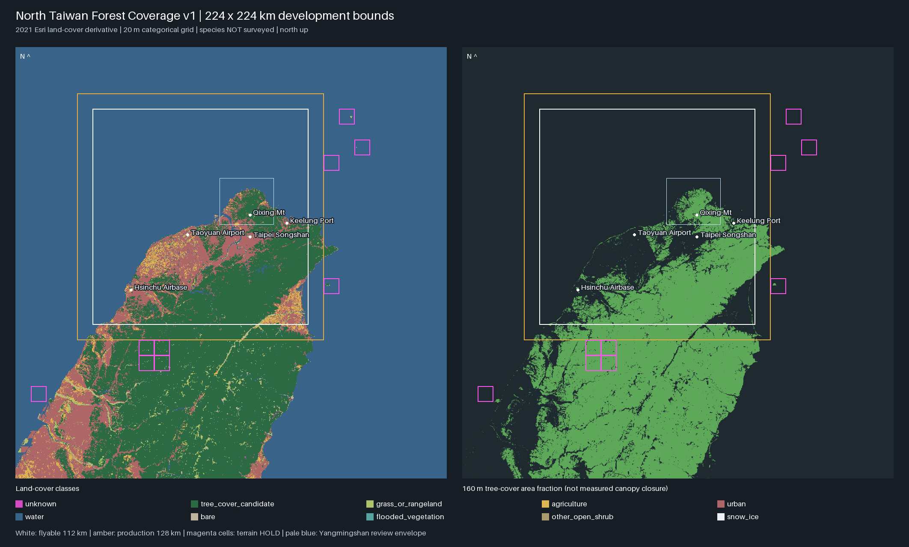

# North Taiwan Forest Coverage v1

**資料成果／Unreal 整合候選；尚未在 UE 5.8 執行。** 本輪完成全區土地覆蓋分類、森林候選遮罩、林型待辦標記與原生材質匯入介面。沒有生成逐株森林、修改地形／Golden 資產／正式場景，也未新增渲染引擎或 LOD 方案。



[核心放大圖：地表留白與林型審查分組](../data/ntw/forest/coverage_v1/core_review.png)

## 範圍與基線

- 2026-10-17 核對遠端 HEAD；從地圖開發線 `feat/ntw-phase2b-seam-lod-closure` @ `e310675a6b390b1853e1cae0adde4b68388ea53b` 建立獨立分支 `feat/north-taiwan-forest-coverage-v1`、獨立 worktree。
- 已讀 [PR #38 植被圖鑑](https://github.com/eddy121384-ui/air-combat-world/blob/de573188e9c099ee06ca706544f23225c43bf77e/docs/research/north-taiwan-vegetation-atlas-v1.md)、[PR #36 混合林](https://github.com/eddy121384-ui/air-combat-world/blob/5f30274211cf1937024ddd29a2b467b695caaa4c/docs/research/taiwan-acacia-confusa-lookdev-v1.md)及既有 Phase 2B／2B-C 地形與 runtime gate；兩個 PR 均唯讀，不合併資產。
- 範圍直接讀既有 `WorldSpec`、`north_core_v1_zones.json`：可飛行 **112 × 112 km / 196 cells**；生產區 **128 × 128 km**，其環帶 **60 cells**；遠景世界 **224 × 224 km**，其餘 **528 cells**。共 **784 個 8 km cell**，包含海面，沒有建立新的局部試塊。
- 既有地圖設定仍標示 PROPOSAL。本資料沿用其開發範圍，不代表全區場景／串流／效能已驗收。所有範圍、座標與間距由設定推導，未擴大可飛行區。

## 來源與可信度

優先盤點 repo：已有地形 cell 統計、核心／環帶、信義保留區及地理要素，但全區 `land.parquet`／官方 DEM 原檔 cache 不在這台環境；現有 Xinyi OSM／DTM cache 只覆蓋局部，不能外推全北台灣。舊 vegetation pilot 只有冠形資產，也沒有全區土地覆蓋資料。

| 來源 | 實際採用與限制 |
|---|---|
| [第四次森林資源調查 57873](https://data.gov.tw/dataset/57873) | 本輪官方目錄 HTTP 200，可核對為 IPCC 林地篩選後按林型 dissolve；目錄所指 [下載 API](https://data.moa.gov.tw/api/FileToJson.ashx?DataId=E31&DataTable=OpenDataList) HTTP 403。**未取得、未使用林型多邊形**。不能把目錄當資料。 |
| Esri／Sentinel-2 **2021** 全球土地覆蓋之 [mutolisp 衍生快照](https://github.com/mutolisp/landuse_map/blob/23423d944ab45d34bb64596f23ffd9eb1cf481ad/README.md) | 2022-04-10 的 EPSG:3826 GPKG，原投影像元約 10.163 m；公開來源說明與 CC BY 4.0。輸入 SHA-256 固定，重取時驗證；本版以 **20 m 分類眾數**取樣。這是遙測土地覆蓋候選，**不是現況林業調查／樹種／林齡／天然林判定**。 |
| 內政部縣市界 **1140318** 的 [第三方海岸衍生快照](https://github.com/siriushsu/taiwan-rail-live/blob/2cd16884c2322ca4db3c646d2914c755368781a1/data/taiwan_land.json) | 原件註明政府資料開放授權條款第 1 版、dissolve＋約 150 m 簡化。原投影環有相交，程式統一 `GEOS make_valid`，不手修／刪除地塊；保留原始 checksum 與處理揭露。只在**向量陸地外加 300 m 保守帶以外**，將缺土地覆蓋資料的區域標成推估海面；有觀測分類者不覆寫。 |
| repo 250 m 取樣的地形摘要 | 只用既有 **cell 級**最大取樣高程作保守審查分組，不製作新 DEM，不由海拔創造森林。不能讀成逐像元海拔／坡向／林型。 |

所有原始來源 URL、固定 commit、SHA-256、授權、官方資料取得狀態收錄於[設定](../worlds/vegetation/north_taiwan_forest_v1.json)及[輸入 provenance](../data/ntw/forest/inputs_v1/provenance.json)。沒有下載或提交參考照片。

## 分類與樹種規則

| 地表代碼 | 分類 | Esri 原代碼 |
|---:|---|---|
| 0 | 未知／雲／缺資料 | 0、10；非海面推估部分 |
| 1 | **樹木覆蓋／森林候選** | 僅 2 Trees；保留可能的果園、人工林、公園樹冠混淆 |
| 2 | 草地或 rangeland 開闊地 | 3、11；11 可能混有低矮木本，不能說全是純草原 |
| 3 / 4 | 農地 / 都市 | 5 / 7 |
| 5 / 6 | 水域 / 裸露地 | 1 或向量海岸推估 / 8 |
| 7 / 8 / 9 | 水淹植被 / 其他開闊木本地 / 雪冰 | 4 / 6 / 9；全部不自動種喬木 |

**只有來源 Trees 可以變成森林候選。** 山坡、稜線、海拔本身不會增加任何森林像元。草原、農地、都市、水域、裸地與未知不會被補滿樹。分類不是林地法律定義；小道路、河溝、窄防風林與新近開發可能低於解析度或晚於 2021，正式部署前仍需新資料及原生道路／建築排除。

林型規則只對既有樹木覆蓋像元標記，依序覆蓋：一般未知 → cell 取樣最大值 ≤800 m 的低地闊葉候選或 ≥1,200 m 的山地未知 → 都市 100 m 鄰接審查 → 陽明山審查框 → 海岸 300 m 審查。這些數字是**保守的美術資料篩選值，不是物種分布界線**。

| rule | 用途／可用資產 |
|---:|---|
| 1 | 低地闊葉**待審查**區；只有紅楠 *Machilus thunbergii*／相思樹 *Acacia confusa* 是既有資產候選，不代表該像元確有此物種。紅楠可作人工選定的局部闊葉調色盤；相思樹須另有舊造林／利用史及坡位證據，**沒有自動相思比例或 25% 目標**。 |
| 2 | 陽明山鑲嵌林待確認；矩形僅為編輯審查範圍，**不是國家公園界、實測林分或檜木林**。草地分類原封保留；柳杉／松類人工林不能用紅楠假充完成。 |
| 3 | 較高山林型未知；包括可能的闊葉、針闊混合、針葉成分，不由海拔選出檜木／鐵杉／水青岡。資產未完成，留空。 |
| 4 / 5 / 6 | 海岸樹冠 / 一般未定林型 / 都市鄰接樹冠；木麻黃、竹林、紅樹林、都市樹等均保留未完成身分，不用現有兩種樹代替。 |

**天然林／次生林／人工林、竹種與造林歷史一律未由本來源判定。** 這些屬性待取得林型／土地利用歷史後補入；沒有用研究樣區出現紀錄外推面積，也沒有生成隨機舊造林斑塊。

限制位元 `1/2/4/8/16/32/64/128` 分別為未知、非喬木、海岸審查、地形 HOLD、既有信義保留、未完成林型、核心外、距非森林中心 ≤40 m 的林緣保守帶。新竹缺口四個 cell **整格 HOLD**（比已知 154.6 km² 缺口保守）；另有五格含少量陸地但沒有高程摘要，也保守 HOLD，合計九格，名單見 manifest。這不代表額外發現九個 DEM 缺口；土地覆蓋仍輸出，不把缺地形變成平地林。信義 EPSG:3826 保留區用 `all_touched` 標記，不改既有 ENU 地形或植被。

本次生成的面積（km²；各區互斥，水域包含海面與內陸水域；不是官方林業統計）：

| 分區 | 樹木覆蓋候選 | 草地／rangeland | 農地 | 都市 | 水域 | 裸地 | 未知 |
|---|---:|---:|---:|---:|---:|---:|---:|
| 可飛行核心 | 2,886.99 | 85.05 | 294.58 | 1,584.23 | 7,683.35 | 8.64 | 0.52 |
| 生產環帶 | 868.78 | 17.33 | 32.24 | 123.29 | 2,792.99 | 5.37 | 0.0032 |
| 遠景其餘區域 | 6,562.17 | 315.97 | 210.20 | 1,672.38 | 24,961.93 | 64.22 | 4.64 |

其餘為水淹植被／雪冰小面積，完整精度及面積守恆見 manifest。全世界森林候選 **10,317.93 km²**；其中 **826.39 km²** 通過核心低地調色盤的保守篩選，仍待地塊／物種審核，不能當成紅楠或相思樹的已確認分布。

## 交付與重現

| 檔案 | 用途 |
|---|---|
| `data/ntw/forest/inputs_v1/` | 已提交、可離線重建的 20 m 分類來源 clip、向量海岸與來源雜湊。原始全台 GPKG 放 ignored cache，不提交。 |
| `coverage_v1/coverage.tif` | 全世界 **11,200 × 11,200**、EPSG:3826，四 band：地表類別、林型審查 rule、限制 bitmask、向量海岸推估海面旗標；**不是 RGBA 彩圖**。可用 QGIS 依 band 1 類別著色。 |
| `coverage_v1/unreal_masks.zip` | 全部 **784 cells** 各含 `classes.png`、`rules.png`、`masks.png`，400 × 400，無重複端點。合計 2,352 張資料材質圖。解壓後路徑與 CSV 一致。 |
| `coverage_v1/cells.csv`、`cells_epsg3826.geojson` | 每格來源分類面積、區域、原生 UE 西北角 cm、保留狀態、待審查面積與路徑。CSV 第一欄 `Name` 可搭配 UE 自訂 DataTable row struct 匯入。GeoJSON 明載投影座標，須按 EPSG:3826 讀取，不能當 RFC7946 經緯度。 |
| `coverage_v1/runtime_chunks.csv` | **19,600 個 1.6 km chunk**，沿用 `chXY`：X 向東、Y 向北；給出對應 cell 材質圖的半開 UV／像元窗，不另外生成森林小樣本。8 km 是資料分區，不是 WP runtime grid。 |
| `coverage_v1/far_canopy_density.png`、`far_hold.png` | 1,400 × 1,400、160 m 網格：20 m 樹木分類的面積占比 0–255，以及未知／地形缺口／信義 HOLD。這是**覆蓋比例代理，不是量測林冠閉合度或高度**。 |
| `coverage_v1/manifest.json`、`overview.png` | 範圍、分類面積、每檔 SHA-256、規則與引擎未測狀態；雙圖總覽可直接視覺核對草原／城市／水域留白。 |

```bash
python -m venv /tmp/acw-forest-env
/tmp/acw-forest-env/bin/pip install -r requirements-ntw-forest.txt
# 預設完全離線，讀已提交 inputs_v1：
/tmp/acw-forest-env/bin/python tools/ntw/forest_coverage.py build
/tmp/acw-forest-env/bin/python -m pytest -q tests/test_ntw_forest_coverage.py
# 需要從原來源重取才使用（驗證固定 SHA-256；需網路）：
/tmp/acw-forest-env/bin/python tools/ntw/forest_coverage.py prepare
```

`build --out /tmp/ntw-forest-repeat` 可重建到其他目錄；輸出無時間戳，ZIP 內時間／權限固定，圖例使用 Pillow 內建字型。不要手改生成檔；修改設定／來源後重建並核對 diff、雜湊與控制點。原資料為 CC BY 4.0：© Esri／Impact Observatory／Microsoft，經 mutolisp 投影衍生；請保留本來源鏈、引用、授權與修改說明。海岸衍生資料依臺灣政府資料開放授權條款第 1 版使用。

離線驗證覆蓋：逐格比對全部原生遮罩與 GeoTIFF／原始分類、784 格及 19,600 chunk 唯一所有權與面積守恆、UE 軸向／UV、跨 cell 林緣不產生假邊界、遠景占比與 HOLD、來源／輸出雜湊。具名控制點含擎天崗開闊地、台北 101 都市、石門水庫上游水面、海峽、觀音山與拉拉山樹木覆蓋；這些是合理性檢查，不能當成全域分類精度評估。既有 WorldSpec 測試另外使用 repo 的 `duckdb==1.4.1`；最小 forest requirements 不需要它。

**本輪實際結果：** forest＋既有 WorldSpec 共 **33 tests PASS**；另在獨立輸出目錄完整離線重建一次，**10 個輸出（含 manifest、總覽圖、ZIP）SHA-256 全部相同**。已人工查看全世界總覽與核心放大圖。提交的來源 clip＋成果約 **11.5 MB**；不含 ignored 的全台原始 GPKG。Unreal／PCG runtime、Blender 與手機效能 **NOT TESTED**。

## Unreal 5.8 使用與下一階段需求

1. 在**隔離專案**開啟 Editor Python，設定 `ACW_FOREST_DATA` 為 coverage_v1 絕對路徑、`ACW_FOREST_CELLS` 為要匯入的 cell ID（逗號分隔），執行 `tools/ntw/import_forest_coverage_textures.py`。只在 `/Game/NTWForestCoverageV1/Data` 建立所選資料材質圖；若目標已存在即停止，**不載入、儲存或修改任何關卡**。沒有預設匯入全世界。這個 Editor API 介面本輪未在引擎執行。
2. 圖片必須 **sRGB 關閉、無損 RGBA8、Nearest、Clamp、NoMipmaps**。Class／rule 取樣值是 `round(channel * 255)`；不能經 BC 壓縮、Gamma、線性濾波變成別的類別。原生 PCG Texture Data 可讀 `masks.png`；Foliage 可用同一資料烘焙成 Landscape layer，現有靜態網格地形也能用世界座標取樣。後者不要為植被重建地形。
3. `masks.png`：**R** 是來源樹木覆蓋；**G** 是保守內緣；**B** 是「核心低地、沒有其他限制」的**調色盤待審查面積**；**A** 是分類已知。**B 不是相思樹比例，也不是可直接大面積種樹的批准。** 所有 rule 的 `DefaultSpawn=False`；未經林型／地塊審查時，PCG 不應將 R 全部接到紅楠或相思。使用者可在審核過的低地多邊形內選用兩樹種；其他 rule 只保留標記。
4. 座標沿用 `WorldSpec`：原點 `(296000,2760000)`，UE `X=(E-originE)*100`、`Y=-(N-originN)*100`。CSV 的 NW 角加局部正 X／正 Y 分別向東／向南；`u=(E-west)/8000`、`v=(north-N)/8000`；像元中心為 `(col+.5,row+.5)/400`。先驗證 NW/NE/SW 三角位置、跨 cell 接合與 `ch00` 位於西南，勿把影像翻北。**Z 不在本資料中**，後續須取樣已驗收地形；HOLD 區不得把 Z=0 當地面。
5. 近景部署由原生 PCG／Foliage／HISM 產生，加入既有道路、建築、水域與任務空間排除，林冠半徑亦須留界；20 m 遮罩不能承諾逐株不穿小路。資產路徑由整合時指定，找不到正確樹種即留空；本分支沒有帶入 PR #36 模型。重用其 HISM material usage 驗證及既有遊戲版本，不改 Golden／LOD。
6. 核心外預設只使用 `far_canopy_density * (1-far_hold)`，由既有地形材質或原生 HLOD／遠景林冠資產呈現大尺度明暗、色塊與林緣；**不是 1,400² 株樹或全區完整 3D 林**。遠景造型與材質仍待整合，不能宣稱已完成 UE 森林畫面。
7. WP 沿用 1.6 km chunk／既有 1,600 m grid、8 km range 的測試基線，但那只通過兩 cell 桌機 terrain PIE，**不是全區森林或手機效能承諾**。只在玩家附近載入對應 cell 材質與近景實例，不能常駐所有材質／HISM；三張 400² RGBA8 約 **1.83 MiB/cell**，784 格全載約 **1.40 GiB**（不含樹），故選擇性載入是必要條件。遠景兩張 1,400² 灰階無壓縮約 3.74 MiB，實際 UE 格式另驗。

下一階段最小驗收：先選可飛行區**跨 cell 的連續路線**（盆地→草原→低丘林→較高山）套用正式已驗收地形與原生 PCG；核對陽明山留白、都市／河岸、未完成樹種空缺、信義邊界、300 m/s streaming、重開持久性、PC／手機材質與實例記憶體。這是後續正式整合，**本輪沒有跑 UE／Blender，也沒有改動場景**。
