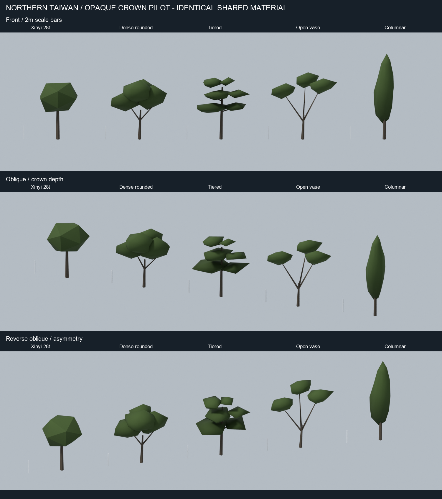
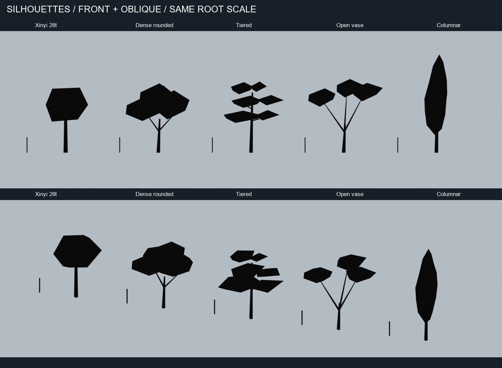
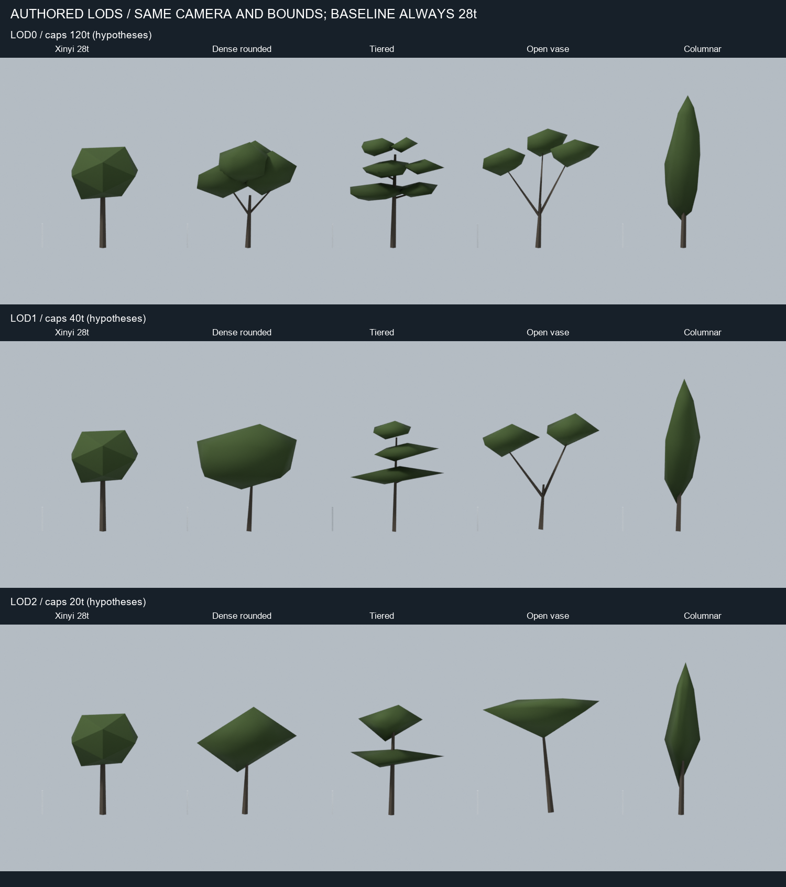
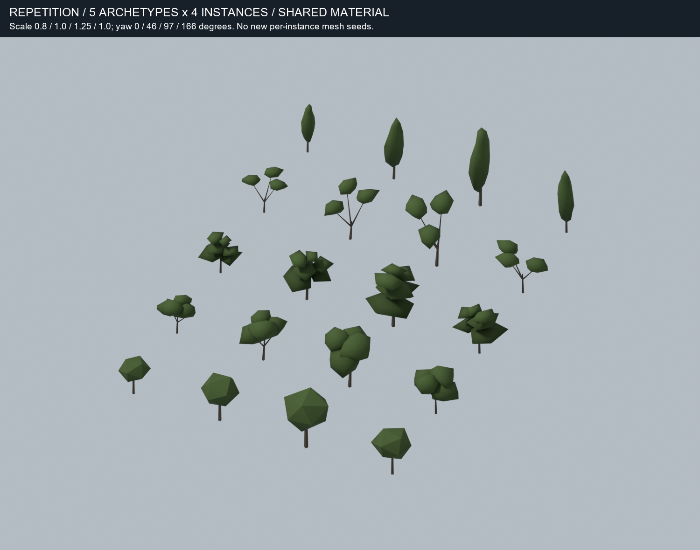
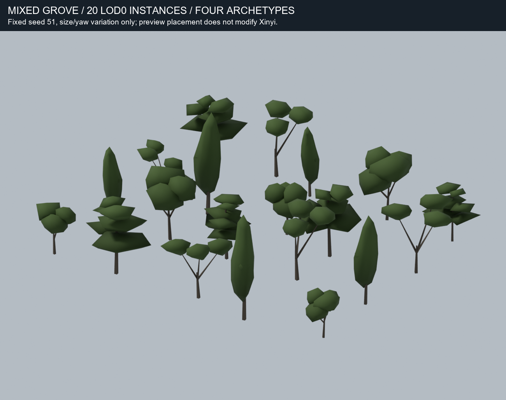
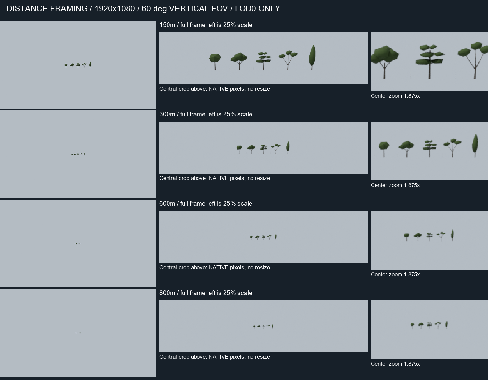

# Northern Taiwan vegetation pilot v0

Status: **isolated opaque-geometry art experiment; pending visual review.** Twelve new GLBs represent four
original procedural crown archetypes at three LODs. No Xinyi replacement or integration. Triangle caps are
experimental hypotheses, not validated mobile budgets. No ImageGen, leaf textures or alpha cards.

## Baseline and inputs

Created `spike/north-taiwan-vegetation-pilot` from the fetched visual-branch HEAD
`ede7960d8ec05b2aa521b1e4c65b5bbd667c456d`, equal to the last verified baseline; ancestry checked.
Read the inventory from PR #15's `research/north-taiwan-environment-assets` at
`796e03892d85731582ddb6c9151d3a1fe49d102a`, particularly sections 6 and Queue B.
PR #15 and the material pilot branch were not modified or merged.

Read `tools/lookdev/build_ground.py::write_tree_mesh`, `xc_foliage` in
`tools/lookdev/shaders/xinyi_city.hlsl`, and the `M_XinyiFoliage` wrapper in `ue_custom_code.py`.
The existing reference has 20 crown + 8 trunk triangles, one material slot, no leaf texture, and uses
height/crown flags, instance color choice, spatial noise and underside darkening. Placement/filter code
is retained. These pilot forms are archetypes, **not botanically verified species or prevalence claims**.

## Illustrated result



Left to right in the lineups: existing Xinyi reference, dense rounded, horizontal tiered, open vase,
tall columnar. All are in metres with the same camera, illumination and material. The small bars are
2m high. Models keep their designed dimensions rather than being independently fitted to the camera.



The pilot uses irregular radial foliage shells, asymmetric lobes, overlapping crown masses and tapered
trunks/branches. No sphere primitives, icosphere crowns, booleans, decimation dependency or leaf-card
substitute is used for the prototypes. The existing icosahedron remains the reference only. An initial
single-shell dome and stacked-plate tier design were rejected during direct preview; the committed
LOD0 models use offset masses and split tiers. Straight polygon edges still show at close range under
the 120-triangle cap; these are schematic crowns, not accepted final naturalistic art.

| Archetype | LOD0 form | Main concern to review |
|---|---|---|
| Dense rounded | Four interlocking irregular masses, two visible major forks, asymmetric top | More lobed than reference; overlapping shells can still read as polygonal chunks |
| Horizontal tiered | Three offset horizontal layers, split fans and tufts, lateral branches | Readable layer spacing, but low-poly tips still look plate-like; review naturalness before approval |
| Open spreading / vase | Three outward major forks with open center and separate irregular foliage fans | Strong branch identity; sparse crown needs density judgment and fails to preserve openness at LOD2 |
| Tall narrow / columnar | Uneven tapered radial profile with small side tuft and slender trunk | Strong height/width cue; far LOD can read as a pointed spindle |



Three **authored** LODs per archetype. Lower-LOD outer bounds are aligned to LOD0; equal bounds do not
mean equal silhouettes. Dense loses individual masses; tiered loses the small tuft details and collapses
three layers into two at LOD2; vase loses the open branch fan at LOD2. These are material limitations,
not a passed LOD-transition gate. No LOD switching distances, crossfade or dither was implemented.



Four repetitions of each form, using scale 0.8/1/1.25/1 and yaw 0/46/97/166 degrees. One geometry
seed per archetype; these images do not imply four independent models. Size/yaw helps but recurring
mass arrangements remain visible. The five rows include the reference.



A 20-instance preview grove mixes the four archetypes with deterministic size, yaw and positional
jitter. This staging is local to Blender and does not touch Xinyi vegetation placement. It illustrates
mixed crown texture only; it is not a Northern Taiwan land-use or ecology model.

## Camera and shading assumptions



Distance frames use **1920x1080, 60 degrees vertical FOV**, 12-degree downward pitch and Euclidean
camera-to-lineup-center distances of 150/300/600/800m. The aim point is `(0,0,6)m`; trees away from
the center are slightly farther. Approximate focal length is 935px; an 8.44m reference tree projects to
52.6/26.3/13.2/9.9px high. The sheet explicitly distinguishes full frames reduced to 25%, unchanged
native-pixel crops and 1.875x nearest-neighbor center enlargements. Crops are fixed, never auto-fitted.
LOD0 is held constant at all distances to isolate crown readability; this is not a shipping LOD policy.
At 600/800m, apparent identities are chiefly width, height and gap/spacing cues; do not infer leaf detail.

Close comparisons use the same orthographic camera, with width 65m. Cycles CPU, 24 samples, fixed seed
31, denoising, Standard view transform with Medium High Contrast, one fixed sun and neutral world fill.
The shared opaque material uses the same green/bark vertex colors and height ramp for every tree,
including reference. It approximates `xc_foliage`'s value structure; it does **not** reproduce its
spatial noise, sky, temporal antialiasing, shadow implementation or night behavior. No exact UE camera
or rendering equivalence is claimed. Denoising may suppress tiny far-distance features.

## Technical measurements

Full per-LOD dimensions, topology/export vertex counts, hashes, file bytes, import counts and PNG
results are in the [asset manifest](../assets/vegetation/north_taiwan/pilot_v0/manifest.json).
Dimensions below are X width / Y depth / Z height in modelling metres; GLB storage uses glTF Y-up.

| Archetype | Triangles L0 / L1 / L2 | Export vertices L0 / L1 / L2 | L0 dimensions (m) | GLB bytes L0 / L1 / L2 |
|---|---:|---:|---|---:|
| Dense rounded | 120 / 36 / 20 | 122 / 38 / 28 | 8.28 / 6.42 / 9.01 | 6040 / 2672 / 2196 |
| Horizontal tiered | 112 / 38 / 20 | 134 / 60 / 34 | 7.81 / 6.45 / 9.24 | 6300 / 3332 / 2388 |
| Open vase | 102 / 40 / 20 | 126 / 72 / 32 | 9.68 / 5.67 / 9.56 | 5940 / 3676 / 2312 |
| Tall columnar | 108 / 38 / 20 | 124 / 39 / 32 | 2.98 / 2.59 / 12.76 | 5956 / 2728 / 2312 |

One material slot and one primitive per model, opaque alpha=1, no texture images/samplers. Exact
position/normal/color tuples are deduplicated before export; hard bark seams remain. Original Xinyi
reference has 28 triangles / 84 exported vertices, width/depth/height 5.51/5.90/8.44m. The companion
shared-material preview has identical triangle coordinates and 76 attribute vertices after deduplication.
Some branch and far trunk ends are intentionally uncapped inside foliage, as with the existing reference;
these are render meshes, not watertight collision solids. Intersecting foliage shells remain separate.

All twelve prototype GLBs together occupy **45,852 bytes**. Fourteen GLBs are included in total: twelve
prototype LODs plus the original reference and its material-comparison counterpart. Triangle/index/normal
and finite-coordinate checks, nonzero triangle area, opaque material checks and Blender reload
triangle/dimension checks are required by the offline validators. No compression extensions or external
resources are needed. Generated-source hashes are recorded; no third-party model licenses are introduced.
Code hashes normalize CRLF to LF for checkout portability; all model and image hashes use exact bytes.

Final validation: **14 GLBs passed the buffer audit**, including zero degenerate triangles and exact
reference triangle equality; all 13 shared-material GLBs passed Blender reload checks. A second geometry
generation reproduced all 14 files byte-for-byte. All **13 final render frames passed**, and six compact
review PNGs passed decode, dimension and SHA-256 checks. Direct image review covered all six sheets.
The far vase trunk was corrected to meet its offset crown cap; its simplified crown still loses openness.

**No mobile frame time, GPU memory, overdraw, instancing/draw-call behavior or real device measurement**
has been performed. LOD0 is 3.6-4.3 times the reference triangle count. Even without alpha cards, opaque
overlapping shells can add hidden-surface work. Low triangle counts do not establish mobile success.

## Reproduction and next experiment

```powershell
$pilotWork = Join-Path (Split-Path (Get-Location) -Parent) 'vegetation-pilot-work'
& 'C:\Program Files\Blender Foundation\Blender 5.2\blender.exe' `
  --background --factory-startup --python-exit-code 2 `
  --python tools/vegetation_pilot/build_pilot.py -- --work-dir $pilotWork
python tools/vegetation_pilot/package_review.py --work-dir $pilotWork
python tools/vegetation_pilot/package_review.py --validate
```

Run from the repository root and pass an absolute work directory to Blender. For the two-run geometry
check, snapshot the model SHA-256 map as `model_hashes_before_rebuild.json` in the work directory, rerun
the generator with `--skip-render`, then run the sheet helper; it compares every GLB to that snapshot.

Blender used: **5.2.1 LTS**. Blender supplies NumPy; the offline sheet/audit helper requires NumPy and
Pillow. No project runtime dependency changed. The generator extracts only the existing tree function
AST to make the reference; it never runs the ground generator or consumes GIS input. Source files are
under `tools/vegetation_pilot/`; assets and compact sheets are under
`assets/vegetation/north_taiwan/pilot_v0/`. Full intermediate frames stay outside the repository in the
selected work directory. The manifest retains their dimensions, byte counts and hashes; regenerate
locally to inspect them. No large `.blend`, cache or render experiment is committed.

Recommended next experiment: first art-review the tiered tips, dense mass joins and vase openness.
Then revise **LOD1/LOD2 silhouette retention** with fixed side-by-side motion captures and a predefined
pixel-error/pop criterion, still without textures. Only after visual acceptance, evaluate an isolated
instanced opaque grove on the target phone against the 28-triangle reference, with the same density,
camera path, lighting and ground. Measure GPU time and hidden-surface cost before choosing a budget.
Keep any later leaf-card/atlas experiment separate; the current task does not authorize it.

No accepted building mesh, Xinyi tree/placement asset, Unreal shader or runtime file was changed.
No merge. Stop at Draft PR for visual review.
