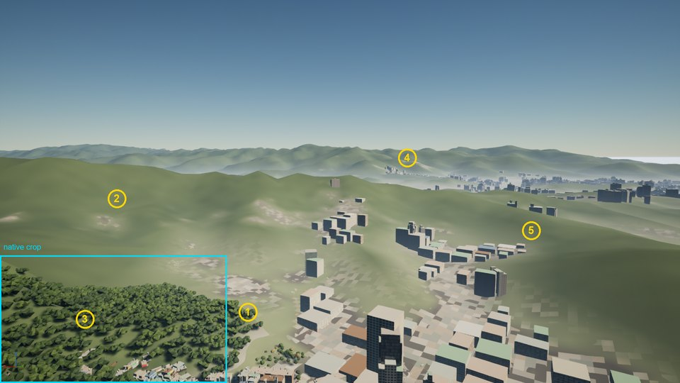
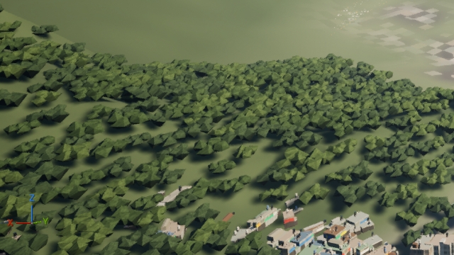

# AC7-class aerial forest — visual benchmark and rendering research v0 (Issue #19, Phase A)

Status: **Phase A research only — pending human visual review.** No Unreal scene, shader, tree mesh, tree
placement, Xinyi geometry/terrain or PR #18 content was changed. No integration code, no forest map.
Phase B (Codex, isolated Unreal A/B spike) must not start until this document is reviewed.

| Item | Value |
|---|---|
| Branch | `research/ac7-forest-visual-benchmark` |
| Base | `feat/opus55-xinyi-visual-quality` @ `ede7960d8ec05b2aa521b1e4c65b5bbd667c456d` (fetched 2026-10-12) |
| PR #18 read at | `spike/north-taiwan-vegetation-pilot` @ `e05a959aa9b6a751e72def07c2781d4709dd2b67` (Draft, untouched) |
| PR #15 read at | `research/north-taiwan-environment-assets` @ `796e03892d85731582ddb6c9151d3a1fe49d102a` (Draft, untouched) |
| Repo code read | `tools/lookdev/build_ground.py` (`write_tree_mesh`, `write_forest_clump`, hill-forest placement), `tools/lookdev/shaders/xinyi_city.hlsl::xc_foliage`, `adapters/unreal/lookdev/xinyi_look_build_level.py` (HISM layers) |
| Images committed | only the project's **own** UE5.8 capture (annotated 50 % frame + one native-pixel crop). **No AC7 or other third-party pixels are committed.** |

## Evidence tags used in this document

| Tag | Meaning |
|---|---|
| **[V-Dev]** | statement by the developer/publisher (Bandai Namco, Project Aces) or a report of their own talk |
| **[V-Epic]** | Epic Games documentation (UE 5.8 doc pages, fetched 2026-10-12) |
| **[V-3P]** | credible third-party technical analysis, **read second-hand** (summary of the original, original not fetched) |
| **[Comm]** | community/player report — anecdotal |
| **[Acad]** | peer-reviewed publication |
| **[Repo]** | read or measured from this repository |
| **[Calc]** | computed in this pass (formulae/scripts given; reproducible) |
| **[Obs]** | my visual observation of an image — subjective, image provenance stated |
| **[I]** | inference / hypothesis — **not** evidence; each has a test in §11 or §12 |

Nothing tagged [I] may be cited later as "AC7 does X".

---

## 1. Executive findings

1. **What is actually verified about AC7's forests is thin.** Verified: UE4 engine [V-Dev/V-Epic], trueSKY
   volumetric clouds with a reported ~100 km × 100 km map, ~15 km height and ~300 km visibility [V-Dev], and —
   from Digital Foundry's 2024 Switch analysis as summarised by GoNintendo/Nintendo Life — that **at significant
   height the forests are represented by flat texture art** on Switch, with foliage draw distance pulled in, fewer
   trees, patchier grass and no foliage shadows vs Xbox One [V-3P]. Community PC reports say tree pop-in responds to
   `r.ViewDistanceScale` / `r.StaticMeshLODDistanceScale` [Comm]. **No developer talk on AC7 terrain or vegetation
   rendering was found** (the only located UE talk is about clouds). A "SpeedTree" claim appeared in one search
   summary but in none of the fetched primary pages — **unverified**.
2. **The AC7 read is a layered illusion, not a dense forest of individual trees** — this is a hypothesis [I]
   consistent with the verified Switch remark and the community pop-in reports, and it must be confirmed from
   captures (§4.3). Near: instanced trees with distance cull. Far: forest painted into the ground texture.
3. **Our current hill forest fails mostly at forest scale, not at tree scale.** From the project's own UE5.8 capture
   (§7): a hard rectangular coverage cut-off, bare "felt" Landscape on every hill outside the Xinyi build box,
   **~68 % top-down canopy cover [Calc]** so light ground shows between crowns, regular clump speckle with dark cast
   shadows, and no canopy grain on far ridges. PR #18's better crowns do not fix any of these on their own.
4. **Canopy coverage, not tree count, should be the controlled variable in Phase B.** Issue #19's suggested
   2k / 5k / 10k instances per km² give only **10 / 22 / 40 % random canopy cover with 8 m crowns** [Calc]. A
   closed subtropical canopy (≥ 85–90 % from above) needs ~20k (12 m crowns) to ~46k (8 m crowns) randomly placed
   crowns per km², or clumped/jittered placement. The sweep must be stated in **coverage** and translated to counts
   per arm (§12.4).
5. **Every flight altitude puts several distance bands on screen at once** [Calc, §5.2]. At 1,000 m with a 20°
   down pitch, ~47 % of rows are theater band (> 2 km) and none are near band; at 50 m the near band dominates.
   Altitude changes the *mix*, not a single LOD. Acceptance must be judged per band inside each altitude pass.
6. **Recommended architecture to test (not a decision):** one canopy-density/height field drives both instance
   placement and a far "canopy-shell" terrain material, so near instances and far canopy agree statistically
   (coverage, crown scale, colour, self-shadow). Ground-under-canopy is dark understory, not lawn. Edges are
   generated by rule (ecotone). Far canopy carries its own crown-scale noise and slope-to-sun self-shadowing.
   Impostors, HLOD and Nanite Foliage are **candidates for the mid band** to be measured, not assumptions (§10).
7. **Phase B blocker to resolve at review:** a 1 km × 1 km map cannot show the far (600 m–2 km) and theater
   (> 2 km) bands. §12.1 proposes a 1 km instanced core inside an identical-across-arms 6 km surround.

---

## 2. Inputs read and baseline facts

### 2.1 Existing Xinyi trees and hill forest [Repo]

| Asset | Geometry | Placement / count | Rendering |
|---|---|---|---|
| `SM_XinyiTree` (`write_tree_mesh`) | 20-face jittered icosahedron crown (±12 %) + 4-sided trunk = **28 tris**, flat per-face normals | 20,401 street/park/OSM trees (v1 doc); yaw, scale 0.8–1.25, 4 colour variants | HISM, LOD1/2, cull 1.5–2.6 km, casts shadow |
| `SM_XinyiForestClump` (`write_forest_clump`) | **5 icosahedra = 100 tris**, centre crown + 4 crowns at 4.0–6.5 m, radii 3.2–4.4 m, heights 5.5–8.5 m | 16 m grid, ±5 m jitter, on DTM where z ≥ 28 m or slope ≥ 0.08 (z < 45 m), outside buildings, **inside the Xinyi build box only**; 1,190 clumps; scale 0.9–1.35 | HISM "HillForest", cull 1.6–2.4 km, casts shadow |
| `xc_foliage` shader | no texture; 4 palette picks (camphor/banyan greens, golden-rain bloom), 3D value noise ×(0.75–1.25), height ramp 0.6→1.1 for underside darkening, roughness 0.85, night under-glow | — | one opaque material slot |

Derived [Calc, `forest_numbers.py` method in §13]: hill forest = **39 clumps/ha = 195 crowns/ha ≈ 3,900 LOD0
tris/ha**; top-down canopy cover of the clump field ≈ **67.7 %** (ellipse approximation of icosahedral
silhouettes, 400 m × 400 m sample, interior only).

### 2.2 PR #18 vegetation pilot [Repo, read-only]

Four opaque archetypes × 3 authored LODs: dense rounded 120/36/20, horizontal tiered 112/38/20, open vase 102/40/20,
tall columnar 108/38/20 tris. No textures or alpha. PR #18's own review notes: tiered tips plate-like, dense mass
joins visible, vase openness lost at LOD2, columnar far LOD reads as a spindle, repetition recognisable. Distance
sheet: 8.44 m reference tree projects to 52.6 / 26.3 / 13.2 / 9.9 px at 150 / 300 / 600 / 800 m (1080p, 60° vFOV).
No device or engine timing.

### 2.3 PR #15 inventory [Repo, read-only]

§6: 5–6 crown archetypes (V1 dense dome … V7 hillside broadleaf canopy, V8 grass/scrub); "the broader world needs a
canopy surface rather than instances beyond ~1.5 km"; overdraw (not triangles) is the mobile hazard; near-crown
removal in Xinyi v0D raised one view by ~7.5 ms because hidden facade/ground pixels became visible. Northern lowland
forest types from the 文山 survey: 紅楠, 相思樹, 水同木, 江某, 香楠, 山紅柿-大明橘 [Acad, via PR #15 S8].

### 2.4 Measurement host caveat [Repo, project memory]

Earlier XinyiLook perf runs were on a workstation whose GPU is an **Intel UHD 770 iGPU** sharing package power with
the CPU; perf drifted several ms between sessions and needed interleaved A/B. Confirm the actual Phase B host GPU
before timing. iGPU numbers do not transfer to a PC/console target.

---

## 3. What was searched and not found (so nobody re-searches blindly)

| Looked for | Result |
|---|---|
| CEDEC / UNREAL FEST / GDC talk on AC7 terrain, ground or tree rendering | **not found** (EN + JA searches). Only the UNREAL FEST WEST 2019 cloud talk [V-Dev] |
| Bandai Namco Studios "Making of AC7" Part 1 / Part 2 | fetched; no terrain/forest/LOD content; pages carry "© DigitalGlobe, Inc." credit (satellite imagery provider) — *how* it was used is not stated |
| Epic developer interview on AC7 | title located; page returned HTTP 403 to fetch — body **not read** |
| Digital Foundry 2019 "every version tested" (PS4/Pro/XB1/X/PC) foliage findings | original not reachable; only forum transcriptions (resolution/fps), nothing reliable on foliage |
| Digital Foundry / Eurogamer 2024 Switch article | Eurogamer blocked to fetch; **content read via GoNintendo and Nintendo Everything summaries** |
| AC7 middleware list incl. SpeedTree | **unverified** |
| Microsoft Flight Simulator forest technique (official) | no Asobo technical source found; only forum/mod claims — not used |

---

## 4. AC7 visual reference evidence

### 4.1 Verified / attributed facts

| # | Fact | Tag | Source |
|---|---|---|---|
| A1 | AC7 is built on Unreal Engine 4 (first in the series) | V-Dev / V-Epic | Epic developer interview (title); Wikipedia |
| A2 | Volumetric clouds via Simul trueSKY plug-in for UE | V-Dev | BNS Making-of Part 1; UNREAL FEST WEST 2019 talk (玉置絢, 菅野昌人) reported by AUTOMATON |
| A3 | Map ≈ 100 km per side, ~15 km height, views across ~300 km | V-Dev (reported) | AUTOMATON report of the 2019 talk |
| A4 | trueSKY initially ~60 % of GPU; reduced to ~30–40 % with a fast mode, distance LOD and VR mode; rain/snow/lightning rebuilt in UE4 | V-Dev (reported) | same |
| A5 | Switch: 720p docked / 540p handheld, 30 fps target, stable | V-3P | DF 2024 via Nintendo Everything |
| A6 | Switch vs Xbox One: "at a significant height, the forests are only represented using flat texture art"; foliage draw distance "pulled in dramatically"; fewer trees, patchier grass | V-3P | DF/Eurogamer 2024-07-19 via GoNintendo (verbatim bullets) |
| A7 | Switch removes foliage shadows vs Xbox One; structures pop in at about the same distance on both | V-3P | DF via Nintendo Life / GoNintendo |
| A8 | PC has no view-distance setting; community `Engine.ini` with `r.ViewDistanceScale`, `r.StaticMeshLODDistanceScale` reported to push trees/buildings further | Comm | DSOGaming; Steam discussions |

What A6 does **and does not** say: it is a statement about the Switch build at significant height. It does not say
how PS4/XB1/PC far forests are drawn. That they also rely on ground texture far away is **hypothesis H-AC1** (§11).

### 4.2 Hypotheses about AC7's forest look (to confirm from captures — never cite as fact)

| ID | Hypothesis | Supporting hint | What would confirm/refute in captures |
|---|---|---|---|
| H-AC1 | Beyond a cull distance, forest is ground texture (satellite-derived or painted) on all platforms | A6, A8, DigitalGlobe credit | slow climb from 100 m to 1,500 m over a forest: do discrete trees vanish into a texture with no remaining relief? |
| H-AC2 | Near trees are instanced meshes whose cull distance scales with UE view-distance settings | A8 | same flight on PC with stock vs edited `Engine.ini` (user's own machine, own copy) |
| H-AC3 | Tree colour/value is tuned to match the ground texture under them, hiding the cull boundary | [Obs] REF-U1 | high-contrast frame at the cull ring: is there a value step? |
| H-AC4 | Tree shadows exist only in a near shadow range; far forest shading is in the texture | A7 (Switch removes them entirely) | shadow presence vs distance on PC at max settings |
| H-AC5 | At combat speeds, motion blur / TAA hide pop-in more than geometric LOD does | — | per-frame review of a low pass with and without motion blur (PC option, if any) |

### 4.3 Reference matrix

**Available now (1 image):**

| Ref | Provenance | Use allowed | Observations [Obs] |
|---|---|---|---|
| **REF-U1** | supplied by the project owner in the Phase A chat, 2026-10-12, as a WebP **1024 × 429**; game, mission, platform, settings, capture mode (gameplay vs replay/photo) and author **unknown**; aircraft and look are consistent with AC7 but **not verified** | local review only; **not committed**; not native-pixel evidence (rescaled/compressed) | Snow-covered boreal/conifer biome — **not** our biome. Forest masses read as a fine dark stipple of individual crowns against bright snow; crown-to-gap contrast is the main carrier. Forest edges are irregular with scattered outlier trees; clearings and roads cut clean anthropogenic lines (incl. a power-line corridor). Trees are interleaved with low-rise housing at the town edge. Far forest fades into a darker blue-grey mass under haze; no visible seam in this still. Camera appears high oblique (est. several hundred m AGL — **estimate only**). |

**Required captures (owner to provide; none may be invented):**
Capture on the owner's own copy, **PC, 1920 × 1080 native, highest settings, no photo-mode filters**, HUD on for ALT
and SPEED readouts (or a matching HUD-off frame). For each: 1 still + ~10 s video on the same path. Store **outside
the repo** (e.g. `%USERPROFILE%\acw-refs\ac7\`) with a sidecar `ref_index.json`
(`id, mission, platform, version, settings, capture_mode, alt_m (HUD), speed_kmh (HUD), pitch_est_deg, time_of_day,
weather, sha256, file`). Only the index — never pixels — may later be proposed for commit.

| Ref | View | Altitude (HUD) | Purpose |
|---|---|---|---|
| R01 | level flight over continuous forest | ~50 m | near band: crown shape, trunk/ground visibility, shadow density |
| R02 | same, gentle 20–30° bank | ~50–100 m | near band in motion: TAA ghosting, pop |
| R03 | level flight, forest to horizon | ~200 m | near→mid transition, canopy grain |
| R04 | 30–45° dive onto forest | ~500 → 200 m | top-down gap visibility (canopy cover) |
| R05 | level flight | ~500 m | mid→far fusion, cull ring visibility (H-AC1/H-AC3) |
| R06 | level flight | ~1,000 m | far/theater: forest as texture, ridge silhouettes |
| R07 | climbing pass 100 → 1,500 m over one forest patch | video | **the key H-AC1 test**: where discrete trees end |
| R08 | forest edge against farmland / clearing | ~150–300 m | edge breakup, outliers, shrub belt |
| R09 | forest against town / roads | ~200–500 m | urban–forest interface (most relevant to Taipei hills) |
| R10 | mountain ridge with forest at grazing angle | ~300–800 m | ridge silhouette roughness |
| R11 | same area, low sun / dusk | any | shadow and value structure |
| R12 | (if available) Switch or PS4 of R05/R06 | same | platform scaling (A5–A7) |

Mission candidates for forest terrain **[I, unconfirmed — owner to verify in game]**: M02 Scofields Plateau, M04
Gunther Bay, M07 Yinshi Valley, M09 Waiapolo Mountains, M13 Sierraplata, M17 Tyler Island, M18 Shilage Castle
(mission/location list from the Ace Combat wiki; terrain type not confirmed by any fetched source).

**Phase A pass-gate note:** with only REF-U1 available, the "grounded AC7 reference" requirement is **partially met**.
The rubric below is written to be calibrated against R01–R12 once supplied; thresholds marked *(cal.)* must not be
frozen before that.

---

## 5. Visual benchmark design

### 5.1 Distance bands (test viewpoints, **not** LOD switch distances)

Band by **slant range** camera→surface: **near < 150 m**, **mid 150–600 m**, **far 600 m–2 km**, **theater > 2 km**.

Projected size at 1080p / 60° vertical FOV (focal 935.3 px) [Calc]:

| Slant range | m per px | 8 m crown | 12 m crown |
|---:|---:|---:|---:|
| 150 m | 0.16 | 50 px | 75 px |
| 600 m | 0.64 | 12.5 px | 19 px |
| 1,000 m | 1.07 | 7.5 px | 11 px |
| 2,000 m | 2.14 | 3.7 px | 5.6 px |
| 4,000 m | 4.28 | 1.9 px | 2.8 px |
| 8,000 m | 8.55 | 0.9 px | 1.4 px |

Consequence [Calc → I]: beyond ~3–4 km a crown is < 2–3 px; individual instances there add cost and aliasing but
cannot add legible shape. That is the regime Bruneton & Neyret 2012 handle with a terrain "shader-map" rather than
geometry [Acad]. Where the switch should sit is a Phase B measurement, not a decision here.

### 5.2 Altitude passes — screen share per band [Calc, flat ground]

| AGL | Pitch | Centre slant | Sky | Near | Mid | Far | Theater | Grazing angles |
|---:|---:|---:|---:|---:|---:|---:|---:|---|
| 50 m | −5° | 574 m | 42 % | 28 % | 23 % | 5 % | 2 % | 0–35° |
| 50 m | −15° | 193 m | 27 % | 43 % | 22 % | 5 % | 2 % | 0–45° |
| 200 m | −10° | 1,152 m | 35 % | 0 | 36 % | 21 % | 9 % | 0–40° |
| 200 m | −25° | 473 m | 10 % | 0 | 58 % | 22 % | 10 % | 0–55° |
| 500 m | −15° | 1,932 m | 27 % | 0 | 0 | 51 % | 22 % | 0–45° |
| 500 m | −35° | 872 m | 0 | 0 | 16 % | 66 % | 18 % | 5–65° |
| 1,000 m | −20° | 2,924 m | 19 % | 0 | 0 | 35 % | 47 % | 0–50° |
| 1,000 m | −45° | 1,414 m | 0 | 0 | 0 | 73 % | 27 % | 15–75° |

Hilly terrain shifts these (slopes facing the camera raise far/theater share at low altitude). Implications [I]:
the 500 m and 1,000 m passes are judged almost entirely on far/theater representations; the 50 m pass is where
crown geometry and TAA stability matter.

### 5.3 Gap visibility depends on grazing angle [Calc]

Probability a view ray reaches the ground through a random canopy (cylinder crowns, layer depth D):

| Canopy | 90° (top-down) | 45° | 30° | 15° | 8° |
|---|---:|---:|---:|---:|---:|
| 8 m crowns, 10k/km², D 6 m | 60 % | 37 % | 26 % | 10 % | 2 % |
| 8 m crowns, 20k/km², D 6 m | 37 % | 14 % | 7 % | 1 % | 0 % |
| 10 m crowns, 10k/km², D 7 m | 46 % | 23 % | 14 % | 3 % | 0 % |

The same forest looks closed from a low pass and open from a dive. **Canopy cover must be judged at the steep views
(R04, P4 dive)**; low passes hide sparse forests. The ground colour under the canopy therefore matters most in dives.

### 5.4 Image-plane motion at combat speed [Calc]

Ground point, 60 fps: at 250 m/s, 150 m slant, 20° off the velocity vector → **8.9 px/frame**; 300 m/15° → 3.4;
600 m/10° → 1.1; 1,500 m → 0.5. At 400 m/s: 14.2 / 5.4 / 1.8 / 0.7. Temporal AA history is least reliable in the
near band at low altitude; far bands are almost static on screen, so **far-band shimmer and LOD pops are the most
visible temporal faults at 500–1,000 m** [I].

### 5.5 Native-pixel comparison protocol

1. Fixed 1920 × 1080 output, 60° vertical FOV, screen percentage 100 % for comparison captures (performance runs may
   add a TSR/upscaled profile separately and label it).
2. Fixed camera pose/path files (ENU metres + yaw/pitch/roll per frame), fixed sun, sky, fog, **manual exposure**
   (no eye adaptation), same post settings, same seed, same time.
3. Compare **unchanged native crops** at fixed rectangles chosen before rendering; enlargements only nearest-neighbour
   and labelled with the factor. Never auto-fit, histogram-match or sharpen one arm.
4. Static frames: after ≥ 64 warm-up frames with the camera locked (TAA/TSR converged); motion frames: frame N of the
   path, both arms.
5. AC7 references are compared for **structure and statistics** (cover, value ratios, edge character), never by
   pixel difference: their camera/exposure cannot be matched.
6. Every sheet records: arm, commit, map seed, pose id, frame index, AA mode, screen %, exposure, capture SHA-256.

---

## 6. Forest-scale success / failure rubric

Each criterion scored 0–3 per band per altitude pass. Thresholds marked *(cal.)* are proposals to calibrate against
R01–R12 and real Northern Taiwan aerial photos before Phase B freezes them.

| ID | Criterion | Measure | Fail (0) | Pass target (≥ 2) |
|---|---|---|---|---|
| F1 | **Canopy closure / density** | visible-ground fraction (VGF) inside the forest mask, from a stencil/ID capture (trees and canopy layer write CustomStencil; ground does not) at P4 dive and P2 level | VGF at 45° > 35 % for "closed forest" class | VGF at 45° ≤ 15 % *(cal.)*; at 90° within ±10 % of the GIS cover target |
| F2 | **Crown legibility (near/mid)** | can a reviewer separate individual crowns and ≥ 3 crown types at 150–600 m | blob carpet or identical repeats | distinct crowns, mixed sizes, no recognisable clone within a 9 × 9 crown window |
| F3 | **Canopy grain (far/theater)** | luminance std-dev of 32 × 32 px tiles in forest vs adjacent bare slope | far forest flatter than bare terrain | forest tile σ ≥ 1.5 × bare-slope σ *(cal.)*, no periodic FFT peak at the instance grid |
| F4 | **Edge breakup** | perimeter ratio of forest mask to its 50 m-smoothed outline; presence of outliers/shrub belt | straight cut or build-box edge | ratio ≥ 1.3 *(cal.)*, outliers within 30 m of the edge, no straight edge not explained by a road/property line |
| F5 | **Value stratification** | in forest mask: sunlit-crown vs shadowed-crown vs gap luminance; forest mean vs adjacent grass | forest lighter than or equal to grass; gaps read as lawn | forest mean L* below grass by ≥ 10 *(cal.)*; gaps darker than lit crowns |
| F6 | **Colour palette** | hue/chroma spread of forest pixels; ridge vs valley shift | single flat yellow-green | dark blue-green base, olive/yellow-green patches (相思樹-like), seasonal accent ≤ 10 % area *(cal.)* |
| F7 | **Shadow & ground response** | slope-to-sun shading and cast-shadow presence per band | far forest unshaded "felt"; near shadows as hard polka dots on bright ground | ridge/valley value split visible at far; near shadows fall on dark understory |
| F8 | **Clearings, roads, interfaces** | roads/power corridors/building lots carve the canopy | trees on roads/roofs or forest stops at a data box | cuts aligned with real features; town–forest interface has scattered trees |
| F9 | **LOD / representation pop** | per-frame mean \|ΔL*\| in 64 × 64 px tiles crossing a transition ring, during P3 slow dolly | step > 3× median frame-to-frame change | no tile step > 1.5× median *(cal.)*; no ring visible in a 10 s clip at 1× speed |
| F10 | **Far fusion seam** | tile-mean L*/C* across instance→canopy-layer boundary | visible band/ring | \|ΔL*\| ≤ 3, \|ΔC*\| ≤ 3 *(cal.)* between adjacent tiles across the boundary |
| F11 | **Temporal stability** | locked camera, 64 frames: per-pixel temporal σ of luminance, p95 in forest mask; P2 pan: crawling/sparkle review | p95 σ > 4 L* | p95 σ ≤ 1.5 L* static *(cal.)*; no crawling at far band in pan |
| F12 | **Cost** | GPU/CPU ms, memory, draw calls at matched F1 | — | reported per §12.6; judged in the decision gate, not by this rubric |

A representation that wins cost by failing F1 (removing canopy) is **not** a win — Issue #19's matched-coverage rule.

---

## 7. Baseline analysis — what is wrong at forest scale

Project's own UE5.8 editor capture, `unreal/Saved/XinyiLook/evidence/final_D_hillside_farcity_day.png`
(captured 2026-09-30, editor viewport — axis gizmo visible; source SHA-256 `46501b1a…94608`; camera pose not
recorded in the file). Since then the hill-forest placement, `write_forest_clump`, `write_tree_mesh` and `xc_foliage`
are unchanged in git history; only the street-tree set was later thinned by the v0D curb filter (`2cf7f8c`), which does
not affect this hillside view.



*Full frame reduced to 50 %. Cyan box = native crop below.*



*Unchanged native pixels (640 × 360 from 0,720).*

| Mark | Observation [Obs] | Rubric | Root cause [Repo] |
|---|---|---|---|
| 1 | forest ends on a straight line | F4, F8 | placement limited to the Xinyi build box |
| 2 | hills outside are bare smooth Landscape — "felt" | F3, F7 | no canopy layer at all outside instances |
| 3 | crowns read as crumpled faceted lumps; light olive ground between them; hard dark cast shadows give a regular speckle | F1, F2, F5, F7 | 5-icosahedron clump on a 16 m grid; ~68 % cover [Calc]; ground under trees = open-grass Landscape colour; flat per-face normals |
| 4 | far ridges are uniform green with no canopy grain or ridge/valley split | F3, F6, F7 | Landscape colour only; beyond HISM cull (≤ 2.4 km) there is nothing |
| 5 | bare hill runs into the city fringe | F8 | same as 2 |

PR #18's archetypes, evaluated against the same rubric (from its own sheets, not re-rendered):

| Criterion | 28-tri reference | PR #18 archetypes | Comment |
|---|---|---|---|
| F2 crown legibility | one silhouette | 4 silhouettes, distinct at 150–300 m in its distance sheet [Obs] | improvement is real but **only in near/mid** |
| F2 at 600–800 m | ~10–13 px blob | identities reduced to width/height/gap cues (PR #18) | consistent with §5.1 |
| F1 / F3 / F4 / F7 / F8 / F10 | not addressed | not addressed | forest-scale problems are independent of the crown mesh |
| Cost | 28 tris | 102–120 LOD0, 36–40 LOD1, 20 LOD2 | ×3.6–4.3 at LOD0; real cost unmeasured |

**Conclusion [I]:** at the 200/500/1,000 m passes, which are dominated by mid/far/theater bands (§5.2), the
largest visual gains should come from canopy closure, the ground under the canopy, edges and a far canopy layer —
not from more crown triangles. This is hypothesis H-02 and must be shown by Phase B arms "+S" (§12.2).

---

## 8. Commercial / documented technique comparison

| Technique | What it solves | Main cost axes | Flight-game risks | Mobile | Maturity in UE 5.8 | Evidence |
|---|---|---|---|---|---|---|
| **Static-mesh foliage / ISM / HISM** | one draw per batch of many instances; cluster culling | CPU culling/LOD per cluster, vertex work, shadow-depth passes | whole cluster switches LOD at once; End Cull Distance makes groups vanish abruptly unless faded with `PerInstanceFadeAmount` | yes | production; 5.8 adds optional hierarchical CPU instance culling for non-Nanite ISM (`r.SceneCulling.HierarchicalCPUCulling`, off by default) | [V-Epic] Foliage Mode doc; UE 5.8 notes via Looman |
| **Authored mesh LODs** (PR #18) | triangle reduction | pop on switch; LODs share lightmap UVs | silhouette loss (PR #18 vase/columnar) | yes | production | [V-Epic], [Repo] |
| **Impostor Baker — Upper Hemisphere** | far trees as one 8-tri card with view-blended atlas (3 nearest frames) | texture memory (Epic uses 2048² atlases; 12×12 = 144 frames for distant foliage), pixel shader blending, optional parallax | atlas resolution vs crowns of 4–12 px; view-blend smearing in fast turns (to measure); masked overdraw | mobile falls back to single frame sample; pixel shader costlier than billboards | in engine docs; Fortnite BR uses hemisphere impostors "for all of our trees when Nanite is disabled" | [V-Epic] Impostor Baker |
| **Traditional billboards** (9 views, 8 cards) | cheapest far stand-in | 72 tris/81 verts; worse masked overdraw | card flip/dither visible in banking | yes | same plugin | [V-Epic] |
| **World Partition HLOD — Instancing layer** | replaces unloaded cells with lowest-LOD ISMs; "ideal for imposter meshes, such as trees and foliage" | HLOD build, streaming | HLOD and loaded-cell content must match visually; Loading Range sets the swap ring | yes | production | [V-Epic] WP HLOD |
| **HLOD Merged / Simplified mesh** | merges cells into one proxy | memory per cell | merged foliage proxies lose canopy grain | yes | production | [V-Epic] |
| **Terrain canopy layer** (material / RVT / data texture) | far forest with zero instances; coverage-correct colour, grain and self-shadow | texture memory and one material's ALU | must match instance statistics at the seam (F10); RVT does not do ISM instance culling or LOD | RVT has fallback path; data-texture route already used in Xinyi | production building blocks; the canopy model itself is ours | [V-Epic] RVT; [Acad] Bruneton & Neyret 2012; [V-3P] A6 |
| **Nanite (opaque meshes)** | cluster LOD without authored LODs | Nanite raster, VSM interaction; WPO wind costs | foliage-dense overdraw/raster cost unknown on target | not on all mobile | production for opaque | not measured here |
| **Nanite Foliage** (Voxels, Assemblies, Skinning) | distant trees as near-pixel voxels instead of billboards/LODs; small assets via assemblies | experimental raster path; VSM requires disabling distant animation | experimental: "use caution when shipping"; non-Nanite fallback merges parts into one mesh | non-Nanite fallback only | **Experimental** (5.7 introduced, 5.8 doc still experimental) | [V-Epic] Nanite Foliage |
| **PCG distribution** (Electric Dreams PCG forest) | rule-based biome placement | editor/runtime generation cost | sample is "graphically intensive" (RTX 2080 minimum): **distribution reference only, not FPS evidence** | — | production framework | [V-Epic] Electric Dreams |
| **Z-fields + shader-maps** | consistent forest lighting from near to horizon, no popping, aggregated sub-pixel trees on terrain | precomputation; custom shader | not an engine feature; research method | — | academic | [Acad] Bruneton & Neyret 2012 |
| **Volumetric textures (texcells) on terrain** | dense forest canopy as layered volume textures | fill rate | dated (2004 hardware) | — | academic | [Acad] Decaudin & Neyret 2004 |
| **Ecology-driven placement** | coherent biome/edge rules (light, moisture, slope) | tooling | — | — | used in Far Cry 5 (Houdini pipeline) | [V-Dev, other studio] GDC 2018 |

What this table does **not** establish: that any one route is cheaper for our camera and density. Nanite helping,
impostors winning, masked always costing more, or three layers always winning are all untested here (Issue #19
decision gate).

---

## 9. Northern Taiwan forest morphology (what to aim at instead of AC7's conifers)

| Aspect | Northern Taiwan target | Source class |
|---|---|---|
| Canopy | closed evergreen broadleaf; from above a **billowy, cauliflower-like surface** of rounded crowns with deep inter-crown shadow rather than visible ground | [I] from aerial photo knowledge; confirm with owner-supplied aerials |
| Dominants | 紅楠 (mid-slope/ridge), 相思樹 (fine-textured olive, planted on lower hills), 水同木/江某 (valleys), 樟/楠 mix | [Acad] 文山 survey via PR #15 |
| Value | darker and bluer than AC7's snow-ground contrast; carried by sunlit crown tops vs crown shadow, not by bright ground | [I] |
| Colour accents | 相思樹 olive/yellow-green patches; seasonal new-leaf flush and flowering (e.g. 臺灣欒樹 already in `xc_foliage`) — small area share | [Repo]; species phenology to verify |
| Non-forest vegetation | 芒草 grassland on high ridges (陽明山), bamboo patches at village edges, tea/terraces, landslide scars, hillside cemeteries | V8 Gov via PR #15; bamboo/cemeteries **[I]** |
| Anthropogenic cuts | roads, power-line corridors, quarries, golf courses, hillside housing | [I], derivable from OSM |
| Edges | forest–city interface is abrupt in Taipei basin ([Repo] urban research: "basin floor that ends abruptly at steep, densely forested hills"), but with street trees and garden trees bleeding outward | [Repo] |

**GIS inputs (data) vs synthetic art choices — keep separate:**

| Input | Role | Status |
|---|---|---|
| MOI 20 m DTM derivative (already audited) | terrain, slope, aspect → self-shadow, valley/ridge class | [Repo] accepted |
| NLSC land-use survey (OGDL v1.0) | forest / agriculture / built classes | [Repo/PR #15] licence noted; not yet ingested |
| ESA WorldCover 10 m (CC BY 4.0), class 10 = tree cover | canopy presence mask | [V-doc] GEE catalog; not ingested |
| Meta/WRI 1 m global canopy height | canopy height/closure prior | **licence not verified in this pass** — check before use |
| OSM `landuse=forest`, roads, power lines | cuts and edges | in use for Xinyi ground [Repo] |
| Crown archetype mix, palette, clumping, edge rules, understory colour | art direction | **synthetic** — tuned to references, never presented as data |

---

## 10. Recommended architecture to test (hypothesis, not decision)

```text
            GIS + art rules
                  |
      canopy field (per 500 m tile, e.g. 2-4 m texel):
      cover %, mean crown size, height, archetype mix weights, edge distance
           |                                   |
   instance placement (near/mid)         canopy-layer material (far/theater)
   PR #18-class opaque archetypes        crown-scale noise at the SAME size/cover,
   + optional mid stand-in               slope/sun self-shadow, ridge/valley value,
   (impostor | lowest LOD | HLOD inst.)  dark understory under gaps
           \_______ dithered crossfade ring, hysteresis, matched statistics _______/
                                  |
                 atmosphere / fog (existing presets)
```

Principles:

1. **Single source of truth.** One canopy field drives both instances and the far layer so cover, crown scale and
   palette agree across the seam (F10). This is the practical analogue of Bruneton & Neyret's near/far pair [Acad].
2. **Understory, not lawn.** Ground under canopy (inside the forest mask) is shaded as dark understory/litter in
   every band, so any remaining gaps read as shadow (F1, F5). Cheap: a mask channel in the existing ground data
   texture approach.
3. **Edges by rule.** Ecotone: outlier trees and a lower shrub belt within ~10–30 m of mapped edges; no data-box edges.
4. **Shadows split by band.** Real cast shadows only where they resolve (near/mid, to be measured); far/theater
   shading baked into the canopy layer from DTM slope/aspect and crown noise — consistent with A7's platform
   behaviour, not copied from AC7 internals.
5. **Transitions are budgeted.** Every representation change has an overlap ring, per-instance fade, and the F9
   pop test. No cluster-wide hard cull in view at 500–1,000 m.
6. **Platform profiles.** PC/console reference profile first; mobile is a separate profile (Issue #19) — likely
   canopy layer + fewer instances, no masked foliage beyond near band ([Repo] PR #15 §9).

Candidate per-band representations to A/B (all open):

| Band | Candidates |
|---|---|
| near < 150 m | PR #18 opaque LOD0/1 · alpha-masked near-only foliage (Arm C) · Nanite opaque (only if available on target) |
| mid 150–600 m | PR #18 LOD1/2 · upper-hemisphere impostor · Nanite Foliage (experimental, PC only) |
| far 0.6–2 km | lowest LOD/impostor instances · canopy layer · HLOD instancing |
| theater > 2 km | canopy layer + atmosphere |

---

## 11. Cost / hypothesis register

| ID | Hypothesis | Risk if wrong | Phase B test | Kill criterion |
|---|---|---|---|---|
| H-01 | Canopy coverage, not instance count, drives the "forest" read at ≥ 200 m | sweep tuned on the wrong variable | density sweep in coverage terms (§12.4) | F1/F3 scores don't change with coverage |
| H-02 | Adding a canopy layer "+S" improves 500/1,000 m passes more than switching A→B crowns | wasted effort on crowns | arms A, B, A+S, B+S | B > A+S at 500/1,000 m on F1–F7 |
| H-03 | Dark understory under canopy removes the "lawn between trees" read for < 0.1 ms | — | toggle understory mask in A and B | GPU delta > 0.3 ms or F5 unchanged |
| H-04 | Upper-hemisphere impostors hold crown identity at 150–600 m better than 20-tri LOD2 at similar GPU cost | impostor smear/memory | D vs B in mid band | D loses F2 or costs > B + 20 % |
| H-05 | Masked foliage (Arm C) overdraw is acceptable near-only and unacceptable beyond ~300 m | — | overdraw view + GPU ms by band | — (measurement) |
| H-06 | Hard cluster culls are the dominant visible pop; per-instance fade fixes it | — | F9 with/without fade | F9 fails with fade too |
| H-07 | Far-band shimmer is driven by sub-3 px crowns and is worse than near ghosting at ≥ 500 m | — | F11 per band | — |
| H-08 | Cast shadows from instances beyond ~600 m add ms without improving F7 | — | shadow distance sweep | F7 drops when far shadows off |
| H-09 | Statistics-matched canopy layer passes F10 without a visible ring | needs extra transition work | F10 at ring | ΔL* > 3 persistently |
| H-10 | HLOD instancing layer is needed only when the test map streams; the 1 km core may not exercise it | false negative | include a streaming run with WP | — |
| H-11 | Nanite Foliage is not shippable for this project in 5.8 (experimental, no mobile) | missed opportunity | optional PC-only arm if host supports Nanite | — |
| H-12 | 16 m clump grid periodicity is visible from 500–1,000 m | — | FFT peak test (F3) on A | no peak |
| H-13 | Triangles alone don't predict GPU ms for these crowns | — | report tris and ms per arm | — |
| H-14 | iGPU host results won't rank arms the same as a discrete-GPU target | wrong recommendation | rerun the ranking on a discrete GPU if available | — |
| H-AC1…5 | AC7 hypotheses (§4.2) | wrong target | owner captures R01–R12 | — |

---

## 12. Phase B specification for Codex (isolated Unreal A/B experiment)

Hard boundaries: new standalone map and new content folder only (suggest `/Game/ForestSpike/`); no edits to
`/Game/XinyiLook`, XinyiV2 maps, accepted geometry/terrain, shaders used by production, tree placement or PR #18
files (Arm B **copies** its GLBs, recording SHA-256). Draft PR, no merge. If UE 5.8 / GPU is unavailable: build
the harness, mark every number **NOT MEASURED**, report the blocker.

### 12.1 Test world

- **Core:** 1 km × 1 km, all arms differ only here (Issue #19).
- **Surround (proposed deviation for review):** 6 km × 6 km around the core, **identical in every arm**, so far and
  theater bands exist on screen. Surround forest is represented by the shared canopy layer S in all "+S" arms and
  bare terrain in plain arms.
- Terrain: deterministic. Preferred: a hilly window from the already audited MOI 20 m DTM derivative (copied, not
  linked); fallback: seeded fBm heightfield with documented seed and parameters. Fixed slope/aspect classes.
- One fixed canopy field (cover %, crown size, archetype weights) generated from a seed; the same field drives every
  arm's instances and S.
- Lighting: one directional sun (fixed azimuth/elevation, e.g. 135°/40°), SkyAtmosphere, SkyLight, height fog,
  **manual exposure**, no Lumen or a fixed Lumen setting stated; same AA (TSR or TAA, stated) across arms; motion
  blur off for measurement, on in a separate visual clip.

### 12.2 Arms

| Arm | Near/mid representation | Far |
|---|---|---|
| A | 28-tri Xinyi reference, instanced (HISM), its LOD1/2 as in Xinyi | none (bare) |
| B | PR #18 four archetypes, 3 authored LODs, mixed by canopy field | none |
| C | alpha-masked foliage with explicit LODs; self-made or properly licensed, provenance + texture budget documented | none |
| D | 3D near (B) → upper-hemisphere impostor (Impostor Baker, 12×12 frames unless justified) → canopy layer | S |
| A+S, B+S, C+S | as A/B/C | shared canopy layer S beyond the instance range |
| U (toggle) | understory mask on/off inside each arm | — |

Tune each arm honestly (cull/fade distances, LOD screen sizes) and **document where parity is not reached**.

### 12.3 Camera paths (fixed files, ENU m, 60 fps timeline)

| Path | Description |
|---|---|
| P1 | 50 m AGL straight, 250 m/s, −5° pitch, 20 s |
| P2 | 200 m AGL, 60° bank turn at 250 m/s, 20 s |
| P3 | slow dolly 30 m/s at 200 m through every transition ring (pop test F9) |
| P4 | dive 500 → 200 m at −35°, 300 m/s (canopy closure F1) |
| P5 | 1,000 m cruise, −20°, 250 m/s |
| P6 | locked camera at 50/200/500/1,000 m, 64 frames each (temporal F11) |
| P7 | edge pass along the forest/clearing boundary at 150 m |
| P8 | high-speed 400 m/s at 200 m, −10° |

### 12.4 Density sweep (coverage-matched)

Target top-down canopy cover **40 % / 70 % / 90 %** of the forest class. For each arm, compute the instance count
that reaches the target with that arm's actual crown footprints (measured from a top-down orthographic stencil
render of the core, not from a formula), and report **both** cover and counts. Reference [Calc] for random
placement: 8 m crowns need ~10k / 24k / 46k per km²; 12 m crowns ~5k / 11k / 20k per km². Also run the Issue's
2k/5k/10k per km² counts as a secondary sweep, labelled with their resulting cover.

### 12.5 Capture outputs

Per arm × density × path: native 1080p PNG frames at fixed indices, a short same-path video, a stencil/ID frame for
F1, an overdraw/shader-complexity frame (`viewmode` quad overdraw where available), and the rubric metrics of §6
computed by script from the frames.

### 12.6 Performance outputs (actual engine output only)

- Host: CPU, GPU, VRAM, driver, OS, UE version/changelist, RHI, power plan; confirm nothing else running
  (`Get-Process`, CPU load) — see the project's capture-harness lessons (interleave arms in both orders, min-of-N for
  small deltas, never two UE sessions at once).
- Frame: CPU game/render/RHI ms, GPU ms (median, p95, worst), frame budget, resolution, screen %, AA, shadow method
  and distance — via `stat unit`, `stat gpu`, `profilegpu` captures, and an Unreal Insights trace per run.
- Scene: draw calls (`stat rhi`), visible instances / triangles (`stat foliage`, `stat initviews` or equivalents
  present in 5.8), GPU memory (`stat rhi`, `memreport -full` once per arm), texture memory for impostors/C.
- Streaming: cold (first pass after load) and warm runs reported separately; worst hitch and its cause if visible.
- Every value from engine output; no FPS inferred from triangles. Missing tools → **NOT MEASURED**.

### 12.7 Decision gate output

A table per altitude pass: rubric scores (F1–F11) vs GPU ms / CPU ms / memory at matched coverage, plus the
side-by-side native sheets. A recommendation names near/mid/far techniques **only** where both visual and
performance evidence support it; otherwise "no winner".

---

## 13. Reproducing this document's numbers

All [Calc] values come from
[`scripts/forest_numbers.py`](assets/ac7-forest-benchmark-v0/scripts/forest_numbers.py) (NumPy only; analysis, not
integration code; run with the project venv: `python -I docs/research/assets/ac7-forest-benchmark-v0/scripts/forest_numbers.py`).
Method:

- Focal length `f = 540 / tan(30°) = 935.3 px`; size in px = `f · size / range`.
- Band shares: for each image row, angle below horizon = pitch + `atan(row_offset / f)`; flat-ground slant range
  `h / sin(angle)`; rows binned by band.
- Existing clump cover: replicate `write_forest_clump` (seed 11) crown centres/radii, place on the 16 m grid with
  ±5 m jitter, scale 0.9–1.35, random yaw (seed 3); rasterise crown ellipses at 0.9 × circumradius on a 0.25 m grid
  over 400 m × 400 m; report interior mean.
- Random cover: `cover = 1 − exp(−N · A)`; gap visibility with a cylinder layer: `exp(−N · (A + 2 r D / tan g))`.
- Image speed: `f · v · sin(a) / (r · 60)` px/frame.

Baseline images: [`scripts/annotate_baseline.py`](assets/ac7-forest-benchmark-v0/scripts/annotate_baseline.py)
`<capture.png> <out_dir>` (Pillow; annotate at native coordinates, LANCZOS reduce to 50 %; crop unchanged). The
source capture lives under git-ignored `unreal/Saved/` and is not committed. Output SHA-256: annotated JPG `7fb2184d…3798`, native crop PNG `2210fc3e…ab41`.

---

## 14. Needed from the reviewer / owner before Phase B

1. AC7 captures R01–R12 (or a subset: at minimum R01, R04, R05, R06, R07, R08) with the sidecar index; confirm what
   REF-U1 is (mission, platform, capture mode).
2. Two to four Northern Taiwan aerial references (own photos or properly licensed) of hill forest at ~200–1,000 m,
   to calibrate F1, F5, F6.
3. Decide the platform priority for Phase B timing (PC/console reference first is assumed) and the measurement host.
4. Approve or reject the 6 km surround deviation (§12.1).
5. Approve the rubric thresholds after calibration, or adjust.

---

## 15. Sources

AC7 / Bandai Namco / platform analysis

- Bandai Namco Studios, *The Making of 'ACE COMBAT7 SKIES UNKNOWN' (Part 1)* — https://www.bandainamcostudios.com/en/behind-the-game/205 ; *(Part 2)* — https://www.bandainamcostudios.com/en/behind-the-game/252
- AUTOMATON, report of UNREAL FEST WEST 2019 talk 「『エースコンバット7』UE4×TrueSkyでの「雲」の表現について」 (2019-09-10) — https://automaton-media.com/devlog/report/20190910-101532/
- UNREAL FEST WEST 2019 page — https://unrealengine.jp/unrealfest/west2019/
- Epic, *ACE COMBAT 7 soars high with UE4…* (title only; body 403) — https://www.unrealengine.com/en-US/developer-interviews/ace-combat-7-soars-high-with-ue4-to-become-franchise-s-best-installment
- Wikipedia, *Ace Combat 7: Skies Unknown* — https://en.wikipedia.org/wiki/Ace_Combat_7:_Skies_Unknown
- GoNintendo summary of Digital Foundry (2024-07-19) — https://gonintendo.com/contents/38100-digital-foundry-offers-a-tech-analysis-of-ace-combat-7-skies-unknown-deluxe-edition ; original (not fetched): https://www.eurogamer.net/digitalfoundry-2024-ace-combat-7-is-one-of-the-most-impressive-switch-ports-weve-ever-tested
- Nintendo Everything summary (2024-07-19) — https://nintendoeverything.com/ace-combat-7-switch-technical-analysis-frame-rate-and-resolution/
- Nintendo Life (2024-07) — https://www.nintendolife.com/news/2024/07/video-digital-foundry-gives-its-tech-verdict-on-ace-combat-7-for-switch (fetch blocked; content via search summary)
- DSOGaming PC view-distance tweak — https://www.dsogaming.com/?p=122369 ; Steam discussion — https://steamcommunity.com/app/502500/discussions/0/1777135944140331772/
- Ace Combat Wiki mission list — https://acecombat.wiki.gg/wiki/Ace_Combat_7:_Skies_Unknown/Missions

Epic Games documentation (UE 5.8 pages, fetched 2026-10-12)

- Impostor Baker — https://dev.epicgames.com/documentation/en-us/unreal-engine/impostor-baker-plugin-in-unreal-engine
- Foliage Mode — https://dev.epicgames.com/documentation/en-us/unreal-engine/foliage-mode-in-unreal-engine
- World Partition HLOD — https://dev.epicgames.com/documentation/en-us/unreal-engine/world-partition---hierarchical-level-of-detail-in-unreal-engine
- Electric Dreams — https://dev.epicgames.com/documentation/en-us/unreal-engine/electric-dreams-environment-in-unreal-engine
- Nanite Foliage — https://dev.epicgames.com/documentation/unreal-engine/nanite-foliage?lang=en-US
- Runtime Virtual Texturing — https://dev.epicgames.com/documentation/en-us/unreal-engine/runtime-virtual-texturing-in-unreal-engine
- UE 5.8 release notes — https://dev.epicgames.com/documentation/unreal-engine/unreal-engine-5-8-release-notes?lang=en-US ; Tom Looman, *UE 5.8 Performance Highlights* — https://tomlooman.com/unreal-engine-5-8-performance-highlights/

Academic / other studios

- E. Bruneton, F. Neyret, *Real-time Realistic Rendering and Lighting of Forests*, Computer Graphics Forum 31(2), 2012, doi:10.1111/j.1467-8659.2012.03016.x — https://diglib.eg.org/handle/10.1111/v31i2pp373-382
- P. Decaudin, F. Neyret, *Rendering Forest Scenes in Real-Time*, EGSR 2004 — https://diglib.eg.org/items/3c60ca3a-63b0-4a34-8e07-3bd2908aff7b
- É. Carrier, *Procedural World Generation of Far Cry 5*, GDC 2018 — https://gdcvault.com/play/1025557/Procedural-World-Generation-of-Far

Land cover

- ESA WorldCover 10 m v200 (CC BY 4.0) — https://developers.google.com/earth-engine/datasets/catalog/ESA_WorldCover_v200
- Meta/WRI canopy height (licence to verify) — https://gee-community-catalog.org/projects/meta_trees/
