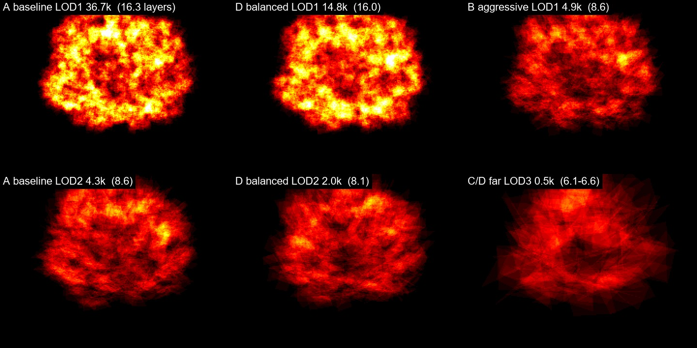

# Forest tree triangle budget — industry survey + small Unreal proof (紅楠), v1

Branch `research/forest-tree-lod-budget-v1`, stacked on `lookdev/forest-assets-v1` @ `a3aaed5` (PR #30). Research + small visual proof only: no forest
system, no new species, no Xinyi / ForestSpike changes, no merge. PR #30 evidence (golden `.blend` sha256 `510F8D10…EB98833`, verified unchanged before
and after every Blender run here) and the UE LOD0/1/2 baseline are kept as the fixed reference.

> Draft for review. Host scope everywhere: **Intel UHD 770 iGPU, UE 5.8, standalone `-game` 1080p** — no statement about discrete GPUs, consoles or phones.

## 0. Short answer

**Is the current 紅楠 too heavy? Yes — for flight and forest use — but not in the way the triangle counts suggest.**

1. **Against the industry (grade [V]/[C], no flight title's per-tree numbers are public).** Game-ready trees ship at LOD0 ≈ 7–25 k, LOD1 ≈ 4–11 k, LOD2 ≈ 1–5 k triangles and a far billboard / impostor of 8–117 triangles (§2.2). Our LOD0 (129 k) is ~5–18× that range; our LOD1 (36.7 k) is bigger than a typical LOD0; our LOD2 (4.3 k) is normal; we have **no far representation**.
2. **LOD0 is not the problem.** 34 k triangles (same 紅楠 cards; no visible loss in the front view, coarser leaves only at the 2–3 m close-up) cost only **17 % less** GPU than 129 k in the front view (+11.0 → +9.1 ms), because near trees are **masked-card fill-bound** (same card area, same ~16 layers). It is also the LOD a flying player sees for ~0.2 s (§2.4). It matters for memory (mesh 6.9 → 2.2 MB), not for flight performance.
3. **LOD1 (52–175 m) is the LOD most worth improving.** In the 100-tree same-tree patch at 150 m slant (55 trees on LOD1, 43 on LOD2): baseline **+25.0 ms** → LOD1 cut to 14.8 k (candidate D) **+14.3 ms (−43 %)** with a crown that stays close to the baseline; → LOD1 cut to 4.9 k (candidate B) **+6.0 ms (−76 %)** but the crown becomes visibly sparser and paler (§6.3). A good LOD1 has to cut *both* triangles and card area; fewer-but-bigger cards only cut triangles.
4. **The cost regime flips with distance.** Near (front, close) the cost is fill-rate (overdraw). From ~150 m the cards are smaller than a pixel and, over 16 patch configurations, GPU time tracks **submitted triangles** (8–21 ms per million triangles) far better than masked fragments (0.2–9 ms per million, a 45× spread) (§6.5). PR #30's "not triangles" is right for the near view and **not** a safe rule for the mid/far band.
5. **Far trees dissolve and cost the most per pixel of information.** The baseline LOD2 loses its crown at 500–1000 m (cards sub-pixel, mips eat the alpha). A 534-triangle far LOD with big cards held a rounder crown and cost **~5× less** in the 1000 m patch (+0.59 vs +3.53 ms). This is a cheap stop-gap; an impostor (Epic's Impostor Baker, Fortnite precedent) is the mature answer and **could not be tested** here (§6.6).
6. **No whole-screen forest number can be derived.** The patch costs above are one tree repeated 100×, one iGPU. Single-tree triangles do not give forest FPS; §8 lists what is unknown and the smallest next experiment.

Provisional single-tree budget for PC (high), **to be validated, not accepted**: LOD0 ≤ ~35 k (< ~50 m), LOD1 ~10–15 k (50–175 m), LOD2 ~2–4 k (175–430 m), far ≤ ~0.5 k or an 8-triangle impostor (> ~430 m). PC (mid) and phones are hypotheses only (§8).

## 1. How to read the evidence

Every number below carries a grade. Nothing is filled in from memory or from guesses; where a number is not public it says **not public**.

| grade | meaning |
|---|---|
| **[O]** | official engine / middleware documentation or vendor documentation (Epic, SpeedTree runtime docs, Simplygon, Microsoft SDK docs) |
| **[V]** | vendor or author blog / asset-store listing: a real number, but an *example* or a *product*, not a shipped game |
| **[C]** | community post / forum: anecdote, undated, no verification |
| **[M]** | measured by us in this PR (Intel UHD 770, UE 5.8, this host only) |
| **[K]** | calculated from the camera model or from numbers above (formula given) |

Unit discipline: **triangles** are what the GPU rasterises; **vertices** are ~0.5–0.8× the triangle count on foliage and are what some listings (Megascans Trees,
the MSFS SDK for aircraft LODs) quote; **quads / cards** are 2 triangles each; "rendered primitives" in Nanite means clusters of triangles, not authored triangles.
Where a source quotes vertices, it is kept in vertices and not converted. UE's `get_num_triangles` (our numbers) counts triangles; a masked card is 2.

Asset class matters as much as the number. Four different things get mixed up in forum threads:

1. **actual shipped game assets** (almost never public per tree);
2. **commercial asset packs** (real, checkable, but sold to many games with different needs);
3. **technology demos** (Epic's Nanite Foliage forest: 41 M triangles per tree is a demo scale, not a budget);
4. **personal works / forum plans**.

## 2. Phase A — what real products and mature assets use

### 2.1 Per-title status (the honest part)

| title | what is public about per-tree geometry | status |
|---|---|---|
| **Ace Combat 7** | Unreal Engine 4 + trueSKY clouds ([UE developer interview, 2019](https://www.unrealengine.com/developer-interviews/ace-combat-7-soars-high-with-ue4-to-become-franchise-s-best-installment)); CEDEC 2019 sessions found are about sky / clouds, sound, story, VR — none about terrain or vegetation. Our own PR #20 review also found **no** developer talk on AC7 terrain/vegetation; SpeedTree use is **unverified**. Players report no view-distance option on PC and `Engine.ini` tweaks to push trees farther ([DSOGaming](https://www.dsogaming.com/?p=122350)). | **per-tree triangle counts: not public** |
| **Ace Combat 8** | Unreal Engine 5, in-house cloud engine "Cloudly" replacing trueSKY, ~10,000 km² map ([Automaton](https://automaton-media.com/en/news/ace-combat-8-wings-of-theve-brings-new-in-house-cloud-engine-a-new-take-on-cinematic-scenes-and-10000-square-kilometer-map/)). Nothing found on forests/vegetation. | **not public**; do not assume Nanite Foliage |
| **MSFS 2020 / 2024** | MSFS 2024 reports an ML pipeline that infers tree species from Bing imagery + LIDAR ([FSNews](https://fsnews.eu/microsoft-flight-simulator-2024-new-information-revealed-in-interviews/)). The SDK has tree *placement* docs and a **generic scenery LOD rule**: 2–5 LODs, each next LOD at least 50 % of the previous polycount, "more commonly 30–40 %" ([MSFS 2024 SDK, Scenery LODs](https://docs.flightsimulator.com/msfs2024/html/3_Models_And_Textures/Modeling/Landscape/LODs.htm)) — this is not a tree-specific budget. Aircraft LOD limits are in *vertices* ([devsupport](https://devsupport.flightsimulator.com/t/lod-limits-feature-what-are-the-criteria/3501)). | **per-tree triangle counts: not public** |
| **War Thunder / Mobile** | Dagor Engine dev blogs found cover sky, lighting, surfaces; none cover trees ([Dagor 6.5 surfaces](https://warthunder.com/de/news/5131-dev-blog-dagor-engine-6-5-neues-surface-rendering-de)). | **not public** |
| IL-2 Great Battles / DCS | only player-side observations (draw-distance setting changes how far trees draw). | **not public** |

So: **no flight title's per-tree budget could be sourced**. Everything below is "what comparable commercial assets and middleware publish", not "what AC7 does".

### 2.2 Published numbers (per tree, triangles unless stated)

| source | class | what | LOD0 | LOD1 | LOD2 | far / billboard |
|---|---|---|---:|---:|---:|---|
| [Simplygon, *Optimizing vegetation assets with reduction and billboard pipeline*](https://simplygon.com/posts/04a89922-2cd3-4ea6-84af-19cf453c05c2) | **[V]** vendor example, Unity HDRP "huge forests", tree origin not stated | LOD3 compared two ways | 15 k | 11 k | 5 k | LOD3 reduction target 400, **billboard cloud 117** ("much lower triangle count … and it looks better") |
| [Microsoft Games / Simplygon, *How to Optimize Vegetation with Simplygon*, Jan 2026](https://developer.microsoft.com/en-us/games/articles/2026/01/how-to-optimize-vegetation-with-simplygon/) | **[V]** illustrations only, from image captions | triangle reducer examples | 56 k → 43 k → 21 k (close range); 56 k → 1 k → 512 (aggressive) | | | remesher 774 / 572 (discouraged for foliage except very distant HLOD) |
| [SpeedTree free UE sample trees](https://store.speedtree.com/?p=532) (numbers from a search-result summary — the store page returned HTTP 403 to our fetch) | **[V]** middleware-vendor sample | broadleaf / conifer | 7,188 / 7,298 desktop | | | broadleaf mobile resolution 999 |
| Fab *Maple Tree Game Model Pack* ([listing](https://www.fab.com/listings/20abd5c9-8e44-430e-91da-a2872bd5d5ad), numbers via search-result summary; page 403 to our fetch) | **[V]** asset pack | large tree 22,490 / 9,057 / 4,580 (LOD0/1/2) | 12.9 k–22.5 k large; 4.7 k–14.6 k medium | 9,057 (one large model) | 4,580 | **billboard 36 tris**, 1024 px |
| Fab *Fir Trees Pack* ([listing](https://www.fab.com/listings/0015d682-64e8-4d70-9ea6-d5f6faaa22be), via search summary) | **[V]** asset pack | 9 models, LOD0–3 | 9.9 k–13 k large | | | **billboard 20 tris** at LOD3 |
| Fab *Forest Oak Trees* (SeedMesh, [listing](https://www.fab.com/listings/a426e94d-1409-4a54-9dba-459a6b27bb45), via search summary) | **[V]** asset pack, photoreal / Nanite-oriented | 6 or 11 LODs | ~301.8 k large | LOD3 96 k | | billboard **8 tris** at LOD10; author advises not using anything above LOD7 as highest detail |
| Fab *MW tropical rainforest trees* (via search summary) | **[V]** asset pack | Nanite foliage, "no traditional LODs" | 82 k–274 k | | | |
| UE Marketplace *Mobile Tree Pack 3* (via search summary) | **[V]** asset pack | 14 trees | PC/console ≈ 7 k | | | mobile ≈ 1.5–3 k; ~600 achievable with the LOD tool |
| Megascans Trees (Epic Marketplace listings, via search summary) | **[V]** scan-based assets | **vertices, not triangles** | mature: 20 k–640 k verts (early-access pack), 3.8 M–180 k verts (Norway maple) | | | LOD5 17,958–2,977 verts (maple); impostor textures included, no billboard count |
| [Drag[en]gine wiki, Tree Canopy LOD](https://developer.dragondreams.ch/wiki/doku.php/gamedev:treecanopylod) | **[C]** engine-community wiki | one worked example | 17,576 | 5,834 (33 %) | | advises foliage triangles drop to 25–50 % of the base for a useful gain |
| Polycount threads ([a](https://polycount.com/discussion/comment/2625900), [b](https://polycount.com/discussion/comment/2626043)) | **[C]** forum | one developer's plan; others push back | "15 k is normal for LOD0 on desktop/console" | 10 k | 5 k | "step down at least 25 %"; "you will kill performance … if you can go to 1000 at LOD1 but leave 5 k" |
| [Epic, Impostor Baker docs](https://dev.epicgames.com/documentation/en-us/unreal-engine/impostor-baker-plugin-in-unreal-engine) | **[O]** | impostor / billboard geometry | | | | **impostor = 1 sprite card, 8 triangles / 9 vertices; "traditional" billboard = 8 cards, 72 triangles**; Fortnite distance foliage uses 12×12 = 144 frames; 2048² atlas; Fortnite BR uses upper-hemisphere impostors for **all trees when Nanite is off** |
| [Epic, Nanite Foliage (UE 5.8, **Experimental**)](https://dev.epicgames.com/documentation/en-us/unreal-engine/nanite-foliage) | **[O]** technology demo scale | forest-demo tree | **41 M triangles**, 12 unique assembly parts, 2,160 part instances, 850 bones; largest asset 3.5 GB → ~29 MB; no LODs/billboards (voxels at distance) | | | non-Nanite platforms get a merged, simplified fallback mesh; Epic states alpha masking "works poorly" with Nanite (overdraw + expensive mask) |

Reading across the published *game-ready* numbers (not Nanite, not photogrammetry): **LOD0 ≈ 7 k–25 k triangles, LOD1 ≈ 4 k–11 k, LOD2 ≈ 1 k–5 k, far billboard / impostor 8–117 triangles.** Each step is 30–75 % of the previous one. The 100 k–300 k class exists but is sold as Nanite / close-up / film-quality, and at least one author tells buyers not to use it as the highest *playable* LOD.

What that does **not** show: these are not measured costs. A 15 k-triangle tree and a 129 k-triangle tree can cost the same if both are overdraw-bound (§5, §6.5).

### 2.3 How mature pipelines handle the rendering cost (documented behaviour)

* **Leaf cards, overdraw, alpha-to-coverage.** SpeedTree's runtime renders trees in 3D near the camera, reduces geometry smoothly with distance (fewer, bigger leaf cards), then fades to a billboard; transitions use alpha-to-coverage "fizzle" cross-fades ([SpeedTree runtime, Level of Detail](https://docs.unity3d.com/speedtree-runtime-sdk/manual/level-of-detail.html); [GPU Gems 3 ch. 4](https://developer.nvidia.com/gpugems/gpugems3/part-i-geometry/chapter-4-next-generation-speedtree-rendering), which also updates shadow cascades at lower rates — nearest every frame, second every 2nd, third every 4th — and renders fewer parts into the farther cascades: the second omits fronds, the third renders only leaves). An **overhead billboard** is cross-faded in when the camera looks down — directly relevant to flight.
* **Simplygon** states why plain decimation fails on foliage ("not very connected and chaotic: a small change in topology introduces a huge geometric error"), splits trunk from leaves, and uses a **billboard cloud** (with an alpha-fitted outline "to reduce overdraw and minimize transparent pixels") for the last LOD; remeshing is discouraged ([Simplygon feature page](https://www.simplygon.com/features/vegetationoptimization)).
* **Epic** ships the Impostor Baker for exactly this (Fortnite precedent). It also documents that impostors are cheaper than 8-card billboards because billboards have "worse overdraw for masked materials", while impostors pay in pixel-shader work (blend of 3 frames).
* **Instancing.** The sources agree on the qualitative split, which our own B1a result (PR #27) also fits: instancing/HISM cuts **draw-call and CPU submission cost**; it does **not** cut per-pixel masked overdraw, vertex work, or shadow-depth work, which scale with what is drawn, not how many draw calls carry it. A numeric statement of "how much" is not available from any source above.
* **Nanite Foliage** removes authored LODs but is Experimental in 5.8, needs Nanite hardware (our host has none), and Epic itself flags masked foliage as its weak case — it is not a basis for a cost budget on our target hardware.

Unverified, widely repeated claims (kept out of the tables): a 2026 blog post gives "8–15× → 1–2×" overdraw figures for modern engines without citing a primary source — not used.

### 2.4 Flight vs ground: what detail can the player actually see?

Camera model of the experiment: 1080p, 60° horizontal FOV → focal length f ≈ 1,662 px. A 紅楠 crown is 15.7 m wide, a spray / leaf clump ~0.7 m, a leaf ~0.10 m, a crown lobe ~4 m. Projected size = f × size / slant distance **[K]**:

| slant | crown width | lobe (4 m) | spray (0.7 m) | leaf (0.1 m) | what still carries information |
|---:|---:|---:|---:|---:|---|
| 50 m | 522 px | 133 px | 23 px | 3.3 px | leaf-level texture, branches |
| 150 m | 174 px | 44 px | 7.8 px | 1.1 px | spray clumps, lobe structure, gaps; leaves are sub-pixel |
| 300 m | 87 px | 22 px | 3.9 px | 0.6 px | lobe structure, crown outline, light/shade pattern |
| 500 m | 52 px | 13 px | 2.3 px | 0.3 px | crown outline, dark-mass / bright-top contrast |
| 1000 m | 26 px | 6.6 px | 1.2 px | 0.17 px | colour, mean density, shadow footprint |

At 250 m/s a tree is inside the current LOD0 band (< 52 m) for ~0.2 s and inside LOD1 (52–175 m) for ~0.5 s **[K]** — most of a flight-game tree's lifetime on screen is LOD2-and-beyond. Beyond ~300 m an individually-modelled leaf cannot be resolved and, with masked alpha + mip-mapping, tends to **dissolve** (§6.4); the representation that carries information there is **crown mass + gaps + colour**, i.e. the job of an aggregate / impostor / canopy layer, not of more triangles.

Fixed-pitch caveat: all distances here are **slant** distances to the crown centre along the PR #30 `agl50` bearing/depression (16.7°): AGL ≈ 0.33 × slant (150 m → 49 m AGL, 300 m → 93 m, 500 m → 151 m, 1000 m → 295 m). A steeper dive changes the projected footprint but not the slant-distance LOD logic.

## 3. Our 紅楠 today (PR #30, fixed baseline — nothing here was changed)

| level | triangles | branch / card tris | cards | overdraw (raster layers, mean) | switch (60° hfov, R = 8.5 m) |
|---|---:|---|---:|---:|---|
| Blender golden | ~20.2 M | 298 k branches + 19.9 M instanced leaves | 15,456 sprays | offline | — |
| UE LOD0 | 129,278 | 67,454 / 61,824 | 30,912 | 16.7 | < ~52 m |
| UE LOD1 | 36,710 | 16,310 / 20,400 | 10,200 | 16.0 | 52–175 m |
| UE LOD2 | 4,256 | 1,474 / 2,782 | 1,391 | 7.9 | > ~175 m |
| far / impostor | **none** | | | | |

Textures 11.7 MB, meshes 9.2 MB (three LODs), 2 materials (bark, masked two-sided foliage). Units: every number here is **triangles** (`get_num_triangles`); a card is 2. Measured by PR #30 on this host: front view +10.6 ms, 50 m AGL (slant ~152 m, LOD1) +1.15 ms, 200 m AGL (slant ~391 m, LOD2) +0.14 ms for **one** tree, with the explicit note that cost was fill-rate + shadow depth.

Gap to the survey (§2.2), per level: LOD0 **129 k vs 7–25 k** (5–18×; the 100 k–300 k class is sold as Nanite / close-up only); LOD1 **36.7 k vs 4–11 k** (3–9× — larger than a typical LOD0); LOD2 4.3 k vs 1–5 k (in range); far: **missing** (published practice: 8–117 triangles). The LOD0→LOD1 ratio (28 %) and LOD1→LOD2 ratio (12 %) are within the "each step 30–75 % or less" range, so the problem is the absolute level, not the ladder shape.

## 4. Phase C — what was tested

Same atlas, same bark, same two materials (`M_TL_LeafCards`, `M_TL_Bark`), same stage / sun / exposure as PR #30, UE 5.8, same golden skeleton and spray transforms. Only the mesh LOD chain differs. The generator is the existing `tools/treegen/machilus_game.py` with two opt-in switches (`ACW_TL_PROFILE`, `ACW_TL_REUSE_BAKE`; the default `v1` path is unchanged and the atlas is **reused**, not re-baked). No new LOD / impostor / forest framework was written.

| id | what | LOD triangles | LOD screen sizes (≈ switch slant) | notes |
|---|---|---|---|---|
| **A** | PR #30 baseline, untouched asset | 129,278 / 36,710 / 4,256 | 1.0 / 0.5 / 0.15 (≈ 52 / 175 m) | reference |
| **B** | "aggressive" first attempt: 40 % of sprays at LOD0, then 12 % / 4 % **top-view-only** enlarged cards | 34,272 / 4,868 / 1,400 | 1.0 / 0.5 / 0.15 | 3 LODs |
| **C** | B + a far LOD | 34,272 / 4,868 / 1,400 / **534** | + 0.06 (≈ 430 m) | LOD3 = 185 cards + 164 trunk tris |
| **D** | "balanced" second iteration after B's LOD1 looked sparse at 150 m | 34,272 / **14,806** / **2,018** / 534 | 1.0 / 0.5 / 0.15 / 0.06 | LOD1 keeps both card views (top + end), 6,182 cards |

The first guess (B) failed the visual check at 150 m (§6.3), so a second iteration (D) was made once; both are reported. Switch sizes were **not tuned** — they inherit PR #30's values, plus 0.06 for the far LOD.

Cameras: PR #30's `front` and `close`, plus four **slant-distance** cameras `sl150 / sl300 / sl500 / sl1000` on the PR #30 `agl50` bearing and depression (16.7°), aimed at the tree centre, 60° hfov, 1080p (`views_budget.json`; AGL = 49 / 93 / 151 / 295 m). Slant distance is camera-to-tree-centre, not AGL.

Two scene forms per candidate: **single** (the one look-dev tree) and **patch** (10 × 10 copies of the same tree in one HISM, 25 m grid with seeded ±4 m jitter, random yaw, scale 0.85–1.15; instance 0 is the look-dev tree). The patch exists only so far-LOD costs rise above the noise floor; it is not a forest system and has no species / size variety. Calculated LOD mix of the patch (§5.3 [K]): `sl150` 2 / 55 / 43 trees on LOD0 / 1 / 2; `sl300` 0 / 3 / 93 (+4 on LOD3 for C, D); `sl500` all LOD2 for A, B but 30 LOD2 + 70 LOD3 for C, D; `sl1000` all LOD2 for A, B, all LOD3 for C, D.

Captures: native SceneCapture2D, 1920×1080, 64 jobs (single × 6 cameras, patch × 4 cameras, forced-LOD ladders). Perf: standalone `-game` 1080p, UE CSV profiler with per-pass GPU stats, one level per (camera, form, candidate) and one empty level per camera, **3 rounds**, run order alternated every round, 260 frames per run. Delta = candidate − empty of the same round and camera.

## 5. Geometry, memory, overdraw

### 5.1 Geometry and memory (UE `get_num_triangles` / vertices; mesh bytes = vertices × 32 B + triangles × 12 B, PR #30's formula)

| | LOD0 | LOD1 | LOD2 | LOD3 | mesh total | textures |
|---|---:|---:|---:|---:|---:|---:|
| A | 129,278 tris / 165,639 v | 36,710 / 50,943 | 4,256 / 6,495 | – | **9.18 MB** | 11.7 MB shared |
| B | 34,272 / 55,437 | 4,868 / 8,152 | 1,400 / 2,578 | – | 2.61 MB | shared |
| C | 34,272 / 55,437 | 4,868 / 8,152 | 1,400 / 2,578 | 534 / 846 | 2.64 MB | shared |
| D | 34,272 / 55,437 | 14,806 / 26,224 | 2,018 / 3,814 | 534 / 846 | 3.39 MB | shared |

Branch triangles: A 67,454 / 16,310 / 1,474; B, C, D LOD0 9,544; LOD1 1,158 (B) / 2,442 (D); LOD2, LOD3 164 (trunk and main limbs only). Card enlargement vs the golden spray size: LOD0 ×1.58; B LOD1 ×2.89 / LOD2 ×5.0 / LOD3 ×9.1; D LOD1 ×2.24 / LOD2 ×4.08 / LOD3 ×9.1. Texture memory (the larger part) is unchanged by any candidate: 11.7 MB.

### 5.2 Offline overdraw (card rasteriser `tools/treegen/card_overdraw.py`, worst case without early-Z, 1080p; mean raster layers over the card footprint / masked fragments in millions at `sl150`)

| LOD | A | B | D |
|---|---|---|---|
| LOD0 | 17.0 layers / 0.295 M | 16.4 / 0.294 M | 16.4 / 0.294 M |
| LOD1 | **16.3** / 0.294 M | **8.6** / 0.159 M | **16.0** / 0.295 M |
| LOD2 | 8.6 / 0.161 M | 7.7 / 0.160 M | 8.1 / 0.154 M |
| LOD3 | – | 6.1 / 0.140 M | 6.6 / 0.156 M |

(`overdraw_sl150_heat.jpg`; other cameras differ only by the 1/d² footprint — `overdraw_*.json`.) Removing cards and enlarging the rest keeps the covered area, so **triangles fall 60–87 % while the layer count barely moves** (A→D LOD1: −60 % triangles, 16.3 → 16.0 layers). Only B's top-view-only LOD1 halves the layers — which is also what makes it look sparse.



### 5.3 Patch LOD mix

screen size = 3.08 × R / d with R = 8.377 m × instance scale (PR #30 convention); thresholds 0.5 / 0.15 (/ 0.06 for C, D). Calculated, not read from the engine (`tools/treegen/budget_patch_lods.py`, `patch_lod_mix.txt`).

## 6. Results (all images native 1080p captures; crops are nearest-neighbour, un-smoothed)

### 6.1 Sheets

| sheet | content |
|---|---|
| `cmp_single_{close,front,sl150,sl300,sl500,sl1000}.jpg` | A / B / C / D, full frame (÷4) on top, native-pixel crop around the tree below |
| `cmp_patch_{sl150,sl300,sl500,sl1000}.jpg` | the same for the 100-tree patch (crop 1:1) |
| `cmp_lods_*.jpg` | forced-LOD ladders (A and B at sl150, A / C / D at sl300, C / D at sl1000) |
| `overdraw_sl150_heat.jpg` | card raster-layer heat maps |

All in `docs/evidence/treegen/budget/`.

### 6.2 Reading notes

My reading of the images below is a single reviewer's judgement; the images are the evidence. Colour / tone differences between A and B/C/D at LOD1 and below are real in the renders (not a stage change: same level, same sun, same exposure).

### 6.3 Visual comparison by slant distance (tree-crown width at 1080p / 60°: 522 / 174 / 87 / 52 / 26 px at 50 / 150 / 300 / 500 / 1000 m)

* **Close (2–3 m)** — A leaves are finer; the budget LOD0 (34 k, cards ×1.58) shows larger, softer leaves (atlas texels magnified); red buds read as smears in both. Not a flight distance. (`cmp_single_close.jpg`)
* **Front (eye level)** — no visible difference at 1080p apart from slightly lighter gaps in B/C/D. (`cmp_single_front.jpg`)
* **150 m (single tree on LOD1)** — A: dense, dark, continuous crown. **B (4.9 k): visibly worse** — see-through holes, pale blue-grey sheen on the enlarged top-only cards, clumpy edge. **D (14.8 k): close to A**, marginally lighter and greener. The patch at 150 m shows the same ordering across 100 trees. (`cmp_single_sl150.jpg`, `cmp_patch_sl150.jpg`, `cmp_lods_sl150_*.jpg`)
* **300 m (LOD2)** — all four read as a round crown with shade pattern; B/C are lighter and bluer, D closest to A; at 1:1 in the patch the four are hard to tell apart. (`cmp_single_sl300.jpg`, `cmp_patch_sl300.jpg`)
* **500 m** — single tree 52 px wide: A and B similar; **C's LOD3 (534 tris) is patchy / hollow on one side**; D's LOD3 acceptable but patchy. Patch at 1:1: indistinguishable between candidates. (`cmp_single_sl500.jpg`, `cmp_patch_sl500.jpg`)
* **1000 m** — single tree 26 px wide: see §6.4. Patch at 1:1: only a slight lightness difference. (`cmp_single_sl1000.jpg`, `cmp_patch_sl1000.jpg`)

B's LOD1 holes are larger than the golden's natural gaps and are the main visible regression; D keeps the gap distribution of A at 150 m. The bluer cast of the enlarged cards is crown-normal blending plus the specular of large flat cards (PR #30 §7 item 5 lists this as an open material issue; none of the candidates fixes it). Leaf flicker, vanishing leaves and temporal noise were **not** evaluated in motion (stills only).

### 6.4 Far trees dissolve with the current cards

At 1000 m slant the baseline LOD2 (1,391 small cards, ×3.3) turns into a sparse scatter of dark pixels — the crown outline is gone. B, C and D (fewer but ×4–9 larger cards) keep a rounder outline; B and C show a hollow centre. Same mechanism as PR #30 §7 item 7 (forced LOD0 dissolving at 200 m). So the far problem is partly a *representation* problem: fewer, bigger cards are better than many small ones in the sub-pixel regime, and an aggregate / impostor is the standard fix (§2.3).

### 6.5 GPU cost (UHD 770, tree − empty, 3 interleaved rounds, mean [min..max] ms; pass columns over frames 60–209)

Empty-stage GPU time per round (ms): front 25.8 / 25.6 / 26.2; sl150 33.3 / 32.7 / 33.0; sl300 32.4 / 32.2 / 33.1; sl500 31.2 / 31.5 / 31.7; sl1000 29.9 / 29.8 / 29.8 (SSAO alone is ~7 ms of it on this iGPU).

| view | form | cand | GPU Δ | Prepass | Basepass | ShadowDepths |
|---|---|---|---:|---:|---:|---:|
| front | single | A | **+11.00** [+10.44..+11.75] | +1.24 | +3.74 | +3.17 |
| front | single | C | **+9.09** [+8.72..+9.34] | +1.21 | +2.51 | +2.67 |
| front | single | D | **+9.34** [+8.70..+10.11] | +1.21 | +2.52 | +2.71 |
| sl150 | single | A | **+1.58** [+1.03..+2.49] | +0.19 | +0.56 | +0.72 |
| sl150 | single | C | **+0.38** [+0.12..+0.70] | +0.04 | +0.15 | +0.14 |
| sl150 | single | D | **+0.79** [+0.54..+1.10] | +0.12 | +0.32 | +0.43 |
| sl150 | patch | A | **+24.98** [+24.81..+25.13] | +2.96 | +10.43 | +11.57 |
| sl150 | patch | B | **+5.99** [+5.72..+6.30] | +0.77 | +2.96 | +2.23 |
| sl150 | patch | C | **+6.14** [+5.90..+6.61] | +0.77 | +2.86 | +2.25 |
| sl150 | patch | D | **+14.32** [+14.14..+14.62] | +1.79 | +6.26 | +6.27 |
| sl300 | patch | A | **+5.88** [+5.22..+6.22] | +1.13 | +3.34 | +1.79 |
| sl300 | patch | B | **+2.46** [+2.01..+2.73] | +0.39 | +1.46 | +0.79 |
| sl300 | patch | C | **+3.02** [+2.60..+3.56] | +0.40 | +1.49 | +0.79 |
| sl300 | patch | D | **+4.52** [+3.66..+5.70] | +0.67 | +2.49 | +1.36 |
| sl500 | patch | A | **+4.71** [+4.44..+4.86] | +1.06 | +2.99 | +1.12 |
| sl500 | patch | B | **+1.86** [+1.59..+2.11] | +0.31 | +1.18 | +0.45 |
| sl500 | patch | C | **+1.42** [+1.04..+1.86] | +0.21 | +0.74 | +0.32 |
| sl500 | patch | D | **+1.57** [+1.52..+1.64] | +0.28 | +1.00 | +0.29 |
| sl1000 | patch | A | **+3.53** [+3.08..+3.88] | +0.82 | +2.99 | −0.27 |
| sl1000 | patch | B | **+1.45** [+1.40..+1.48] | +0.16 | +0.37 | −0.20 |
| sl1000 | patch | C | **+0.66** [+0.53..+0.74] | +0.10 | +0.32 | +0.03 |
| sl1000 | patch | D | **+0.59** [+0.55..+0.61] | +0.10 | +0.31 | +0.04 |

Reading (this host only):

* **Near / single tree is fill-bound.** Front: 129 k → 34 k triangles (−73 %) is −17 % GPU. Overdraw is unchanged (16.7 → 16.4 layers).
* **Shadow depth is a large slice.** At `sl150` it is 46 % of A's patch delta (+11.6 of +25.0 ms) and 44 % of D's (+6.3 of +14.3); the level's dynamic shadow distance is 600 m, so it is ~0 at 1000 m. Masked cards cast into the cascades.
* **Patch cost tracks submitted triangles, not fragments.** Triangles per frame (sum over patch trees of the LOD each tree uses) and masked fragments (offline rasteriser × 1/d² footprint scaling; `fragment_model.md`):

| view | cand | triangles submitted (M) | masked fragments (M) | GPU Δ ms | ms per M triangles | ms per M fragments |
|---|---|---:|---:|---:|---:|---:|
| sl150 | A | 2.46 | 47.4 | +24.98 | 10.2 | 0.53 |
| sl150 | B | 0.40 | 30.5 | +5.99 | 15.1 | 0.20 |
| sl150 | D | 0.97 | 47.5 | +14.32 | 14.8 | 0.30 |
| sl300 | A | 0.52 | 5.3 | +5.88 | 11.2 | 1.10 |
| sl300 | D | 0.23 | 5.2 | +4.52 | 19.3 | 0.87 |
| sl500 | A | 0.43 | 1.65 | +4.71 | 11.1 | 2.86 |
| sl500 | C | 0.08 | 1.52 | +1.42 | 17.9 | 0.93 |
| sl1000 | A | 0.43 | 0.39 | +3.53 | 8.3 | 8.97 |
| sl1000 | C | 0.05 | 0.34 | +0.66 | 12.3 | 1.91 |

  Over all 16 patch configurations (`fragment_model.md`) the cost per million triangles stays within 8.3–20.6 ms, while the cost per million fragments spans 0.2–9.0 ms. A and D have the *same* fragment count at `sl150` (47 M) but cost +25.0 vs +14.3 ms, i.e. fewer triangles at equal fragments lowers cost here. These are 16 correlated points on one iGPU with candidates that change triangles, card count and layers together; this shows tracking, not an isolated cause, and the per-triangle figure is **not** transferable to other GPUs. It does mean: from ~150 m, where cards are ≤ 1 px, **triangle (and card) count is a real cost on this host**, contrary to the near-view reading.
* **LOD1 is where the money is at 150 m**: 55 of 100 patch trees. D saves 10.7 ms of A's 25.0 (−43 %); B saves 19.0 ms (−76 %).
* **Far LOD**: C vs B at 1000 m (all trees LOD3 534 vs LOD2 1,400): +0.66 vs +1.45 ms (−54 %); vs A +3.53 (−81 %). At 500 m (70 / 30 split) the C/D gain over B is smaller (+1.4–1.6 vs +1.9).
* **Noise / drift**: spread over the 3 rounds is below ±0.4 ms in most rows and up to ±1 ms for `sl300` C / D and `sl150` single A. PR #30 measured A single at 50 m AGL (slant ~152 m) +1.15 ms; here +1.58 [+1.03..+2.49] — host drift between sessions, so only interleaved same-session comparisons are used. Single-tree deltas at 150 m are within ~1 ms of noise: that single-tree ranking is **not** reliable; the patch rows are.
* **Pass columns**: `GPU/<pass>` columns stop updating after ~frame 209 on the heavy patch levels, so pass breakdowns use frames 60–209 for every run; GPUTime / FrameTime are stable from frame ~10 (`analyze_budget_perf.py`).

### 6.6 Hard-switch step size and the impostor attempt

**LOD step proxy** (`lod_pop.json`, `budget_lod_pop.py`): for forced-LOD pairs at one camera, mean luminance difference / blurred (5×5) RGB mean-absolute difference of the tree crop — A sl150 LOD1→LOD2 0.024 / 0.032; A sl300 LOD0→LOD1 **0.032** / 0.035 (largest); B sl150 LOD0→LOD1 0.023 / 0.033; D sl150 LOD1→LOD2 0.020 / 0.033; D sl300 LOD2→LOD3 0.004 / 0.025; C sl300 LOD2→LOD3 0.001 / 0.028; sl1000 LOD2→LOD3 C 0.002 / 0.010, D 0.007 / 0.015. All steps are 1–4 % per channel; the budget chains are **not larger than the baseline's own steps** at these switches. This is a single-frame size-of-step proxy at a forced LOD, **not** a popping test: no cross-fade, no motion, and the engine's actual threshold position is not exercised.

**Impostor (Epic Impostor Baker) — attempted, blocked.** The plugin ships with UE 5.8 as Experimental and is driven by Editor Utility Widgets. Three probes (`adapters/unreal/treelookdev/tl_probe_impostor*.py`): (1) with the plugin enabled in `TreeLookdev.uproject` the Blueprint assets load and expose only generic widget members; (2) in the GUI editor with a copy of the baseline mesh selected, `AssetAction_StaticMeshImpostor.run()` ran and produced no assets in 420 s; (3) the same with "throttle CPU when not foreground" disabled, none in 300 s. We stopped there (time-box). This says **nothing** about the baker in an interactive editor session; it means it cannot be scripted from here without reading its Blueprint graphs. Consequently no impostor was measured; candidate C/D's 534-triangle LOD3 is a cheap stand-in, not an impostor. (The Impostor Baker documentation's own numbers — 8 triangles per impostor, 72 per 8-card billboard — are in §2.2.)

## 7. Findings against the hypothesis band in the brief

| hypothesis (brief) | finding |
|---|---|
| very close 20–60 k | 34 k is enough from the front view upward; close-ups (2–3 m) are visibly softer than 129 k. **Not a flight distance.** |
| near–mid 5–20 k | 14.8 k (D) held the baseline look at 150 m; **4.9 k (B) did not** with the current card technique. The band's lower end needs a different LOD1 construction (cut-out / cluster cards), not just fewer cards. |
| mid–far 0.5–4 k | 1.4–2.0 k at 175–430 m held the crown shape at 300 m (B/C slightly lighter and bluer than A, D closest); 534 triangles at 500–1000 m kept a rounder crown than A's 4.3 k but is patchy / hollow on single trees. |
| far: billboard / impostor | not measured (tooling blocked, §6.6). Published numbers say 8–117 triangles. |
| "higher numbers are needed to keep quality" | not supported at LOD0 beyond ~50 m, nor at LOD1 beyond ~15 k, in these captures. LOD1 at ~15 k vs 37 k: no visible loss at 150 m, 43 % cheaper in the patch. |

## 8. Provisional vegetation budget (proposal — nothing below is accepted or validated beyond what §6 states)

Per **tree** (triangles, current masked-card technique; switch slants inherited from PR #30, crown radius 8.4 m):

| | LOD0 (< ~50 m) | LOD1 (50–175 m) | LOD2 (175–430 m) | far (> ~430 m) | status |
|---|---:|---:|---:|---|---|
| **PC high** | ≤ ~35 k | **10–15 k** | **2–4 k** | **≤ ~0.5 k** (or 8-tri impostor) | LOD0 / LOD1 / LOD2 / 534-tri far LOD **measured** here (D); impostor **untested** |
| **PC mid** | ≤ ~15–20 k | ≤ ~5–7 k | ≤ ~1.5 k | ≤ ~0.5 k / impostor, switch distances ×0.6–0.7 | **hypothesis** from published 7–15 k LOD0 and "each step 30–40 %" (§2.2); B's 4.9 k LOD1 failed the visual check, so 5–7 k needs a new LOD1 construction |
| **phone (high-end)** | ≤ ~1.5–3 k | ≤ ~0.6–1 k | impostor from ~100–150 m | impostor | **hypothesis only**, from published mobile figures (SpeedTree mobile 999; mobile pack 1.5–3 k; community "100–250 high / 2 tris far") — **not tested; the masked-card technique itself is unproven on mobile** |

Per **screen** (visible forest): **cannot be stated.** The 100-tree patch above is one tree repeated, one iGPU, 1080p, CSM shadows; per-million-triangle costs are not transferable to other hardware, and a single tree's triangle count does not give forest FPS. Unknowns that block a reliable number:

1. cost vs forest density (thousands of instances, occlusion, species variety) and shadow-cascade cost at flight altitudes;
2. HISM vs non-instanced (every patch here used HISM, so the instancing saving was not measured);
3. any discrete GPU, console or phone (UHD 770 has no Nanite / VSM / Lumen);
4. LOD transition quality in motion (cross-fade / dither, temporal flicker) — stills only;
5. impostor quality and cost at 150–600 m; the seam between 3D crowns and a far canopy layer (PR #27 F10 was a FAIL);
6. Nanite Foliage on our target hardware (Experimental; Epic's masked-foliage caveat);
7. the actual per-tree numbers of AC7 / AC8 / MSFS / War Thunder (not public).

**Smallest next experiment toward a screen budget**: a thousands-of-instance HISM patch (e.g. 2,000–5,000 trees, chain D, three altitudes) on this host and, if possible, one discrete GPU, with the same CSV harness — report ms per 1,000 trees per distance band; then substitute the far band with an impostor and repeat. Treat the §6.5 per-triangle figures as hypotheses to check, not as a model.

## 9. Next steps worth the effort (1–2)

1. **Far / mid representation via Epic's Impostor Baker, run interactively.** The far band is triangle-bound on this host and the current cards dissolve at 500–1000 m. Bake an upper-hemisphere impostor from a copy of candidate D's LOD0 in the editor GUI, add it as candidate E to the existing harness (≈ one more mesh path + level + capture job), and measure the same patch and the 300–600 m transition against D's LOD2/LOD3. Decide LOD2/LOD3 vs impostor from that.
2. **A LOD1 that cuts card area and triangles together.** LOD1 holds most of the patch cost at 150 m; D vs B shows the trade (look vs ms) is set by layer count. PR #30 already measured ~73 % of each card as transparent: alpha-fitted cut-out cards (SpeedTree "generate mesh" / Simplygon tight-fit precedent) or cluster cards, aiming for D's look at about B's cost; verify with `card_overdraw.py` first (cheap, offline), then the patch harness.

Not recommended now: more LOD0 reduction work (little flight value), Nanite Foliage (Experimental, no Nanite hardware here), a general LOD framework.

## 10. Reproduce, deviations, failure log

```powershell
$b = "C:\Program Files\Blender Foundation\Blender 5.2\blender.exe"; $py = "D:\Users\EDDY\.venvs\acw-xinyi\Scripts\python.exe"
# budget / balanced LOD chains (atlas reused; golden .blend opened read-only, sha256 510F8D10... checked before/after)
$env:ACW_TL_REUSE_BAKE="1"; foreach ($p in "budget","balanced") { $env:ACW_TL_PROFILE=$p
  & $b -b --factory-startup -noaudio --python tools/treegen/machilus_game.py -- docs/evidence/treegen/machilus/machilus_thunbergii_v1.blend out/treegen/machilus_game }
& $py tools/treegen/budget_views.py out/treegen/machilus_game
# offline overdraw (per profile), patch LOD mix
$env:ACW_TL_VIEWS="views_budget.json"; $env:ACW_TL_PROFILE="v1"; & $py tools/treegen/card_overdraw.py out/treegen/machilus_game out/treegen/budget_overdraw/v1 sl150,sl300,sl500,sl1000
& $py tools/treegen/budget_patch_lods.py out/treegen/machilus_game/views_budget.json
# UE 5.8: meshes, perf levels, captures, perf (needs the PR #30 generated content: Content/, out/treegen/machilus_game)
& ./tools/treegen/run_tl.ps1 -Script tl_budget_build.py -Name bm -Env @{ACW_TL_BUDGET_STAGE="meshes"} -Expect tl_budget_build.meshes.report.json
& ./tools/treegen/run_tl.ps1 -Script tl_budget_build.py -Name bl -Env @{ACW_TL_BUDGET_STAGE="levels"} -Expect tl_budget_build.levels.report.json
& ./tools/treegen/run_tl.ps1 -Script tl_budget_capture.py -Name cap -Env @{ACW_TL_SPEC="<abs>/capture_spec_b1.json"} -Expect tl_budget_capture.b1.report.json
& ./tools/treegen/run_tlb_perf_schedule.ps1 -Prefix q1 -Rounds 2; & ./tools/treegen/run_tlb_perf_schedule.ps1 -Prefix q1 -Rounds 1 -FirstRound 3
& $py tools/treegen/budget_compare.py unreal/TreeLookdev/Saved/TreeLookdev/captures/b1 <out>; & $py tools/treegen/budget_lod_pop.py <captures/b1> <out.json>
& $py tools/treegen/budget_fragment_model.py docs/evidence/treegen/budget
```

Evidence in `docs/evidence/treegen/budget/`: `cmp_*.jpg`, `overdraw_sl150_heat.jpg`, `budget_perf_q1.json` (every run's medians + per-round deltas), `overdraw_{v1,budget,balanced}.json`, `mesh_audit.json`, `game_report_{budget,balanced}.json`, `lod_pop.json`, `fragment_model.md`, `patch_lod_mix.txt`, `views_budget.json`, capture specs, UE build receipts.

Code changes (all opt-in; PR #30 default paths unchanged): `tools/treegen/machilus_game.py` (profiles `budget` / `balanced`, `ACW_TL_REUSE_BAKE`; the default profile `v1` writes the same files as before), `tools/treegen/card_overdraw.py` (`ACW_TL_PROFILE`, `ACW_TL_VIEWS`, `lod3`), `tools/treegen/run_tl_perf.ps1` (accepts `L_TLB_` levels), new `budget_*.py`, `analyze_budget_perf.py`, `run_tlb_perf_schedule.ps1`, `adapters/unreal/treelookdev/tl_budget_*.py`, probe scripts. `unreal/TreeLookdev/TreeLookdev.uproject` now also enables `ImpostorBaker`, `GeometryScripting`, `BlueprintMaterialTextureNodes`, `EditorScriptingUtilities` (needed only for the probes; **all perf runs here had them enabled**).

Failures and deviations, kept visible:

* Epic Impostor Baker: three probes, no output (§6.6).
* B's first LOD1 failed the visual check at 150 m → D added (not hidden).
* The first `lod3` profile used `min_r = 0.30`, which removed all branches (`ValueError` in the generator); fixed to 0.18 (trunk + main limbs, 164 tris) and re-exported. The golden hash was re-verified after every Blender run.
* `GPU/<pass>` CSV columns stop after ~209 frames on the heavy patch levels; one common 60–209 window is used for all runs (runs are 260 frames, originally planned 600).
* UE returned `-1073741819` at shutdown on two import runs after their receipts were written (`PASS`); the assets and levels were verified by later stages. The `b1` capture receipt was overwritten by the candidate-D capture run (same set name); all PNGs are present.
* Fab and SpeedTree store pages returned HTTP 403 to direct fetch: those rows are grade [V] **via search-result summaries** and should be re-checked against the live pages before being quoted.
* Host drift between PR #30's session and this one (A single, 50 m AGL: +1.15 vs +1.58 ms) is why only interleaved same-session deltas are compared.

Limits: one host (Intel UHD 770 + i7-12700), UE 5.8 CSM shadows, still images only, one tree species / one seed / one atlas, same-tree patch, no Nanite / VSM / Lumen, no discrete GPU, no phone, no impostor, no LOD cross-fade.
