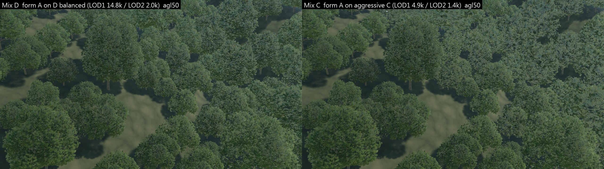
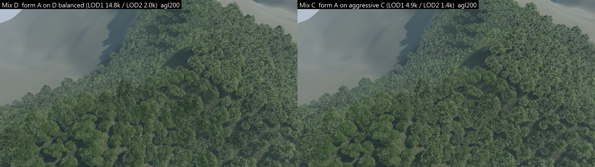
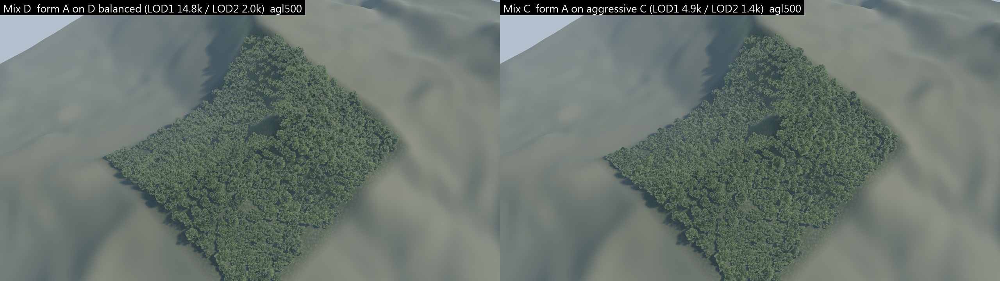
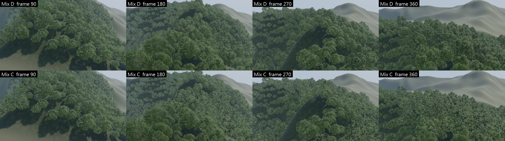

# Taiwan hillside forest — low-precision tolerance test v0: Mix D vs Mix C, UE 5.8

Follow-up to `taiwan-hillside-forest-mix-v0.md` (Draft PR #33, review 5543331378). Same 象山 block, the same 989 Mix V0 trees (positions, crown
forms, tints), cameras, flight, sun and render settings. **One change:** the 593 form-A 紅楠 use PR #31's existing aggressive **C** LOD chain
instead of D balanced; the 396 crown-B trees are unchanged. No new tree, atlas, shader or LOD system; the A, B and Mix V0 baselines
(`/Game/HillsideForest/r6`, `m1`) are untouched. Mix C is built as `m2`.

> **Follow-up: LOD1 visual recovery v0** (C + side cards, chosen chain T) → `taiwan-hillside-forest-lod1-recovery-v0.md`.

> Draft for visual review. Host: **Intel UHD 770 iGPU, UE 5.8, standalone `-game` 1080p**. GPU numbers are exploratory, 2 interleaved rounds.

| form A chain | LOD0 | LOD1 (≈ 52–172 m) | LOD2 (≈ 172–430 m) | LOD3 (> ≈ 430 m) |
|---|---:|---:|---:|---:|
| **D** balanced (Mix D) | 34,272 | 14,806 (top + end cards) | 2,018 | 534 |
| **C** aggressive (Mix C) | 34,272 | **4,868** (top-only enlarged cards) | **1,400** | 534 |

LOD0 is identical; the test is really about **LOD1 and LOD2**, i.e. the 50–430 m band a pilot sees most of the time.

## 0. Short answer

**Partly. The forest hides C better than a single tree does, but not completely, and the price difference is large.**

* **200 m AGL: acceptable to me.** Mix C is slightly paler and smoother in the form-A areas; with B stands, tone patches and shadows the
  difference is hard to see without the side-by-side.
* **500 m AGL: equivalent** (LOD3 is the same 534-triangle budget in both; only 28 of 587 form-A trees are on LOD2).
* **50 m AGL and the normal-speed canopy pass: noticeable.** Form-A crowns in the LOD1 band (≈ 50–170 m) turn **paler, blue-grey and
  flatter** — PR #31's B/C LOD1 problem ("sparser, paler, top-only cards") is still visible, now as pale patches inside the canopy instead
  of single sparse trees. The near trees (LOD0) and all crown-B trees are pixel-identical. Mixing softens it (B stands and shadows break it
  up) but does not hide it.
* **Flicker:** no new temporal artefact found. The flicker proxy inside the tree mask is **3 % higher at the median, 8 % at p95** for C, with
  no isolated spikes (0 frames where C exceeds D by > 20 %; frame-level and tile-level pop proxies: 0 events for both). Real-time viewing of
  `fly_DvsC.mp4` / `fly_DvsC_crop1to1.mp4` is left to you.
* **GPU (forest cost over the empty stage):** Mix C is **−32 % at 50 m, −29 % at 200 m, −41 % in the flyover (p95 −27 %)** — Mix C at 50 m
  (+97 ms) costs about what single-紅楠 A cost at 200 m (+97 ms, earlier session).

So the forest does raise tolerance for the cheap LOD at 200 m and beyond; in the 50–170 m band the remaining issue is C's **paleness and
flatness (card material / layer count)**, not its triangle count. A middle LOD1 between C and D (or fixing the pale sheen of enlarged
top-only cards) looks like the efficient next step — not a decision this test makes.

## 1. Native renders (Mix D left / Mix C right)





* Native-pixel 640×360 centre crops: `dc_crop_agl{50,200,500}.png`. Full Mix C stills: `still_C_agl*.jpg`.
* **Where they differ:** `dc_diff_agl*.jpg` = |D − C| luminance × 4. Differences sit only on form-A crowns beyond LOD0 range; crown-B trees
  and the nearest trees are identical. Share of pixels with |ΔL| > 0.03: 28 % / 39 % / 14 % at 50 / 200 / 500 m (mean |ΔL| 0.023 / 0.031 /
  0.011). At 500 m the two LOD3 meshes have the same budget but different random card sets (generator profiles), hence pixel noise there.
* **Flyover** (7.5 s canopy pass, 40 m/s, 56–78 m AGL, normal speed): `fly_DvsC.mp4` (D | C, 2 × 1280×720, 60 fps) and
  `fly_DvsC_crop1to1.mp4` (native-pixel 960×540 centre crops side by side — flicker is easier to judge unscaled); frames 90 / 180 / 270 / 360:
  `dc_flight.jpg`.



| native metric | Mix D 50 / 200 / 500 m | Mix C 50 / 200 / 500 m |
|---|---|---|
| canopy share of the block in frame (crowns + shadows) | 89.8 / 89.1 / 84.9 % | 89.4 / 89.0 / 85.2 % |
| tree-pixel median saturation | 0.30 / 0.25 / 0.20 | 0.29 / 0.24 / 0.20 |
| tree-pixel median value (brightness) | 0.29 / 0.33 / 0.38 | 0.30 / 0.34 / 0.37 |

Coverage does not drop (C's enlarged cards keep the footprint); C is slightly brighter / less saturated, matching what the images show.

## 2. Flicker (動態閃爍) — `flicker.json`, `flicker_chart.png`

PR #31 `flight_analyze.py` proxy: mean |I(t+1) − 2 I(t) + I(t−1)| of luminance (960×540) inside the tree mask (|forest − empty flight| > 0.03),
same camera path for D and C, the empty flight rendered once for the mask.

| | Mix D | Mix C | C / D |
|---|---:|---:|---:|
| median | 0.0844 | 0.0869 | **1.03** |
| p95 | 0.0989 | 0.1073 | **1.08** |
| frames where C > 1.2 × D | | 0 | |
| mean luminance gap D − C in the mask | | | −0.013 (C brighter) |
| whole-frame / 8 × 6-tile pop spikes | 0 / 0 | 0 / 0 | |

The proxy is dominated by camera motion (both curves have the same shape); only the ratio is meaningful. C runs a steady 3–8 % higher —
consistent with more sub-pixel card edges at the same footprint — without isolated events.

## 3. LOD distribution and triangles (calculated, trees in view; same thresholds for both)

| view | form A LOD0 / 1 / 2 / 3 | form B LOD0 / 1 / 2 / 3 | triangles Mix D → Mix C |
|---|---|---|---:|
| 50 m AGL | 2 / 83 / 251 / 42 | 1 / 69 / 127 / 25 | 2.86 M → **1.88 M (−34 %)** |
| 200 m AGL | 0 / 9 / 346 / 157 | 0 / 13 / 193 / 77 | 1.41 M → **1.11 M (−21 %)** |
| 500 m AGL | 0 / 0 / 28 / 559 | 0 / 0 / 24 / 372 | 0.57 M → 0.55 M (−3 %) |

## 4. GPU — exploratory (UHD 770; empty / Mix D / Mix C interleaved in one session, order reversed in round 2; 500 m not timed)

| view | GPU empty | GPU Mix D | GPU Mix C | **Mix D − empty** | **Mix C − empty** | **C − D** |
|---|---:|---:|---:|---:|---:|---:|
| 50 m AGL | 40.2 | 182.2 | 137.2 | +142.0 [141.8..142.3] | +97.0 [96.8..97.2] | **−45.1 (−32 %)** |
| 200 m AGL | 44.8 | 132.2 | 106.6 | +87.5 [87.2..87.7] | +61.9 [61.7..62.0] | **−25.6 (−29 %)** |
| flyover median | 42.7 | 147.9 | 104.5 | +105.2 [103.7..106.8] | +61.8 [61.2..62.3] | **−43.5 (−41 %)** |
| flyover p95 | 46.0 | 173.2 | 138.6 | +127.2 | +92.6 | **−34.7 (−27 %)** |

ms, medians (stills frames 60–209, flyover rows 20–490). Mix D reproduces the Mix V0 run (PR #33 update 2) within 1.5 ms. Where the saving
comes from (C − D): 50 m prepass −6.1, base pass −19.3, shadow depths −19.8 ms; 200 m −3.7 / −11.2 / −10.4 ms. C's LOD1 halves the card
layers (top-only cards), so masked overdraw and shadow casting both fall — the saving is larger than the triangle saving alone. For scale:
single-紅楠 A cost +164.5 / +97.2 ms at 50 / 200 m (Mix V0 run).

## 5. Gates

Mix C passed the same fail-closed fresh-process persisted-material gate: **243 / 243** (5 HISMs; form A = `/Game/TreeLookdev/Budget/C/…`,
593 instances; form B = crown B, 396; every leaf slot a MIC of the Masked `M_TL_LeafCards`; no default material; no package dirtied after
loading all maps) and the native pixel guard (tree-pixel saturation 0.29 / 0.24 / 0.20). Receipts: `hf_build_C.report.json`,
`hf_verify_C.report.json`.

## 6. Limits

One block, one sun, one flight; calculated LOD counts (HISM selects per cluster node); flicker and pop are proxies, and I did not watch the
clips in real time; 2 perf rounds on one iGPU; C's LOD3 differs from D's in card selection only. The judgement "acceptable at 200 m,
noticeable at 50 m / in the pass" is one reviewer's reading of the native frames.

## 7. Reproduce

```powershell
$py = "D:\Users\EDDY\.venvs\acw-xinyi\Scripts\python.exe"
# PR #31's C mesh must be in unreal/TreeLookdev/Content/TreeLookdev/Budget/C (gitignored content, copied from the PR #31 worktree)
./tools/forest/run_hf_all.ps1 -Rev m2 -Instances instances_mix.json -AChain C -Renders stills_forest,stills_empty,flight_forest,flight_empty
& $py tools/forest/hillside_frames.py out/forest/hillside unreal/TreeLookdev/Saved/TreeLookdev/hillside/movies m2 out/forest/hillside/evidence_m2 views_mix.json instances_mix.json
& $py tools/forest/hillside_lod_tolerance.py unreal/TreeLookdev/Saved/TreeLookdev/hillside/movies m1 m2 m2 out/forest/hillside/evidence_m1 out/forest/hillside/evidence_m2 out/forest/hillside/evidence_dc
./tools/forest/run_hf_perf.ps1 -Rev m1 -MixRev m2 -Prefix p5 -Rounds 2 -Views agl50,agl200,flight
& $py tools/forest/hillside_perf.py unreal/TreeLookdev/Saved/TreeLookdev/hillside/perf p5 out/forest/hillside/evidence_dc/perf_p5.json
```

Code this round: `ACW_HF_A_CHAIN` (D default / C) in `hf_build.py` and `hf_verify.py`, `-AChain` / `-Renders` in `run_hf_all.ps1`,
`tools/forest/hillside_lod_tolerance.py`. Evidence: `docs/evidence/forest/hillside_v1/lod_tolerance/`.
