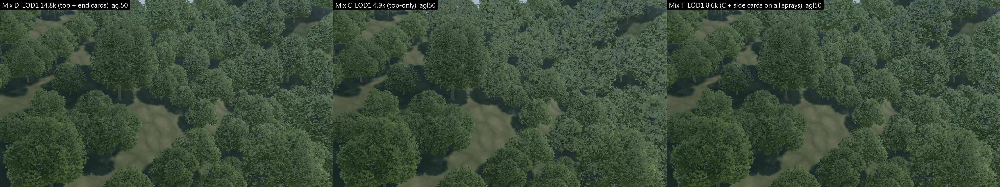
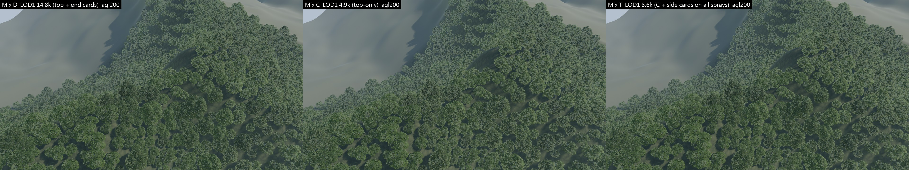
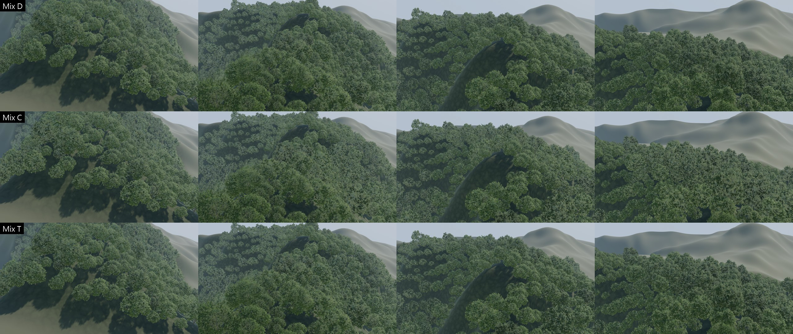

# Taiwan hillside forest — Forest LOD1 visual recovery v0 (紅楠 A, aggressive C), UE 5.8

Follow-up to `taiwan-hillside-forest-lod-tolerance-v0.md` (Draft PR #33, review 5543836389). Same 象山 250 m × 250 m block and the same 989
Mix V0 trees (593 紅楠 A + 396 crown B), cameras, sun, flight and render settings. **Only form A's LOD1 changes**; LOD0 / LOD2 / LOD3 of the
new chains are byte-identical to C (checked), crown B is untouched. All baselines stay: Mix D `m1`, Mix C `m2`, the golden reference
(sha256 `510F8D10…`, re-checked after every generator run), PR #30 / #31 / #33 evidence. New builds: `m3` (S), `m7` (T); lighting checks
`m4` / `m5` / `m6` / `m8`.

> Draft for review. Host: **Intel UHD 770 iGPU, UE 5.8, standalone `-game` 1080p**. GPU numbers exploratory (2 interleaved rounds).

## 0. Answer

**Adopt T for 紅楠 A: C + side cards on every LOD1 spray (LOD1 8,578 triangles; LOD0 / 2 / 3 unchanged = 34,272 / 1,400 / 534).**

* **Cause:** C's LOD1 is top-only. It keeps 12 % of the sprays as enlarged top cards and drops every side ("end") card, which loses
  **45 % of the leaf-card area and half the side-facing cards** compared with D's LOD1. Fewer stacked layers mean less crown self-occlusion (shadow and SSAO), so visible
  leaves read **brighter, bluer and less saturated** (+12 % brightness, +5 % B/G, −12 % saturation at 50 m) and the crown has no dark interior. It is **not**
  a normals / sky-reflection or baked-AO problem: those are the same as D's.
* **Fix:** restore the side card on C's existing LOD1 sprays, with no new sprays, atlas, material, shader or re-model. +3,710 triangles
  (+1,855 cards) over C. The first, smaller step (S: side cards on the half facing sideways, +1,856 triangles) recovered only ~half.
* **Result (native pixels, where D and C differ):** T removes **76 % / 83 % / 79 %** of C's brightness / saturation / blue offset at 50 m
  (70 / 82 / 82 % under a second, low front-lit sun) and 82 / 100 / 76 % at 200 m. Flicker p95 is back to D's level (1.02 × D; C was
  1.08 ×); there are no pop spikes, holes or colour jumps. To my eye, 50 m and the canopy pass now read close to D, a touch flatter in
  1:1 crops.
* **Cost:** forest GPU over the empty stage **+115.7 ms at 50 m, +70.9 ms at 200 m, +83.3 ms flyover median** — vs C +97.2 / +63.9 /
  +62.2 and D +141.9 / +87.8 / +106.2. T is **18–22 % cheaper than D** and keeps **59 % / 71 % / 52 %** of C's saving. LOD1 mesh is
  0.60 MB (D 1.02, C 0.32).
* **Not adopted:** S (cheaper, +8 ms at 50 m, but only half the recovery) and C (cheapest, visibly pale and flat at 50 m and in the pass).
  If the remaining ~20 ms at 50 m matters more than the look on a given platform, C stays the fallback; it is not overwritten.

Recommendation: freeze the 紅楠 form-A chain at **34,272 / 8,578 / 1,400 / 534** and close the 紅楠 LOD study; the next visual gain is a
genuinely different Taiwan lowland species, not more 紅楠 tuning.

## 1. Why C's LOD1 reads pale and flat (analysis)

LOD1 is what form-A trees use at ≈ 52–172 m slant — the 50 m-AGL view's mid-ground and most of the canopy pass.

| LOD1 (form A) | triangles | leaf cards | card area | horizontal cards (\|n_z\| > 0.7) | side-facing cards (\|n_z\| < 0.4) | baked occlusion (VC.G mean) | shading-normal up-component |
|---|---:|---:|---:|---:|---:|---:|---:|
| **D** balanced | 14,806 | 6,182 (top + end, ×2.24) | 5,248 m² | 49 % | 20 % | 0.742 | 0.12 |
| **C** aggressive | 4,868 | 1,855 (top only, ×2.89) | **2,873 m² (−45 %)** | **60 %** | **9 %** | 0.710 | 0.11 |
| S = C + side cards on ½ | 6,724 | 2,783 | 4,011 m² | 55 % | 15 % | 0.712 | 0.13 |
| **T** = C + side cards on all | 8,578 | 3,710 | 5,145 m² | 50 % | 19 % | 0.712 | 0.09 |

(From the exported GLBs; card area in m² at scale 1.)

Native pixels (50 m AGL, the 21 % of the frame where D and C differ): C's leaf pixels are **+12 % brighter, −12 % saturation, +5 %
bluer (B/G)** than D's; only 2.6 % of those pixels are background showing through, so it is not holes — it is an additive blue-grey on the
leaves.

The brief's three hypotheses:

1. **Card orientation / normals → sky reflection: not the main cause.** All four LOD1s use crown-blended shading normals with almost the
   same distribution (up-component 0.09–0.13), and the same material; C's baked occlusion is even slightly darker than D's. A material or
   normal change would treat a symptom.
2. **Top-only cards → no side volume: the main cause.** C keeps 12 % of the sprays as enlarged (×2.89) top cards and drops every
   side ("end") card, so it loses **45 % of the card area and half the side-facing cards**. Fewer stacked layers mean less crown
   self-occlusion — fewer CSM self-shadows (C saves ~20 ms of shadow depth at 50 m) and less SSAO depth variation — so each visible leaf
   gets more blue sky light (brighter, bluer, less saturated) and the crown loses its dark interior (flat). From an oblique flight view the
   remaining horizontal cards are also seen near edge-on.
3. **Small local fix: yes — restore side cards, keep C's sprays.** S puts the existing "end" card back on the half of C's LOD1 sprays whose
   crown-surface normal is most horizontal (the crown sides); T puts it back on all of them. No re-modelling, no new atlas / shader /
   material, LOD0 / 2 / 3 unchanged; profiles `budget_side` / `budget_side100` in `tools/treegen/machilus_game.py`.

## 2. How much of the look comes back (native pixels, same pixels where D and C differ)

Share of C's offset from D that the new LOD1 removes (1 = looks like D, 0 = looks like C):

| | brightness | saturation | blue (B/G) |
|---|---:|---:|---:|
| **S** 50 m, standard sun (140° / 47°) | 0.48 | 0.50 | 0.46 |
| **S** 50 m, alternative sun (250° / 28°, low, from behind the camera) | 0.42 | 0.50 | 0.49 |
| **T** 50 m, standard sun | **0.76** | **0.83** | **0.79** |
| **T** 50 m, alternative sun | **0.70** | **0.82** | **0.82** |
| T 200 m, alternative sun | 0.78 | 1.03 | 0.80 |
| S 200 m, standard sun | 0.48 | 0.60 | 0.39 |
| T 200 m, standard sun | 0.82 | 1.15 | 0.76 |

The result holds under the second light, so the fix is not a tuning to one sun angle; nothing was darkened.

## 3. Native renders (D | C | new)

Standard sun (azimuth 140°, elevation 47°), left to right **D | C | T**:




* **1:1 pixels at 50 m** (`dcs_crop1to1_agl50.png`; top row = frame centre, bottom row = the upper-right LOD1 band where C read pale):
  C's band is the blue-grey, flat one; T has the dark gaps and clump relief back and is close to D. T is still slightly flatter than D
  (D keeps 20 % of sprays at LOD1, T 12 % with bigger cards).
* **Second light** (sun 250° / 28°: low, late, from behind the camera — front-lit, which shows paleness most): `dcs_alt_agl50.jpg`,
  `dcs_alt_agl200.jpg`. Same ordering as above; T is not tuned to one sun angle.
* 500 m: `dcs_still_agl500.jpg` — T = C (form A is on LOD2 / LOD3 there, which are unchanged).
* **Flyover, normal speed** (7.5 s canopy pass, 40 m/s, 56–78 m AGL): **`fly_DCS.mp4`** (D | C | T, 3 × 960×540, 60 fps) and
  **`fly_DCS_crop1to1.mp4`** (native-pixel 640×540 centre crops side by side); frames 90 / 180 / 270 / 360 per variant in `dcs_flight.jpg`.
* First step S for reference: `S_dcs_still_agl50.jpg`, `S_dcs_crop1to1_agl50.png` (D | C | S) — visibly between C and D.



Single reviewer's reading of native frames; I did not watch the videos in real time — please judge `fly_DCS.mp4` / `fly_DCS_crop1to1.mp4`.

## 4. Flicker, popping, colour jumps, holes

| | D | C | S | **T** |
|---|---:|---:|---:|---:|
| flicker proxy median (× D) | 1.00 | 1.03 | 1.03 | **1.02** |
| flicker proxy p95 (× D) | 1.00 | 1.08 | 1.05 | **1.02** |
| whole-frame / 8 × 6-tile pop spikes | 0 / 0 | 0 / 0 | — | **0 / 0** |
| canopy share of block in frame 50 / 200 / 500 m | 89.8 / 89.1 / 84.9 % | 89.4 / 89.0 / 85.2 % | — | **89.8 / 89.3 / 85.2 %** |
| tree-pixel saturation 50 / 200 m | 0.30 / 0.25 | 0.29 / 0.24 | — | **0.30 / 0.25** |

Flicker = PR #31 proxy, mean |I(t+1) − 2 I(t) + I(t−1)| of luminance inside the tree mask (vs the empty flight), same path for all; it is
dominated by camera motion, only the ratios matter (S's ratios come from the first comparison run, D | C | S; T's from the D | C | T run). No new holes
(canopy share equal to D), no colour jump (tree-pixel colour equal to D). The LOD1 → LOD2 step of T (now a denser LOD1 above C's top-only
LOD2 at ≈ 172 m) has the same structure as D's own LOD1 → LOD2 step and produced no pop events, but it was not measured separately.
Gates: T **243 / 243** fresh-process persisted-material checks (form A = `/Game/HillsideForest/Trees/A_CSide100/…`), S 243 / 243, native
pixel guard PASS.

## 5. GPU — exploratory (UHD 770; empty / D / C / S / T interleaved in one session, order reversed in round 2)

Forest cost = forest − empty of the same round and view, mean [min..max] of 2 rounds (ms):

| view | D (m1) | C (m2) | S (m3) | **T (m7)** | T vs D | T vs C | C's saving kept by T |
|---|---:|---:|---:|---:|---:|---:|---:|
| 50 m AGL | +141.9 [141.0..142.8] | +97.2 [96.4..98.0] | +105.3 [102.8..107.8] | **+115.7 [113.8..117.6]** | **−18 %** | +18.5 | **59 %** |
| 200 m AGL | +87.8 [87.7..88.0] | +63.9 [61.8..66.0] | +67.7 [67.1..68.2] | **+70.9 [70.4..71.4]** | **−19 %** | +7.0 | **71 %** |
| flyover median | +106.2 [104.8..107.5] | +62.2 [61.9..62.5] | +71.5 [70.6..72.5] | **+83.3 [83.2..83.5]** | **−22 %** | +21.2 | **52 %** |
| flyover p95 | +129.4 | +93.9 | +102.9 | **+116.2** | −10 % | +22.3 | 37 % |

Where T's extra cost goes (T − C, 50 m): prepass +3.2, base pass +7.5, shadow depths +9.0 ms — the restored side cards add masked
overdraw and shadow casters, which is exactly what brings the self-occlusion back. C and D reproduce the previous session within 2 ms.
Absolute frame GPU at 50 m: empty 42.6, C 139.8, T 158.3, D 184.5 ms (UHD 770, 1080p).

## 6. Reproduce

```powershell
$b = "C:\Program Files\Blender Foundation\Blender 5.2\blender.exe"; $py = "D:\Users\EDDY\.venvs\acw-xinyi\Scripts\python.exe"
# atlas frames reused from the PR #30 game output: copy <machilus_game>/bake/frames.json to out/treegen/machilus_game_cs/bake/
$env:ACW_TL_REUSE_BAKE = "1"
foreach ($p in "budget_side", "budget_side100") { $env:ACW_TL_PROFILE = $p
  & $b -b --factory-startup -noaudio --python tools/treegen/machilus_game.py -- docs/evidence/treegen/machilus/machilus_thunbergii_v1.blend out/treegen/machilus_game_cs }
./tools/treegen/run_tl.ps1 -Script hf_import_crown_b.py -Name hf_import_a_cside100 -Expect hf_import_a_cside100.report.json -Env @{
  ACW_HF_CROWN_B_GAME = "$PWD\out\treegen\machilus_game_cs"; ACW_HF_IMPORT_PROFILE = "budget_side100"
  ACW_HF_IMPORT_DEST = "/Game/HillsideForest/Trees/A_CSide100"; ACW_HF_IMPORT_REPORT = "hf_import_a_cside100.report.json" }
./tools/forest/run_hf_all.ps1 -Rev m7 -Instances instances_mix.json -AChain T
./tools/forest/run_hf_all.ps1 -Rev m8 -Instances instances_mix.json -AChain T -SunAz 250 -SunEl 28 -Renders stills_forest
& $py tools/forest/hillside_lod1_recovery.py unreal/TreeLookdev/Saved/TreeLookdev/hillside/movies out/forest/hillside/evidence_m1 out/forest/hillside/evidence_m2 out/forest/hillside/evidence_m7 out/forest/hillside/evidence_dct m1 m2 m7 m2 m4 m5 m8
./tools/forest/run_hf_perf.ps1 -Rev m2 -MixRev m1 -ExtraRevs m3,m7 -Prefix p6 -Rounds 2 -Views agl50,agl200,flight
& $py tools/forest/hillside_perf.py unreal/TreeLookdev/Saved/TreeLookdev/hillside/perf p6 out/forest/hillside/evidence_dcs/perf_p6.json
```
(S is the same with `budget_side`, `-AChain S`, `/Game/HillsideForest/Trees/A_CSide`, revisions m3 / m6.)

Code this round: `tools/treegen/machilus_game.py` (opt-in profiles `budget_side`, `budget_side100`; every existing profile unchanged),
`hf_import_crown_b.py` (generic import env), chains S / T and `ACW_HF_SUN_AZ / _EL` in `hf_build.py` / `hf_verify.py`, `-SunAz / -SunEl`
in `run_hf_all.ps1`, `-ExtraRevs` in `run_hf_perf.ps1`, `tools/forest/hillside_lod1_recovery.py`. Evidence:
`docs/evidence/forest/hillside_v1/lod1_recovery/`.
