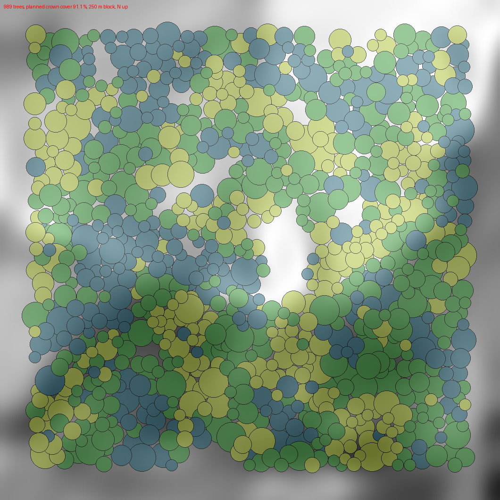
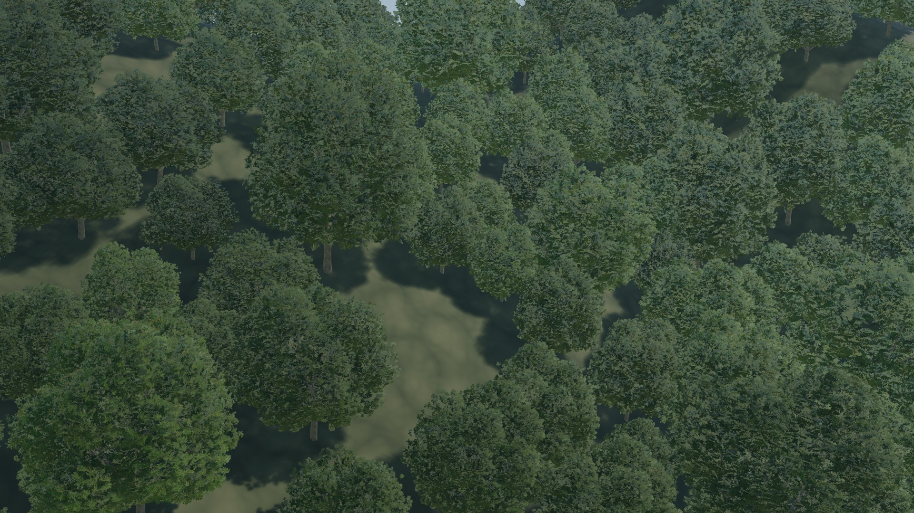
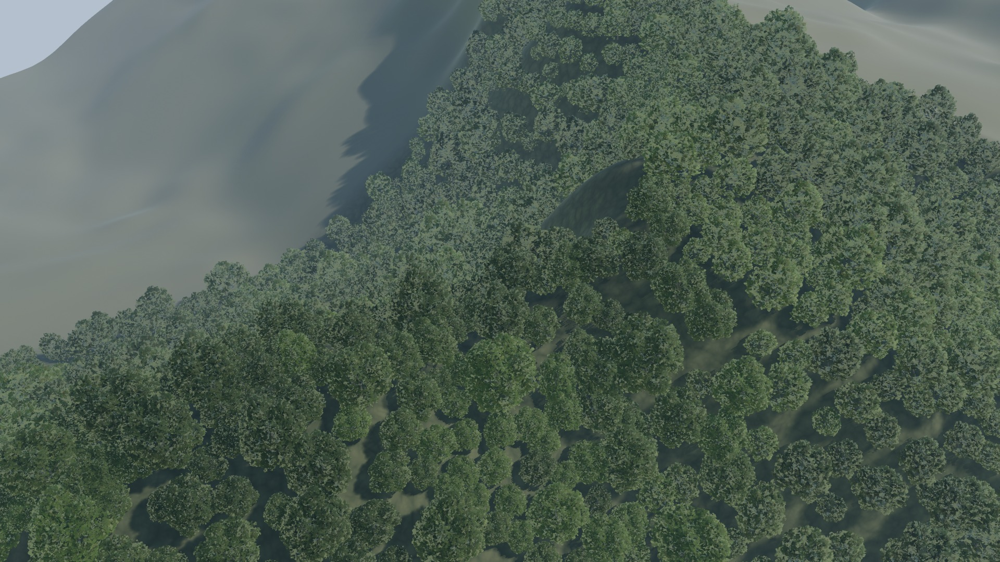
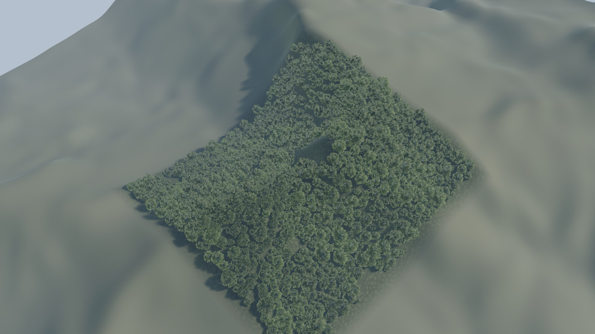
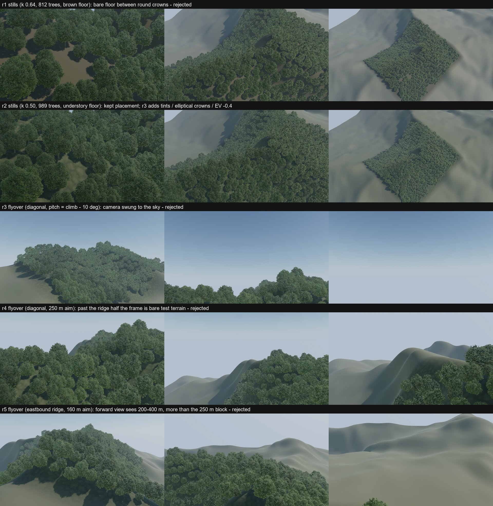

# Taiwan hillside forest look-dev v1 — 紅楠 D balanced on a Xiangshan (象山) slope, UE 5.8

Branch `lookdev/taiwan-hillside-forest-v1`, stacked on `research/forest-tree-lod-budget-v1` @ `52df3d5` (PR #31). Forest art look-dev, not a
performance study: one 250 m × 250 m hillside block, one tree asset, existing Unreal features only. PR #30 / #31 results and assets are kept
untouched (only referenced). No Xinyi / North Taiwan production content, no new species, no new LOD / impostor work, no renderer changes.

> Draft for visual review. Host everywhere: **Intel UHD 770 iGPU, UE 5.8, standalone `-game` 1080p** (no Nanite / Lumen / VSM; CSM shadows).

> **Follow-up: Forest Mix V0** (second 紅楠 crown form, A vs B on the same block) → `docs/research/taiwan-hillside-forest-mix-v0.md`.

**Core question:** can the current 紅楠 plus mature Unreal features make a patch of forest that, from the air, really reads as North Taiwan?

## 0. Short answer

**Partly.** From 200 m and 500 m AGL the block reads as a dense, closed broadleaf canopy draped over real Xiangshan relief: lumpy crown
texture, tone variation, gaps and shadows. At 500 m the far LOD (534 tris) does **not** dissolve. From 50 m AGL and in the low canopy pass
it reads as **a park of one tree species**: the same rounded dome repeats, the canopy has too little height layering, and it lacks the species
mix, the light/yellow-green crowns, the climbers and the shrub layer that make North Taiwan's low-elevation forest (楠榕林帶) look like
itself. The material and LOD pipeline worked (Masked foliage verified on disk and in native pixels; no visible LOD pop in the flyover by the
proxies used). What limits the look is **one asset / one silhouette**, not Unreal features. On the UHD 770 the block costs +100–165 ms GPU at 50–200 m AGL
and +19 ms at 500 m (exploratory; shadow depth ~40 % of it).

| question (brief §8) | finding (single reviewer's reading; images are the evidence) |
|---|---|
| canopy natural? | 200 / 500 m: yes, a convincing closed canopy with gaps. 50 m: crowns read as separate round domes, "planted" rather than wild. |
| obvious repetition? | 50 m: yes (one dome silhouette, the same card texture). 200 m: mild. 500 m: no, but spacing looks a little even. |
| dissolve at distance? | No. In-block canopy share of the frame 93 % / 90 % / 86 % at 50 / 200 / 500 m AGL; 94 % of trees at 500 m are on LOD3 and still read as crowns at native pixels. |
| LOD popping? | No step visible in native frame strips around the busiest calculated switch frames (≤ 8 trees switch in any frame); frame-level and tile-level difference proxies found **0** spikes over 745 calculated switches. I did not watch the clip in real time — **please judge `fly_r6.mp4`**. |

## 1. What was built

| item | choice | evidence |
|---|---|---|
| terrain | **real DTM**: MOI 2025 20 m bare-earth DTM (repo mirror `data/lookdev_cache/moi_2025_dtm_xinyi_mirror.tif`, the source already accepted in `docs/xinyi-terrain-v0-dtm-result.md`), local EPSG:3826 grid centred at 121.5752 E, 25.0268 N (象山 north-west flank + summit), bicubic to 2 m, 505 × 505 samples = 1,008 m, a real UE **Landscape** (8 × 8 components × 63 quads) | `tools/forest/hillside_terrain.py`, `terrain.json` |
| forest block | 250 m × 250 m centred on the grid; terrain 72–182 m a.s.l. inside it (the 象山 summit, 182 m, is 42 m south-east of the block centre), slope mean 33°, p90 52° | `terrain.json`, `scatter_map.png` |
| tree | 紅楠 **D balanced** (PR #31): LOD 34,272 / 14,806 / 2,018 / 534 triangles, screen sizes 1.0 / 0.5 / 0.15 / 0.06 — unchanged | `hf_verify.report.json` |
| instancing | 3 **HISM** components (one per leaf tint), 989 instances, no collision, shadows on | `hf_build.report.json` |
| variants | yaw, slope lean, size (XY 0.45–1.15), height / width ratio, mildly elliptical crowns, 3 leaf tints from **existing** `M_TL_LeafCards` parameters | §3 |
| stage | sun azimuth 140°, elevation 47° (mid-October ~10:30), sky atmosphere, captured sky light, light height fog (basin haze), manual exposure −0.4 EV, CSM to 1,200 m | `hf_build.report.json` |

The 20 m source cannot carry relief below ~20 m (the 六巨石 rocks, trail cuts, retaining walls): the slope is a smooth real-terrain envelope.
Outside the block the Landscape is a flat **placeholder** olive-grey: it is test terrain, deliberately not forest.

**Unreal features used / not used.** Landscape (via the repo's existing `XinyiLandscapeBridge` editor plugin, which only calls
`ALandscape::Import`), HISM, material instances, SkyAtmosphere / SkyLight / ExponentialHeightFog, Level Sequence + Movie Render Queue, CSV
profiler. **PCG was not used:** instance placement is a deterministic offline pass (§2) written into HISMs, so the rules are auditable,
deterministic (instances are bit-identical per seed; the r3, r4 and r6 rebuilds gave the same still metrics to 4 decimals, PNG bytes differ
slightly) and run headless without driving a PCG graph from editor Python.
Moving the same rules into a PCG graph (surface sampler + density filters from slope / TPI / noise + self-pruning) is straightforward and is
the natural next step once the look is accepted.

## 2. Placement rules (`tools/forest/hillside_scatter.py`, seed 20261016; all global, no per-tree edits)

* topography from the same quantised heightmap as the Landscape: slope, and a 30 m topographic position index (ridge > 0 / valley < 0);
* crown radius log-normal (median 5.6 m), ×1.15 valleys, ×0.85 ridges, ×0.88 on slopes > 35°, ±8 % with a 35 m cluster field, ~4 % emergent
  crowns 7–8.6 m;
* **gaps**: the lowest 8 % of a 16 m / 35 m noise score gets no tree (tree-fall / light gaps); slopes > 45° keep 45 % of candidates;
* **pass 1 (canopy trees)**: dart throwing in random order, centres ≥ k × (r_i + r_j) apart, k = 0.50 − 0.08 × cluster (crowns interlock
  40–60 %; clumps tighter);
* **pass 2 (canopy closure)**: any free hole wider than 3 m outside a gap gets a crown of 1.8 × its inscribed radius, until none is left;
* height = XY scale × U(1.0, 1.25) (×1.07 valley, ×0.93 ridge); X / Y scale ratio 0.82–1.22; yaw U(0, 360); downslope lean 0.12 × slope
  (≤ 6°) ± 2°; trunk base sunk 0.25 m + 0.35 m × tan(slope);
* the forest floor inside the block is a dark mottled green **understory proxy** (`M_HF_Ground`, a ground colour — no extra species).

| metric | value |
|---|---:|
| trees | **989** (697 canopy pass + 292 closure pass) = 158 / ha |
| crown width p10 / median / p90 | 6.8 / 9.4 / 14.0 m |
| tree height (est., 14.2 m × Z scale) p10 / median / p90 | 7.0 / 9.8 / 15.0 m |
| leaf tints V0 / V1 (lighter, yellower) / V2 (darker, bluer) | 396 / 299 / 294 |
| **planned crown cover** (union of nominal crown discs, 0.5 m raster) | **91.1 %** (designated gaps 7.9 %) |
| **rendered canopy share of the block in frame** (native, crowns + their shadows) 50 / 200 / 500 m AGL | **92.8 % / 90.3 % / 85.9 %** |
| nearest-neighbour distance mean / min | 6.2 / 3.3 m |
| Clark–Evans R | 1.56 (regular side; expected for interlocking canopy trees, no grid or rows visible) |



## 3. Variants (no new tree system)

Rotation, size, height/width, crown ellipticity and lean are instance transforms. Colour uses three `MaterialInstanceConstant`s of the
unchanged PR #30 `M_TL_LeafCards`, changing only existing parameters: V0 = parent; V1 `TintHi (1.34, 1.26, 0.80)`, `TintLo (0.90, 0.94,
0.70)`, `Brightness 0.50`; V2 `TintHi (0.98, 1.04, 1.00)`, `TintLo (0.66, 0.76, 0.78)`, `Brightness 0.34`. Tints follow a 25 m noise field
(+25 % random) so neighbouring crowns often share a tone.

## 4. Masked foliage material — persisted-setting validation (brief §5)

PR #31's first patch measurements drew the engine's grey default material because the ISM usage flag existed only in editor memory. This
round makes that failure impossible to miss, in three independent places:

1. **Build** (`hf_build.py`) re-asserts and **saves** `Used with Instanced Static Meshes` on `M_TL_LeafCards` / `M_TL_Bark` (both were
   already saved by PR #31: `flag_before = true`).
2. **Fresh-process gate** (`hf_verify.py`, separate `UnrealEditor-Cmd`, fail-closed; no renders run unless it passes): reads the assets
   from disk — leaf `BLEND_MASKED`, two-sided, two-sided-foliage shading, ISM usage saved; bark ISM usage saved; package not dirty after
   load. For **every** map that renders the forest (main, stills, flight, 3 perf maps): HF_Forest has 3 HISMs with the D mesh (4 LODs,
   1 / 0.5 / 0.15 / 0.06), slot 0 resolves to `M_TL_Bark`, slot 1 to an `MI_HF_Leaf_V*` whose base is the Masked `M_TL_LeafCards`, never a
   default / WorldGrid material; 989 instances; 32 sampled transforms equal `instances.json` (0.0 cm, 0.0 %); MIC overrides read back; the
   Landscape has 64 components and `M_HF_Ground`. After loading all maps (HISMs registered), **no material or forest package was dirtied** —
   a missing saved flag would have been set in memory there. Result r6: **PASS, 169 / 169 checks**.
3. **Native pixel guard** (`hillside_frames.py`, fails the run): tree pixels of the standalone `-game` MRQ frames (forest frame vs the same
   pose without the forest) must be green: median saturation ≥ 0.12 and ≥ 70 % hue 50–170°. r6: saturation 0.30 / 0.24 / 0.19, green
   share 94 / 90 / 76 % at 50 / 200 / 500 m → **PASS** (the grey default material gives saturation ≈ 0).

## 5. Native renders (brief §6)

All frames: Movie Render Queue, standalone `-game`, 1920×1080, deferred, 1 spatial / 1 temporal sample, no AA / LOD / cinematic overrides
(PR #31 recipe). Stills are the last frame of a 48-frame hold per pose (TAA / streaming settle). All stills look north-east (bearing 45°)
with the sun from the right.

| still | camera | trees in view on LOD0 / 1 / 2 / 3 (calculated) | triangles submitted (calc.) |
|---|---|---|---:|
| `still_agl50` | 50 m AGL, pitch −10°, inside the block's south-west part, looking up-slope toward the summit | 3 / 149 / 375 / 68 | 3.10 M |
| `still_agl200` | 200 m AGL, pitch −40°, 226 m from the block centre | 0 / 19 / 532 / 240 | 1.48 M |
| `still_agl500` | 500 m AGL, pitch −55°, 517 m from the block centre; the block fills 26 % of the frame | 0 / 0 / 53 / 930 | 0.60 M |





Native-pixel 640×360 centre crops: `crop_agl{50,200,500}.png`; tree / block masks used for the metrics: `mask_agl*.jpg` (green = forest
pixels, red = block ground not covered).

**Flyover** (`fly_r6.mp4`, clean 1080p60, H.264 crf 21 re-encode of the crf 16 master; `fly_r6_annotated_720p.mp4`, with frame / AGL /
calculated LOD mix / red bar on frames with ≥ 3 calculated switches; the 451 native PNG frames are not committed, they are regenerable): a 7.5 s canopy pass, eastbound along the summit ridge toward the 象山 peak, 40 m/s, 56–78 m AGL (70 m over a 250 m-smoothed ground
line), camera aimed 90 m ahead (pitch −20° … −35°). It starts just outside the block (bare slope in the foreground) and ends at the block's
east edge, where the placeholder terrain east of the summit becomes visible — a 250 m block cannot fill a forward view for longer. Three
earlier flight designs were rejected on their native frames (§8).

## 6. LOD distribution (calculated; brief §7)

Screen size = 3.08 × R / d (UE `ComputeBoundsScreenSize`, 60° hfov 16:9, R = 8.377 m × instance scale), trees inside the view frustum.
HISM selects LODs per cluster node, so the engine can differ near a threshold; these are **calculated**, not read from the engine.
*Corrected in the Mix V0 update:* the first revision scaled the bounds sphere by max(XY scale, Z scale), ignoring the elliptical X / Y
scales; UE uses the largest of X / Y / Z. Still counts moved by ≤ 8 trees per LOD (50 m was 1 / 144 / 378 / 71); the flyover row and the
findings are unchanged (the flyover numbers already used X / Y / Z).

| view | LOD0 (34 k) | LOD1 (14.8 k) | LOD2 (2.0 k) | LOD3 (534) |
|---|---:|---:|---:|---:|
| 50 m AGL still | 3 | 149 | 375 | 68 |
| 200 m AGL still | 0 | 19 | 532 | 240 |
| 500 m AGL still | 0 | 0 | 53 | 930 |
| flyover, mean over 451 frames | 0.4 | 97.9 | 325.6 | 67.9 |

The flyover has 745 calculated switches of in-view trees (99 frames with ≥ 3). LOD2 (2,018 tris) carries most of what a pilot sees from
50–200 m AGL; LOD0 is almost never on screen.

## 7. GPU cost — exploratory (brief §7; UHD 770, not a benchmark, no 60 fps target)

Same map pair per view (forest / forest removed), standalone `-game` 1080p, CSV profiler, fixed 60 fps step, 2 rounds with the order
reversed in round 2; still views: median over frames 60–209; flight: median and p95 over CSV rows 20–490 (whole pass). Δ = forest − empty
of the same round, mean [min..max] over the 2 rounds. Empty stage (terrain, sky, fog, SSAO) is 41–47 ms on its own on this iGPU.

| view | GPU forest (ms) | GPU empty (ms) | **Δ forest** | Prepass Δ | Basepass Δ | ShadowDepths Δ |
|---|---:|---:|---:|---:|---:|---:|
| 50 m AGL | 204.0 | 40.6 | **+163.5** [163.4..163.6] | +23.6 | +67.5 | +65.3 |
| 200 m AGL | 145.7 | 46.9 | **+98.8** [96.7..100.9] | +16.0 | +44.5 | +38.1 |
| 500 m AGL | 66.0 | 47.2 | **+18.8** [18.0..19.7] | (pass columns noisy at this view: ±5–10 ms between rounds) | | |
| flyover, median | 159.8 | 43.2 | **+116.7** [116.0..117.3] | | | |
| flyover, p95 | 199.5 | 46.6 | **+152.8** [151.1..154.5] | | | |

Reading (this host only; exploratory):

* ~1,000 masked-card trees at 50–200 m AGL cost **~100–165 ms** of GPU on the UHD 770 — the scene runs at ~5–7 fps there, ~15 fps at
  500 m. Per tree in view that is ~0.27 ms at 50 m (595 trees), ~0.13 ms at 200 m (791) and ~0.02 ms at 500 m (983); it is consistent in kind with PR #31's 100-tree patch (+34.8 ms at 150 m slant).
* **Shadow depth is ~40 %** of the forest cost at 50 / 200 m (+65 / +38 ms): 989 masked casters in 4 CSM cascades out to 1,200 m. Base pass
  (+68 / +45 ms, masked overdraw) is the other ~40 %. The obvious levers, not tried here: shorter / coarser far cascades or no far-tree shadow
  casting, and a cheaper mid LOD — exactly the PR #31 next steps (impostor / cut-out cards).
* At 500 m, where 94 % of trees are on the 534-triangle LOD3, the forest costs +19 ms: far LOD works for cost too.
* Triangles submitted (calculated): 3.10 M / 1.48 M / 0.60 M at 50 / 200 / 500 m.

## 8. Iterations and failures (kept visible)



* **r1** (k = 0.64, 812 trees, brown floor): native stills showed bare ground between separate round crowns (the D crown is a dome whose
  widest ring is well inside its nominal radius). → k = 0.50 + closure pass (989 trees) and the dark mottled understory floor (**r2**).
* **r3** added the three tints, elliptical crowns and −0.4 EV (from PR #31's −0.6 for the native stage) — the look reviewed here. r3, r4
  and r6 stills give the same metrics to 4 decimals (r5's frames were not analysed; its run was stopped for the flight change).
* **Flyover**: r3 (diagonal path, pitch = path climb − 10°) swung between −36° and +12° and filmed the sky; r4 (diagonal, aim 250 m ahead)
  and r5 (eastbound ridge, aim 160 m ahead) showed mostly the bare test terrain because a forward view at 50–90 m AGL reaches 200–400 m,
  more than the block. r6 (aim 90 m ahead, −20° … −50°) is the delivered clip. The r4 / r5 perf runs were stopped and discarded.
* UE 5.8 editor Python: `set_material_instance_*_parameter_value` returns `False` even when it applies the value (probe
  `hf_probe_params.py`); the build now verifies by reading values back. `get_outermost().is_dirty()` is not exposed; the gate uses
  `EditorLoadingAndSavingUtils.get_dirty_content_packages()`. The first r1 build attempt failed on this and its partial folder was deleted.
* UE exited `-1073741819` at shutdown after writing PASS receipts on several stages (as in PR #31); later stages re-verified the content.
* Pop proxies are blunt: a whole-frame and an 8 × 6-tile frame-difference spike detector (> 2× rolling median). Both found 0 events; their
  sensitivity to a single small crown switching was not calibrated. `flight_switch_strips.jpg` shows frames −2..+1 around the three busiest
  calculated switch frames (8, 8, 5 trees): no step is visible at that scale. Real-time viewing is left to the reviewer.
* The "rendered canopy share" counts crown **shadows** on the floor as forest (forest frame vs empty frame), so it slightly overstates
  crown cover, most at 50 m.

## 9. What would make it read as North Taiwan (next round — needs your call)

1. **More than one silhouette.** The repetition at 50 m is the dome shape, not the placement. Even two more broadleaf crown forms
   (flat-topped 樟 / 相思樹-like, tall narrow 江某-like) or a second 紅楠 seed would break it; this round was not allowed to add species.
2. **Height layering and a shrub layer**: a few hundred sapling-scale instances under gaps / edges, or a cheap understory card layer,
   instead of the ground colour.
3. **Colour**: North Taiwan canopies in sun are more saturated and more varied (yellow-green new flush of 紅楠 / 樟, dark 榕); the leaf
   cards also show PR #31's pale blue-grey sheen on enlarged cards at 200 m — a material task.
4. **A bigger block or a far canopy layer** so the 500 m view and the flyover are not framed by placeholder terrain.
5. Port the §2 rules to a PCG graph once the look is accepted.

## 10. Reproduce

```powershell
$py = "D:\Users\EDDY\.venvs\acw-xinyi\Scripts\python.exe"
# offline: terrain (RAW16 + metadata), placement, camera poses / calculated LOD mix
& $py tools/forest/hillside_terrain.py out/forest/hillside
& $py tools/forest/hillside_scatter.py out/forest/hillside
& $py tools/forest/hillside_views.py out/forest/hillside
# UE 5.8 (needs PR #31's TreeLookdev Content - Materials, Textures, Meshes, Budget/D - and the prebuilt XinyiLandscapeBridge plugin copied
# into unreal/TreeLookdev/Plugins/ ; both are gitignored): build -> fresh-process gate -> MRQ configs -> native renders
./tools/forest/run_hf_all.ps1 -Rev r6
& $py tools/forest/hillside_frames.py out/forest/hillside unreal/TreeLookdev/Saved/TreeLookdev/hillside/movies r6 out/forest/hillside/evidence_r6
./tools/forest/run_hf_perf.ps1 -Rev r6 -Prefix p3 -Rounds 2
& $py tools/forest/hillside_perf.py unreal/TreeLookdev/Saved/TreeLookdev/hillside/perf p3 out/forest/hillside/evidence_r6/perf_p3.json
```

New code: `tools/forest/` (terrain, scatter, views, frames, perf, run scripts), `adapters/unreal/treelookdev/hf_*.py`.
`unreal/TreeLookdev/.gitignore` adds `Plugins/`. No PR #30 / #31 file changed. Evidence: `docs/evidence/forest/hillside_v1/`.
