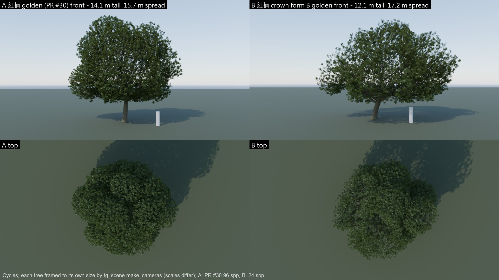
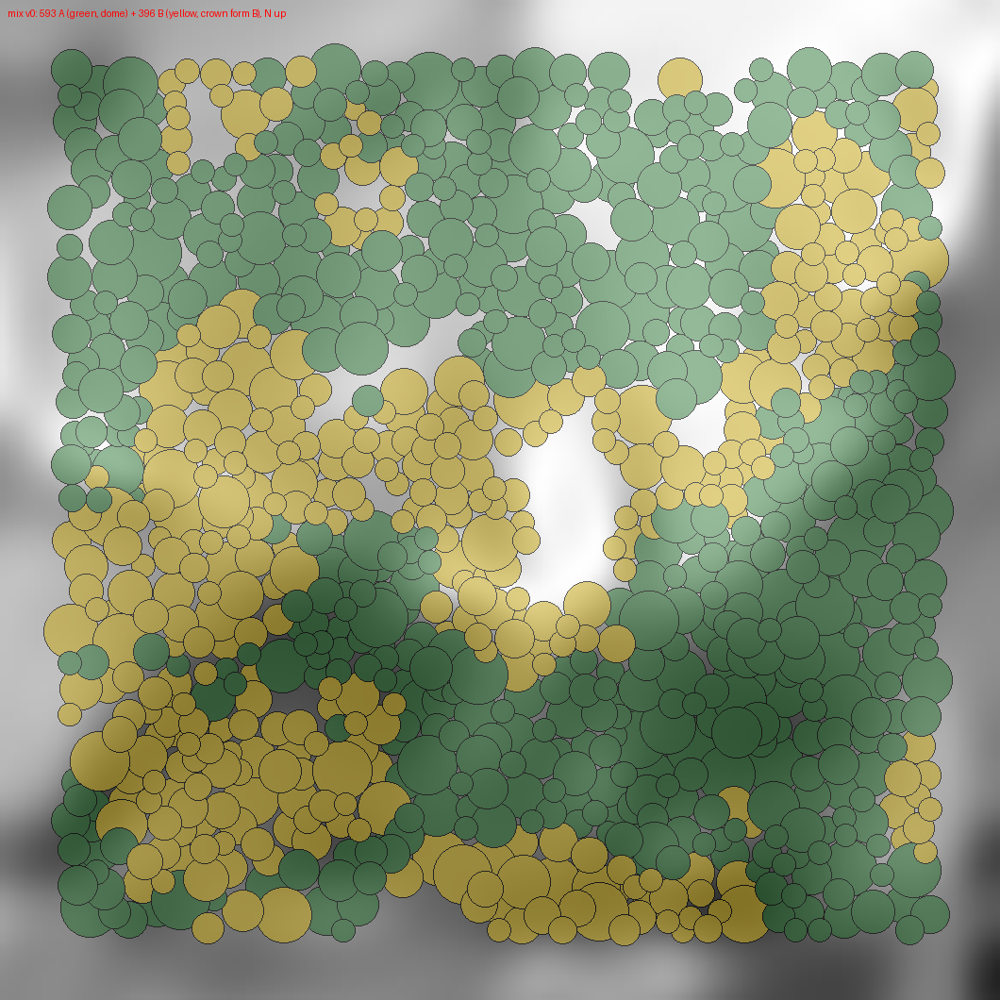
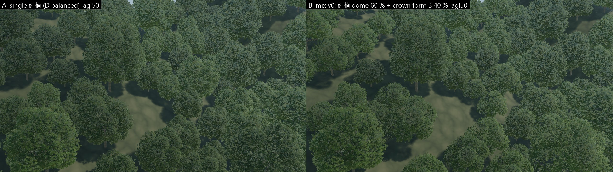
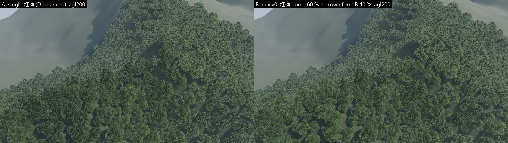
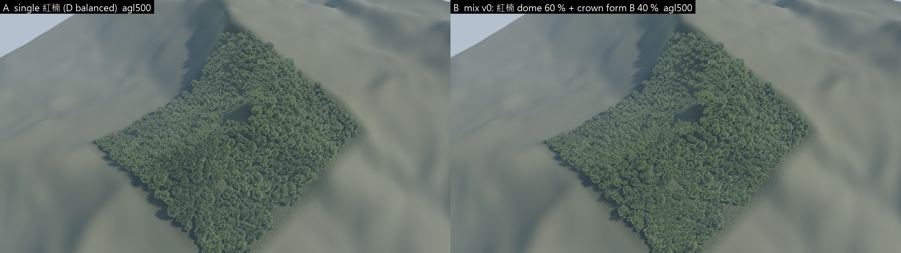

# Taiwan hillside forest — Forest Mix V0 (two 紅楠 crown forms), UE 5.8

> **Follow-up: low-precision tolerance test** (Mix D vs Mix C: form A on PR #31's aggressive C LOD) → `taiwan-hillside-forest-lod-tolerance-v0.md`.

Follow-up to `docs/research/taiwan-hillside-forest-lookdev-v1.md` on the same branch / Draft PR. Same 象山 250 m × 250 m block, same
terrain, stage, cameras, flight and render settings. No scene enlargement, no third tree, no forest-system refactor, no production map.

> Draft for visual review. Host: **Intel UHD 770 iGPU, UE 5.8, standalone `-game` 1080p**. GPU numbers are exploratory.

**Question:** does adding a second crown form make the hillside forest clearly more natural / more North-Taiwan than single 紅楠, and does it
make a cheaper tree version acceptable?

## 0. Short answer

**A modest, real improvement — not a transformation.**

* **What improved:** the mix breaks the single-dome rhythm. Flatter, broader, lopsided crowns now sit on ridges, steep faces and gap edges.
  Lighter yellow-green stands read as patches, and B's lower crowns (median 7.7 m vs 10.3 m) add some height layering. This is most
  visible at 50 m AGL and in the flyover; at 200 m it mostly reads as **tone patches**; at 500 m the two versions are hard to tell apart.
* **What did not change:** both forms use the same leaf-card atlas, bark and material. At native pixels the *leaf texture* still reads as
  one species, which is now the dominant "sameness" cue at 50 m. A second **leaf material / atlas** (not more geometry) would be the next
  lever; this round did not allow a new species.
* **Cheaper tree:** crown B is 16–22 % lighter per LOD (28,850 / 11,500 / 1,598 / 470 tris vs 34,272 / 14,806 / 2,018 / 534), and its
  looser crown does not stand out as "degraded" inside the mix. Mixing it in at 40 % cut forest GPU time by **13 % at 50 m, 9 % at
  200 m, 15 % at 500 m and 9 % in the flyover (p95 −12 %)** with no visible loss to me. That supports "variety lowers sensitivity to
  per-tree detail" in this one test, but it is a single reviewer's reading, not a blind comparison.

| review point | A (single 紅楠, PR #33 r6) | B (mix v0) |
|---|---|---|
| crown shape variety | one rounded dome everywhere | dome + flatter / broader / lopsided crowns, oriented downslope |
| tone | 3 tints, evenly spread | + a lighter yellow-green family in stands (ridges, gap edges) |
| height layering | median 10.3 m | A 10.3 m / B 7.7 m median |
| reads as random noise? | — | no: B forms 20–80 m stands with mixed edges (`mix_map.png`) |
| distance dissolve | none (86 % in-block canopy share at 500 m) | none (85 %) |
| LOD pop proxies (frame / tile) | 0 / 0 | 0 / 0 (I did not watch the clips in real time — please judge `fly_AvsB.mp4`) |

## 1. The second tree — 紅楠 crown form B (option 1 of the brief)

Same species, same pipeline, parameters only (`tools/treegen/params/machilus_crown_b.json`, applied through a new opt-in
`ACW_TG_PARAMS` override in `tools/treegen/machilus_thunbergii.py`; unset = PR #30 golden, unchanged, golden sha256 `510F8D10…` re-checked):
lower fork (2.1 m), 4 spreading limbs (20–44°), leaning trunk, a wider, flatter, lopsided crown envelope (r_xy 8.8 / 7.0 m, top 6.6 m,
azimuthal asymmetry 0.22 / 0.12), 14 larger foliage lobes, fewer interior sprays (looser, deeper gaps).

| | A: 紅楠 (PR #30 / #31, D balanced) | B: 紅楠 crown form B (D-balanced recipe) |
|---|---:|---:|
| golden height × spread | 14.1 × 15.7 m | 12.1 × 17.2 m |
| golden sprays / triangles | 15,456 / 20.2 M | 11,758 / 14.6 M |
| **game LOD0 / 1 / 2 / 3 triangles** | 34,272 / 14,806 / 2,018 / 534 | **28,850 / 11,500 / 1,598 / 470** |
| vertices LOD0 / 1 / 2 / 3 | 55,437 / 26,224 / 3,814 / 846 | 43,922 / 20,099 / 2,941 / 685 |
| LOD screen sizes | 1.0 / 0.5 / 0.15 / 0.06 | 1.0 / 0.5 / 0.15 / 0.06 (same policy) |
| mesh memory (verts × 32 B + tris × 12 B) | 3.39 MB | 2.67 MB |
| textures / materials | atlas + bark, `M_TL_LeafCards` / `M_TL_Bark` | **shared** (0 new textures); 2 extra MICs of the same leaf material |

Game LODs: `tools/treegen/machilus_game.py` profile `balanced` with the PR #30 atlas frames reused (`ACW_TL_REUSE_BAKE`), so no re-bake and
no new texture; imported by `adapters/unreal/treelookdev/hf_import_crown_b.py` (Nanite off, 4 LODs, same slots / screens).



## 2. The mix (`tools/forest/hillside_mix.py`; A stays `instances.json`, B is `instances_mix.json`)

Every tree keeps A's canopy footprint (crown centre, radius); **40 %** become crown form B, chosen by an ecological score, not per tree at
random: 0.55 × a 30 m clump field + 0.25 × ridge (TPI) + 0.20 × slope + 0.35 × next to a real opening (+ small jitter). B trunks are placed so
the lopsided crown sits over A's footprint, turned downslope (± 25°); B's height is scaled ×1.05–1.30 of its crown scale, so at equal
footprint it stands ~25 % lower. B uses two lighter / yellower tints of the same leaf material (V3, V4).

| | value |
|---|---:|
| trees total | **989** (unchanged) |
| A 紅楠 dome / B crown form | **593 / 396 = 60 % / 40 %** |
| tints A V0 / V1 / V2 / B V3 / V4 | 249 / 191 / 153 / 247 / 149 |
| B share on ridges (TPI > 2) / slopes > 35° / next to gaps | 42 % / 59 % / 22 % (A: 28 % / 24 % / 8 %) |
| median height A / B (est.) | 10.3 / 7.7 m |
| HISMs | 5 (form × tint) |



## 3. Native renders (A left / B right; same cameras, same settings as PR #33 r6)





Native-pixel crops side by side: `ab_crop_agl{50,200,500}.png`; full-size B stills: `still_B_agl*.jpg`; flyover frames 90 / 180 / 270 /
360 (A top, B bottom): `ab_flight.jpg`. Videos: **`fly_AvsB.mp4`** (A | B side by side, 2 × 1280×720, 60 fps) and `fly_m1.mp4` (B alone,
1080p60). Same 7.5 s canopy pass as PR #33.

Persisted-material gate for B (fresh process, fail-closed): **PASS 243 / 243** — 5 HISMs, D mesh for form A (593) and crown-B mesh for form
B (396), every leaf slot a MIC of the Masked `M_TL_LeafCards`, no default material, no material package dirtied after loading all maps.
Native pixel guard: PASS (tree-pixel saturation 0.30 / 0.25 / 0.20 at 50 / 200 / 500 m).

| metric (native) | A 50 / 200 / 500 m | B 50 / 200 / 500 m |
|---|---|---|
| canopy share of the block in frame (crowns + shadows) | 92.8 / 90.3 / 85.9 % | 89.8 / 89.1 / 84.9 % |
| tree-pixel median saturation / value | 0.30 / 0.24 / 0.19 · 0.28 / 0.32 / 0.37 | 0.30 / 0.25 / 0.20 · 0.29 / 0.33 / 0.38 |

B's crowns are looser by design, so 1–3 points less canopy share; B is very slightly brighter.

## 4. LOD distribution (calculated, trees in view; HISM selects per cluster node)

| view | A: LOD0 / 1 / 2 / 3 | B mix: form A + form B | triangles A → B |
|---|---|---|---:|
| 50 m AGL | 3 / 149 / 375 / 68 | 2 / 83 / 251 / 42 + 1 / 69 / 127 / 25 | 3.10 M → 2.86 M (−8 %) |
| 200 m AGL | 0 / 19 / 532 / 240 | 0 / 9 / 346 / 157 + 0 / 13 / 193 / 77 | 1.48 M → 1.41 M (−5 %) |
| 500 m AGL | 0 / 0 / 53 / 930 | 0 / 0 / 28 / 559 + 0 / 0 / 24 / 372 | 0.60 M → 0.57 M (−6 %) |
| flyover, mean | 0.4 / 97.9 / 325.6 / 67.9 | 0.5 / 100.7 / 326.6 / 65.4 (both forms) | |

## 5. GPU cost — exploratory (UHD 770; empty / A / B interleaved in one session, order reversed in round 2; 2 rounds)

| view | GPU empty | GPU A | GPU B | **A − empty** | **B − empty** | **B − A** |
|---|---:|---:|---:|---:|---:|---:|
| 50 m AGL | 41.9 | 206.4 | 184.6 | +164.5 [163.8..165.2] | +142.7 [142.6..142.7] | **−21.8 (−13 %)** |
| 200 m AGL | 46.0 | 143.1 | 134.1 | +97.2 [96.8..97.6] | +88.1 [87.3..88.9] | **−9.1 (−9 %)** |
| 500 m AGL | 45.8 | 65.8 | 62.9 | +20.1 [19.7..20.4] | +17.1 [16.4..17.9] | **−2.9 (−15 %)** |
| flyover median | 42.5 | 159.8 | 149.3 | +117.3 [116.4..118.2] | +106.7 [105.2..108.2] | **−10.6 (−9 %)** |
| flyover p95 | 45.7 | 197.7 | 179.4 | +152.0 | +133.8 | **−18.2 (−12 %)** |

ms, medians (stills: frames 60–209; flyover: rows 20–490). A's numbers reproduce PR #33's separate run within 1.7 ms. At 200 m (the one
view whose per-pass columns were stable in both rounds) B saves 4.4 ms shadow depth, 3.9 ms base pass, 1.3 ms prepass. The saving (9–15 %)
is larger than the calculated triangle saving (5–8 %): crown B also has fewer, looser cards (less masked overdraw and fewer shadow casters).
Still ~5–7 fps at 50–200 m on this iGPU — no 60 fps target this round.

## 6. Reading, limits, next step

* The mix answers "does a second crown form help?" with **yes, modestly**, mainly through tone stands and silhouette variety at low altitude.
  The leaf texture / material is now the strongest remaining sameness cue; geometry is not.
* "Cheaper tree acceptable?" — in this test, yes: 40 % of the forest on a 16–22 % lighter tree costs 9–15 % less GPU without a visible
  loss to me. A blind A/B review and other views would be needed before generalising.
* Limits: one block, one sun, one seed; same atlas for both forms; the B tint family is a choice, not measured colour; LOD counts are
  calculated; perf is 2 rounds on one iGPU; pop proxies are blunt (0 events in both) and the clips were not watched in real time by me.
* **Smallest next step (needs your call):** keep form B, add a second leaf atlas / material variant (darker, glossier, larger-leaf
  broadleaf look) for one of the two forms — still "two trees", no third — and re-run this same A/B.

## 7. Reproduce

```powershell
$py = "D:\Users\EDDY\.venvs\acw-xinyi\Scripts\python.exe"; $b = "C:\Program Files\Blender Foundation\Blender 5.2\blender.exe"
$env:ACW_TG_PARAMS = "$PWD\tools\treegen\params\machilus_crown_b.json"
& $b -b --factory-startup -noaudio --python tools/treegen/machilus_thunbergii.py -- out/treegen/machilus_b --tag v1 --no-render
# atlas frames reused from the PR #30 game output: copy <machilus_game>/bake/frames.json to out/treegen/machilus_b_game/bake/
$env:ACW_TL_PROFILE = "balanced"; $env:ACW_TL_REUSE_BAKE = "1"
& $b -b --factory-startup -noaudio --python tools/treegen/machilus_game.py -- out/treegen/machilus_b/v1_machilus_thunbergii.blend out/treegen/machilus_b_game
Remove-Item Env:ACW_TG_PARAMS, Env:ACW_TL_PROFILE, Env:ACW_TL_REUSE_BAKE
./tools/treegen/run_tl.ps1 -Script hf_import_crown_b.py -Name hf_import_crown_b -Env @{ACW_HF_CROWN_B_GAME="$PWD\out\treegen\machilus_b_game"} -Expect hf_import_crown_b.report.json
& $py tools/forest/hillside_mix.py out/forest/hillside
& $py tools/forest/hillside_views.py out/forest/hillside instances_mix.json views_mix.json
./tools/forest/run_hf_all.ps1 -Rev m1 -Instances instances_mix.json
& $py tools/forest/hillside_frames.py out/forest/hillside unreal/TreeLookdev/Saved/TreeLookdev/hillside/movies m1 out/forest/hillside/evidence_m1 views_mix.json instances_mix.json
& $py tools/forest/hillside_ab_sheets.py out/forest/hillside/evidence_r6 out/forest/hillside/evidence_m1 unreal/TreeLookdev/Saved/TreeLookdev/hillside/movies r6 m1 out/forest/hillside/evidence_ab
./tools/forest/run_hf_perf.ps1 -Rev r6 -MixRev m1 -Prefix p4 -Rounds 2
& $py tools/forest/hillside_perf.py unreal/TreeLookdev/Saved/TreeLookdev/hillside/perf p4 out/forest/hillside/evidence_ab/perf_p4.json
```

Changes this round: `tools/treegen/machilus_thunbergii.py` (opt-in `ACW_TG_PARAMS`, default path unchanged), `tools/treegen/params/`,
`tools/forest/hillside_mix.py`, `hillside_ab_sheets.py`, instance-file / mix options in `hillside_views.py`, `hillside_frames.py`,
`hillside_perf.py`, `run_hf_all.ps1`, `run_hf_perf.ps1`, two-form support in `hf_build.py` / `hf_verify.py` (A builds exactly as before),
`hf_import_crown_b.py`. The A baseline maps (`/Game/HillsideForest/r6`) and its evidence are untouched; the A LOD table in the v1 doc was
corrected (§6 there). Evidence: `docs/evidence/forest/hillside_v1/mix_v0/`.
