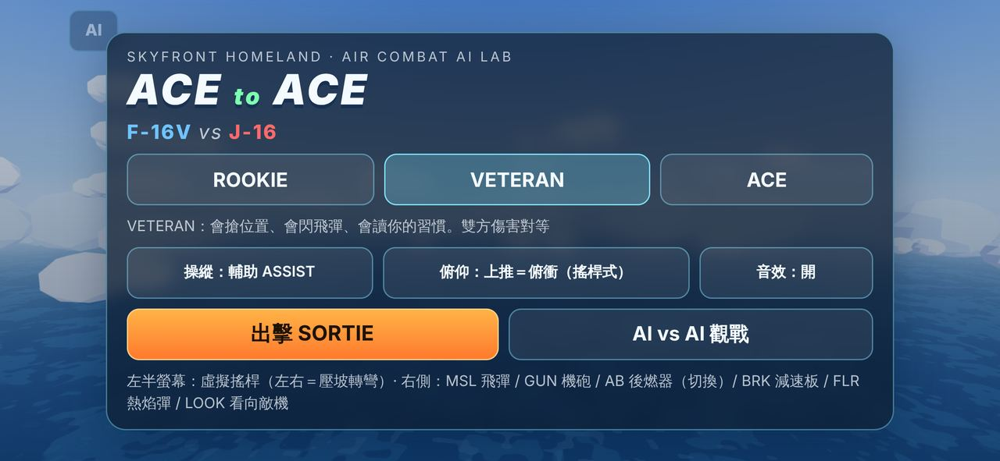

# Ace to Ace — 1v1 arcade air-combat AI lab (browser prototype)

Skyfront Homeland 的第一個可玩入口（Issue #34）。一片海、一片天、F-16V 對 J-16。
目標是驗證「飛行員 AI 本身好不好玩」，不是美術或擬真度。

- **真 3D**：低多邊形、cel / toon shading、inverted-hull 描邊；機型輪廓可辨識但非精確建模。
- **街機空戰**：能量制飛行模型（轉彎速率在角速度峰值、拉 G 掉速、爬升換高度），簡化的飛彈 / 機砲 / 熱焰彈。
- **AI 完全本機**：傳統遊戲 AI（狀態評估 + 戰術模式 + 機動控制器），runtime 無 LLM、無網路。
- 與 `unreal/`、`cities/`、`tools/`（城市管線）完全隔離；本目錄不依賴也不修改它們。



## 啟動

不需要建置步驟（three.js r180 已 vendored 在 `vendor/`）。任何靜態伺服器即可：

```bash
cd prototypes/ace-to-ace
python3 -m http.server 8080        # 或 npx serve .
# 桌面：http://localhost:8080
# iPhone：同一個 Wi-Fi 下開 http://<電腦的區網 IP>:8080 （Safari，橫向）
```

URL 參數（開發用）：`?debug`（AI 狀態面板）、`?mode=aivai`（直接觀戰）、`?mode=pvai`、
`?skill=rookie|veteran|ace`、`?seed=N`（可重現的開局）、`?autopilot=chaser`（自動駕駛玩家機，煙霧測試用）。

## 操作

| | 觸控（iPhone，橫向） | 鍵盤 |
|---|---|---|
| 轉彎 / 俯仰 | 左半螢幕浮動搖桿 | 方向鍵 |
| 後燃器 | `AB`（切換） | `W`（按住） |
| 減速板 | `BRK`（按住） | `S` |
| 飛彈 / 機砲 | `MSL` / `GUN`（按住） | `Space` / `Shift` 或 `F` |
| 熱焰彈 | `FLR` | `Q` |
| 看向敵機 | `LOOK`（按住） | `E` |
| AI 狀態面板 | `AI` | `Tab` / `` ` `` |
| 暫停 / 再戰 | `II` / 結算畫面按鈕 | `Esc` / `Enter` |

**ASSIST（預設）**：搖桿左右＝要求「轉彎 G」，坡度由 G 自動解出（bank = acos(1/n)），所以
全力轉彎會維持水平、不會變成爬升迴圈把自己拉到失速；先滾轉再拉；**手指放開保持最後搖桿量，不會自動回中**；重新觸碰可接續微調，手動將搖桿回中才自動改平；
低速自動後燃器。搖桿置中時上下就是純俯仰（翻筋斗、俯衝都還是你的）。
**MANUAL**：搖桿直接是滾轉率與俯仰。俯仰方向可在標題畫面切換（預設搖桿式：上推＝俯衝）。

## 規則（為街機節奏調整，非真實性能）

- HP 100；飛彈 50–75 傷害（兩發必死）、機砲 4/發；熱焰彈 2 組，25 秒回充 1 組。
- 飛彈 12 枚、左右掛架各 5 秒裝填；鎖定需目標在機頭 30° 內 0.85 秒；最小射程約 450 m。
- 飛彈有自動駕駛延遲：**在約 2–3 秒前用最大 G 側向急轉**可以甩掉；太晚或速度太低會被追上。
- 5 分鐘時限：依剩餘 HP 判定；同分則「Sudden Death」（下一次命中定勝負，再 60 秒仍無則平手）。
- 戰區半徑 12 km、升限 10 km；出界 12 秒判負。墜海即損失。
- 難度只改「AI 飛行員的品質」，飛機、物理、武器完全相同；另依街機慣例，ROOKIE 時玩家受到的傷害 ×0.75。

## 架構

```
src/sim/   飛行模型、武器、規則、射控輔助（純 JS，無 three.js，Node 可跑）
src/ai/    飛行員 AI、無線電台詞、測試用 bot（含 human proxy）
src/game/  three.js 渲染、模型、HUD、輸入、音效、主迴圈
tools/     aivai.mjs（無頭 AI 對戰與校準）、browser-check.mjs（Playwright 實機畫面檢查）、model-viewer.html
```

AI 輸出與玩家完全相同的控制量（俯仰 / 滾轉 / 方向舵 / 油門 / 武器），經過同一個 `stepAircraft()`；
它不能做出玩家做不到的機動。模擬以 60 Hz 固定步長、種子化亂數執行，AI vs AI 可完全重現。
決策層（`ai/`）與飛行 / 武器規則（`sim/`）及渲染輸入（`game/`）分離，未來移植到 Unreal 時可以照搬設計與參數。

## 飛行員 AI

`src/ai/pilot.js`，分四層：

1. **感知**：看到的是 0.26–0.6 秒前的對手（依難度）再做航位推算；用 RWR/MAWS 規則得知被鎖定與來襲飛彈。
   不讀取玩家輸入。
2. **態勢評估**：距離、ATA（我的機頭對它）、aspect（我是否在它六點）、它對我的 ATA、接近率、
   比能量差（高度 + 速度²/2g）、飛彈威脅（含「這枚飛彈還追得到我嗎」的動能判斷）。
3. **戰術模式**（優先序 + 最短停留 + 兩票遲滯，避免抖動）：
   - `ENGAGE` 遠距佈局：偏置接近準備 lead turn、能量不足時爬升、搶高度優勢；對頭時會先開一發「逼迫彈」。
   - `ATTACK` 追擊：遠距 lead pursuit、近距機砲提前量追蹤（含前饋控制）、接近率過高改 lag + high yo-yo、
     能量不足 low yo-yo / 卸載加速。
   - `DEFEND` 被咬：向攻擊者急轉、近距減速板逼對手衝過頭再反咬、機砲範圍內 jink、能量大時拉垂直。
   - `EVADE` 飛彈：遠時 beam / crank、2–3 秒內最後急轉、依難度時機放熱焰彈；有鎖定時「回敬一發」。
   - `EXTEND` 脫離重整：卸載、後燃、俯衝加速，拉開後**一定回頭**再接戰（有時間上限與冷卻）。
4. **機動控制器**：把「想往哪個方向飛、用多少 G」轉成升力向量控制（先滾轉、再拉、重力補償、
   G 受限時保留重力補償、目標角速度前饋），輸出與玩家相同的搖桿量。

**防無限繞圈**：偵測 12 秒內雙方持續高 G 迴轉、沒有任何傷害進展、角度優勢沒變化，或「領先角度但從未把機頭對上」
→ 啟動破局：高 yo-yo（爬出迴圈平面再翻轉俯衝到提前點）、剪刀反轉、或脫離重整後重新對頭。45 秒內連續失敗就升級為重整。

**防避戰**：`aggression` 會隨「很久沒開火」「距離太遠」上升；高時不再脫離、降低開火門檻、會打牽制彈；
被命中時暫時變謹慎。重整只能是重整：有時間上限、回頭條件，且被對手機頭指著時會中止。

**讀你的習慣**：AI 觀察自己的飛彈接近你時你有沒有在閃（高 G 或熱焰彈），更新「閃避指數」，調整它的開火門檻；
結算畫面會告訴你它對你的判讀。

**讓玩家看得懂**：戰術轉換會觸發攔截到的敵方無線電（預寫台詞，有冷卻）；`AI` 面板顯示模式、機動名稱、
決策理由、ATA / aspect / 能量差 / Pk / 侵略性與最近的決策紀錄。

**難度**：ROOKIE / VETERAN / ACE 只改反應時間、G 使用率、瞄準誤差、射擊紀律、閃避時機，
以及「會不會用進階戰術」的機率（逼迫彈、回敬、lag / yo-yo、破局選擇、減速反咬、飛彈動能判斷）。

## 測試

```bash
node tools/aivai.mjs --suite --n 100 --write docs/aivai-report.json   # 無頭對戰與校準（約數分鐘）
node tools/aivai.mjs --n 40 --blue human --red veteran --verbose        # 單一組合 + 決策紀錄
node tools/browser-check.mjs                                             # Chromium 實際啟動遊戲並截圖
```

- **AI vs AI**：同一套 AI 對打（正面開局 / 隨機幾何 / 交換機型）、ACE vs ROOKIE 技術梯度、
  直飛靶機與最大 G 繞圈靶機（必須擊落）、兩種壓迫型追擊 bot。統計勝率、時間、飛彈命中率、
  **繞圈秒數**（雙方 >3G、200–2500 m、20 秒無開火）、**>5 km 避戰秒數**、最長無開火時間、先開火者勝率、擊墜機會窗。
- **Human proxy**：走真正的玩家輸入路徑（`PlayerController` + ASSIST），只用 HUD 可見資訊（目標框方向、鎖定、
  SHOOT 提示、MISSILE 警告），有反應延遲、拇指漂移（OU 雜訊）與常見習慣。它是玩家模型，不是玩家。
- **瀏覽器**：桌面 1280×720 與 iPhone 13 mini 尺寸（812×375、觸控事件）各跑一次：標題、自動駕駛對戰、
  鍵盤操作、觸控搖桿與按鈕、AI 觀戰、擊墜鏡頭、結算與 `Enter` 再戰；收集 console 錯誤與 draw call 數。

最新結果見 [`docs/aivai-report.json`](docs/aivai-report.json) 與 PR 說明。
