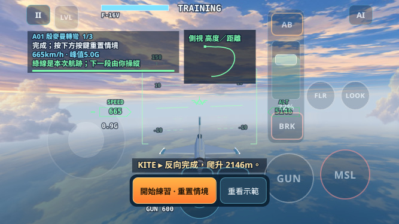
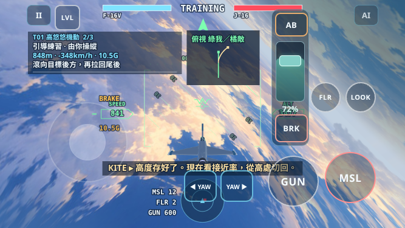
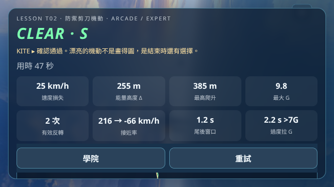

# Advanced Flight Academy MVP

基線：2026-10-24 確認的 `main@3368c55ba967e8386e0ba8114b6b77f718981970`。獨立分支 `feat/ace-advanced-academy-mvp`。僅變更瀏覽器原型及其 CI；L01–L10 通關條件、物理、PlayerController、AI／武器性能皆保留。

## 怎麼玩

在 `prototypes/ace-to-ace` 執行 `npm start`，以手機橫向開啟 `/`，選「飛行學院」下方進階訓練。也可用 `?lesson=A01&mode=arcade&control=expert` 直接開簡報。

三課都是 **Briefing → Demonstration → Guided Practice → Challenge → Debrief**。示範期間由 KITE 操縱同一套物理模型；手指不能替示範機操縱。示範與練習成功後凍結情境，玩家可看航跡、重看示範，或按明確標示「重置情境」的按鍵交棒。練習成功不等於通關；Challenge 必須親手再做一次，僅保留狀態讀數與低能量警告。重試直接回示範，不重播簡報。

- **A01 殷麥曼**：半筋斗、經過向上垂直姿態、倒飛反向，之後至少 140° 實際身體軸滾轉；最後反向 ±15°、坡度 <12°、航跡角 <7°、速度 >396 km/h，穩住 1 秒；爬升至少 600m。水平繞圈、漏做半滾轉均不能過。
- **T01 高悠悠**：初始接近率約 324km/h。先爬升至少 250m，有 ≥0.5 秒低於4.5G 的爬升，再取得尾後 80–1400m、ATA<18°、偏離機尾<50°、接近率 ±126km/h、速度 ≥360km/h 的連續1.2秒窗口。射擊本身不算通關；不良窗口持續開火2秒叫停。
- **T02 防禦剪刀**：從650m尾隨開始；至少兩次經過平翼、方向相反且新方向航向移動≥8°的實際坡度反轉；追兵需穿越起始航向前方且當時在玩家前半球，距離<1500m。之後取得尾後1.2秒窗口（ATA<30°、其餘同T01），或帶≥540km/h速度拉開>1.8km、追兵機頭偏離>60°、持續拉開2秒。只存活或一直同向拉 G 無法通過。

綠線是實測玩家航跡，橘線是敵機；A01 使用側視，其餘俯視。結算保留本次數據與簡化航跡摘要，沒有新增完整 Tactical Replay。每段最多400個取樣，0.2秒間隔；只畫Canvas線條，不新增3D資產。

## 實際手機畫面

以下為Chromium 667×375 CSS px、模擬安全區；正常輸入學生驅動原本的Input／PlayerController後暫停檢視，非Safari實機、非美術合成。完整瀏覽器驗收另使用真實時間主迴圈與觸控事件。







## 可行性與四模式結果

下表是固定訓練情境的正常輸入學生，時間為 **Challenge 模擬秒數**，不含示範／練習與閱讀停留。完整每例結果在 [Node evidence](evidence/advanced-academy/node-results.json)。

| 課程 | Arcade Assisted | Arcade Expert | Tactical Assisted | Tactical Expert |
|---|---:|---:|---:|---:|
| A01 | 封鎖：改用 Expert | 23.68s | 封鎖：改用 Expert | 22.52s |
| T01 | 41.00s | 10.58s | 40.15s | 10.73s |
| T02 | 13.78s | 15.62s | 14.05s | 14.95s |

`probe-advanced.mjs` 保留前置探測，**不是正式通關測試**。原始過頂操作在 Expert 約22–23秒完成，約5G、爬升1.8–2.1km；相同輸入在 Assisted 65秒仍未形成倒飛反向，後續落入低能量。原因是 Assisted 的近垂直直接控制在回到60°以下時交回自動改平。A01 簡報說明限制，提供明確的 Expert 切換按鍵；Session 層也阻擋不相容模式，沒有暗中代滾。

T01 的 Assisted 是協調轉彎近似：先拉起，再側推與前推修低航跡，不能把 Expert 的升力向量操控說明直接照搬。學生爬升約1.2km，Expert 約0.5km；時間與耗能差異如實保留，不補推力、不降低標準。兩者共享同一通關窗口。

T02 前置探測曾使用完整 Rookie PilotAI；其後續戰術容易把第一堂剪刀課帶入其他機動。MVP 改用 repo 既有 **ChaserBot 純追擊**（既有感知延遲／升力控制、正常物理，僅在本課關閉武器）。這是刻意過度追擊的教學對手，不能推論同一操作能擊敗 Veteran／Ace。反咬是攻防位置改善，30° ATA 不代表已取得機砲命中解。

## 原理、模型與規則的界線

| 層次 | 本次教學 |
|---|---|
| 真實原理 | 垂直機動交換速度／高度；升力方向與 G 影響路徑；Yo-Yo 管理接近率；剪刀依賴相對運動、反轉和能量，不是單靠煞車。 |
| 模型近似 | 共用點質量能量、四元數姿態、G onset、速度相關可用G及飛行路徑延遲；沒有完整攻角、失速／尾旋、側滑、倒飛供油或真機特技包絡。 |
| 教學規則 | 固定安全高度和入場速度、練習武器不傷人、明示重置情境、遊戲窗口／時間門檻、評等。不是實機操作手冊或通用作戰處方。 |

沒有新增一鍵特技。示範腳本只產生虛擬搖桿和油門／AB／BRK，經由真正 PlayerController；玩家操作時不使用示範控制器。唯一位置／姿態設定發生於每段明示的情境重置。自動測試也檢查控制器更新前後不直接寫姿態、速度、位置或 G。

## 驗證及重現

```sh
node tools/probe-advanced.mjs
node tools/test-advanced-academy.mjs
node tools/test-academy.mjs
node tools/test-academy-coaching.mjs
node tools/browser-check.mjs --scenario advanced
```

- 基線：main 的20條Node回歸命令全過；Chromium `modes` 操控基準通過。
- 新測試：10個相容組合完整示範／練習／挑戰成功、2個A01封鎖；34個錯誤引導學生及10個錯誤Challenge學生，必須先飛過示範並以 telemetry 對應原因失敗；12次固定輸入重現；10個合成TILT路徑成功；舊進度保存相容。
- KITE 的倒飛、爬升與衝過頭提示有觀測值斷言；Challenge 不使用引導提示。平面轉彎、漏半滾轉、只拉G、不管速度、不反轉、未有位置便開火，均有具體原因。
- Chromium 驗證812×375／667×375、四模式、模擬34px左右與21px下安全區、實際觸控／取消、觀摩時不被手指接管、交棒凍結、暫停／恢復、模式切換、保存／重整、失敗與快速重試；對照Node時間／評等。截圖須人工檢視。
- Node 21條命令全過（含新增進階）；既有9個Chromium情境全過，見 [回歸清單](evidence/advanced-academy/browser-regression.json)。通關後HUD空階段例外及Node Canvas測試替身的Safe Area讀取已修正；補入對應回歸。進階三課手機複驗零錯誤；完整四模式／雙尺寸最終複驗與CI連結記錄於PR。

## 仍需驗收與最值得做的下一步

先讓沒有航空背景的玩家在 iPhone Safari 實機試飛三課，檢查是否能**離開提示仍做出機動**，尤其T01 Assisted的分段操控，以及T02是否學會看追兵而非背節拍。Chromium／合成感測器不等於Safari實機或雙拇指手感驗收。

自動學生目前驗證的是T02反咬路徑；安全脫離分支尚需實戰可完成性驗證。

MVP只有固定訓練情境、字幕教官、2D航跡摘要，沒有完整回放或多敵機戰術。手機小圖是簡化投影，無法表現滾轉本身。T01 Assisted近似的教學負擔仍比Expert大；若實機新手無法理解，應縮小其開放範圍或另寫經驗證的操作指引，而不是暗改飛控。訓練敵機也可能在錯誤追擊中墜落／越界，會如實叫停並顯示未完成原因。
