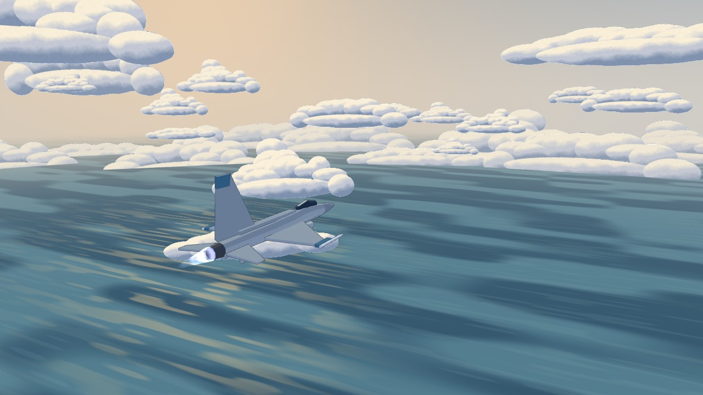
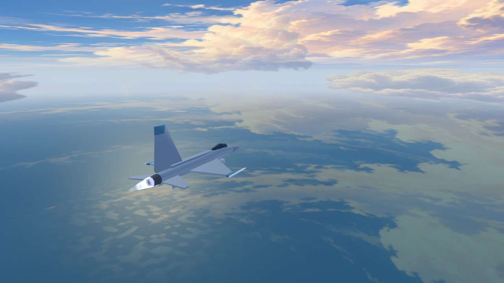
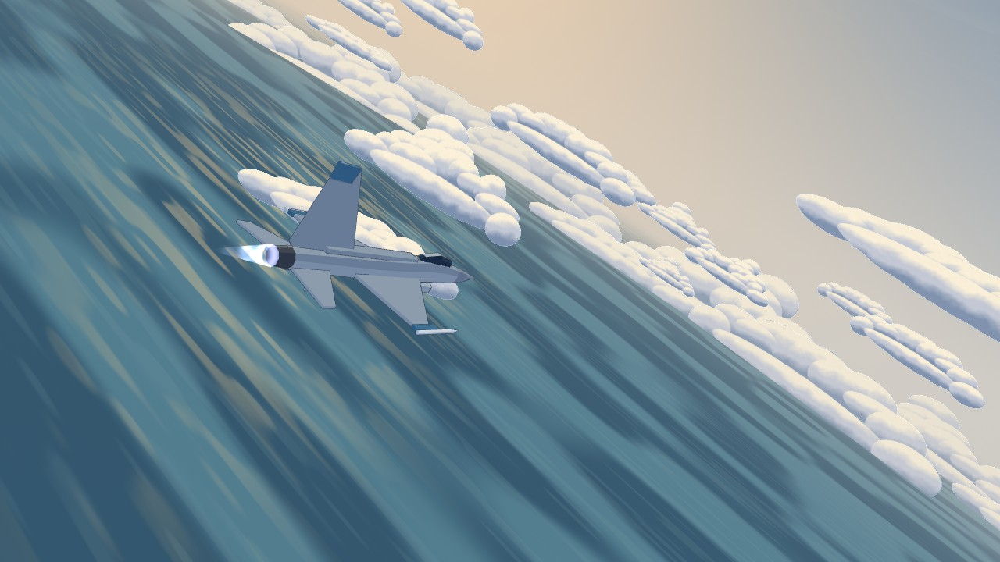
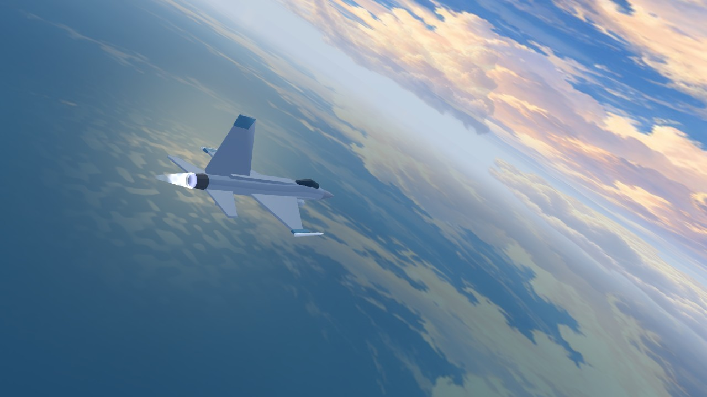
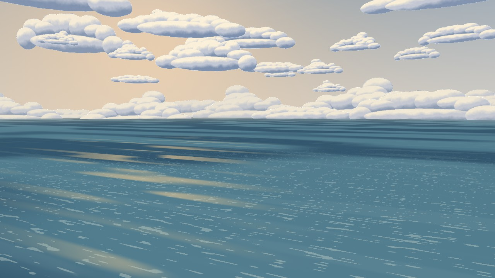
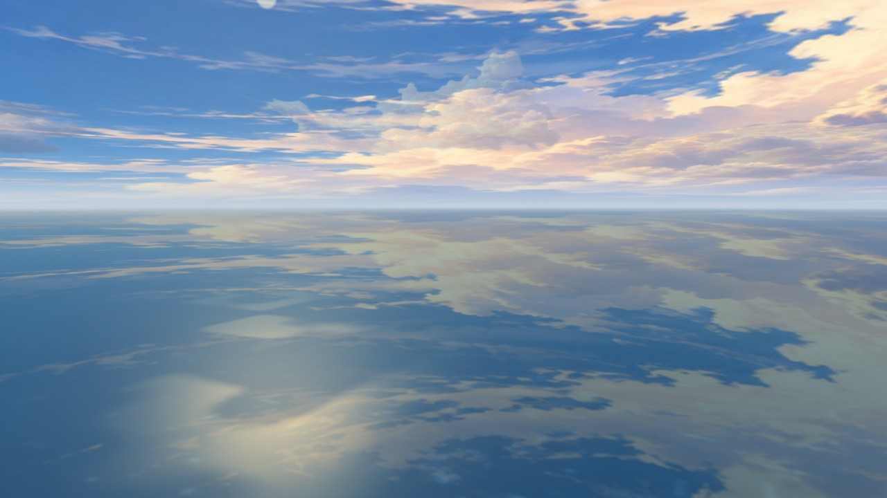
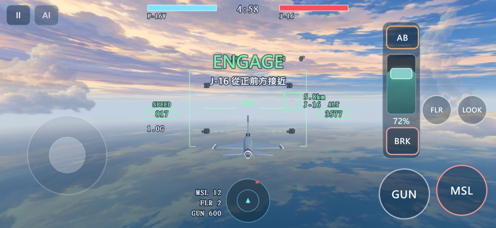

# Ace to Ace — NPR / anime film lookdev 第二輪

這是 Ace to Ace 獨立的小型視覺實驗，不是最終定案。基準為第一輪 commit `2678c34`。
只修改 `prototypes/ace-to-ace/`，不改 Unreal / Skyfront Homeland 主專案方向，PR #35 維持 Draft。

## 第一輪不足與本輪方向

第一輪雖然更換了色盤與 toon 材質，畫面主體仍是重複的橢圓雲塊、方向性程序海面，
加上清楚的三階明暗和輪廓線，因此仍偏風格化 3D 遊戲。這輪把主要視覺工作交給原創背景畫，
讓 renderer 負責空氣透視、反射色、世界視差與飛機受光。

| 項目 | 第一輪 | 第二輪 |
|---|---|---|
| 天空與遠雲 | 漸層及程序卷雲 | 原創大型天空背景畫、非對稱雲牆、天頂與地平線融合 |
| 中景／低雲 | 100 張相似的程序 atlas 畫片 | 8 張大型原創雲畫，四種不同構圖，少量視差層 |
| 海面 | 強方向性噪聲、筆刷長條 | 大面積天空反射色、柔和深淺、暖光路、遠霧 |
| 飛機 | 窄轉折三階 toon、較淡的底色 | 連續冷暖明暗、曲面法線、局部高光與天空補光、較深灰藍塗裝 |
| 輪廓 | 0.65 CSS px 灰藍線 | 0.24 CSS px 更淡色線，保留剪影即可 |
| 畫面統一 | 微量紙感／畫面噪聲 | 移除畫面顆粒，以共用背景畫和霧色統一 |

## 實作重點

**背景畫與空氣感。** 內建 ImageGen 產生一張原創天空畫與一張原創透明雲形畫，
不用外部影片截圖或不明來源素材。背景畫映射到既有 skydome，保留世界方向，
處理環繞接縫、天頂與地平線的淡出。畫中的大型雲牆與低雲海主導構圖；
八張中景雲只提供深度，不再靠大量相似雲物件填滿畫面。

**雲層融合。** 中景雲使用一般 alpha 混合與由遠至近的 instance 排序，維持一個雲 draw call。
每幀只更新 8 個變換與 UV tile；淡化近距畫片，邊緣與遠距色依背景畫霧化。
所有卡片的幾何下緣都在海面以上，避免被海面切成硬直線。只用既有 forward renderer，
沒有加入 volumetric clouds 或多層後製。

**海面。** 與天空共用同張背景貼圖，取設計化的反射方向，混合藍綠大色塊與低頻變化。
暖光路和輕微近水參考受像素覆蓋率限制；刪除長條筆刷與畫面 noise。
天空與海面在遠處使用相同的地平線色，避免霧帶斷層。

**飛機。** 保留所有幾何、機型比例、剪影與遊戲尺寸。用既有 smoothNormal 柔化機身曲面，
保留機翼的平面；較寬的冷暖明暗過渡取代硬 toon 分階。局部肩部反光、座艙亮面與天空補光
直接在同個材質內完成，不增加材質 draw call，不引入金屬 PBR 或鏡面 render target。

操控、虛擬搖桿、油門、AB/BRK、HUD 邏輯、飛行手感、AI 戰術、武器和玩家按鈕均未更動。

## 比較畫面

以下 chase、bank、ocean 為相同世界位置、相同相機、相同 seed 的固定 Renderer 檢查，
不是換鏡頭或後期修圖。雲分布與材質是本輪變更；近雲檢查因雲位置改變，不做同位置 A/B 宣稱。

| 視角 | 第一輪基準 | 第二輪 |
|---|---|---|
| 追機 |  |  |
| 側傾 |  |  |
| 海面 |  |  |



## 素材與修改檔案

| 檔案 | 變更 |
|---|---|
| `src/game/lookdev.js` | 背景畫映射、海面反射／霧化、透明雲融合、連續飛機受光 |
| `src/game/render.js` | 共用背景貼圖、8 張中景雲、雲 instance 排序 |
| `src/game/models.js` | 調整灰藍機身、座艙、雷達罩塗裝，幾何不變 |
| `tools/lookdev-viewer.html` | 天空貼圖載入收據、環繞接縫和天頂檢查視角 |
| `tools/browser-check.mjs` | JPEG MIME、8 雲／背景圖載入斷言、接縫與天頂 smoke |
| `tools/prepare-lookdev-r2-assets.py` | 從已提交原圖可重現匯出 runtime 貼圖 |
| `assets/lookdev/source/r2-sky.png` / `source/r2-clouds.png` | 兩張 ImageGen 原始素材 |
| `assets/lookdev/sky-painting-r2.jpg` / `cloud-paintings-r2.png` | 兩張 runtime 素材 |
| `assets/lookdev/r2-generation-prompts.json` / `README.md` | 完整 prompt、生成來源、匯出與預算 |
| `README.md` / 本文件 / `docs/lookdev-r2-validation.json` | 當前方向、驗證收據與限制 |
| `docs/screens/lookdev-r2-*.jpg` | 六張固定前後圖與一張實際觸控畫面 |

素材完整來源、最終 prompt 與重匯出方式見 [`assets/lookdev/README.md`](../assets/lookdev/README.md)
和 [`r2-generation-prompts.json`](../assets/lookdev/r2-generation-prompts.json)。
生成本身不是決定性的；從已提交 PNG 到 runtime 檔案的匯出是本機可重現的。
第一輪素材及文件保留為歷史，不由本輪 runtime 載入。

## 測試與預算

指定五項測試：`test-airbrake-throttle.mjs`、`test-power-strip.mjs`、`test-brake-trap.mjs`、
`test-flight-path.mjs`、`test-hud-attitude.mjs` 均執行並通過。

```sh
node tools/browser-check.mjs --scenario all --out tools/out/lookdev-r2-full
```

完整 browser smoke 涵蓋桌面出擊、鍵盤、LOOK、飛彈、iPhone 尺寸觸控模擬、雙指搖桿／油門、
放手保持、AB 切換、BRK 共存與放開、AI 觀戰、殘骸材質、結算與再戰。
固定畫面另外檢查天空／雲圖載入、shader、近雲、俯衝、環繞接縫與天頂。
殘骸畫面使用受控傷害事件驗證渲染，不把它算成 AI 勝率或實戰擊墜統計。
完整 smoke 產生 27 張截圖並以機砲擊墜到達結算／再戰；最後的接縫清空區調整之後，
另跑 `--scenario lookdev --out tools/out/lookdev-r2-after`，9 張畫面檢查皆通過。
兩次均無 console、shader 或資產請求錯誤。從提交原圖重新匯出的兩張 runtime 素材，SHA256 均保持一致。

詳見 [`lookdev-r2-validation.json`](lookdev-r2-validation.json)。原始 PNG 與完整報告在忽略的 `tools/out/`。
貼圖 runtime 下載合計約 697 KiB；按 RGBA8 + mipmap 估算約 8.67 MiB，較 R1 增加約 6 MiB。
雲本體是 **1 draw call / 8 instances / 16 triangles**。沒有新增全螢幕 pass，保留自適應 DPR。

## 仍不足與下一步

- 飛機仍受原低多邊形幾何、面板與座艙細節限制；本輪改善的是照明與配色，未重建模型。
- 遠雲是固定背景畫，近雲仍是平面。極端穿越或交疊時可看出 2.5D 性質；instance 中心排序
  不能解決所有相交透明面，霧化和分布只降低其可見性。
- 海面是背景畫的設計化反射，不是動態波浪、岸線或完整環境反射；近距還可繼續精修。
- 此天空是構圖式 panorama，側後方環繞與天頂用 shader 融合，尚不是全方向人工繪製的 skybox。
- 大畫片的 fill rate、額外天空取樣與貼圖記憶體需實機驗證。Chromium / SwiftShader 的 smoke
  只證明可啟動與流程可用；沒有取得實際 iPhone Safari 的幀時間、發熱與 MSAA 結果。

下一輪優先在 iPhone Safari 進行完整轉向、低空、穿雲與近距交戰的 5–10 分鐘驗證，再決定
是否補一張側後方背景畫或少量更精準的座艙／機身反光細節。整輪以獨立 commit 保留可回退性。
