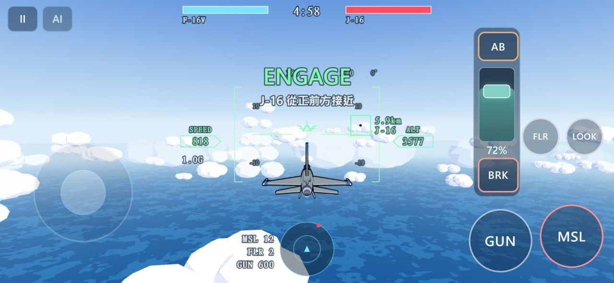
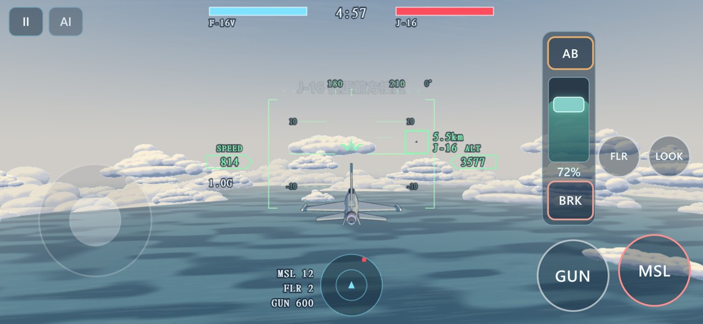
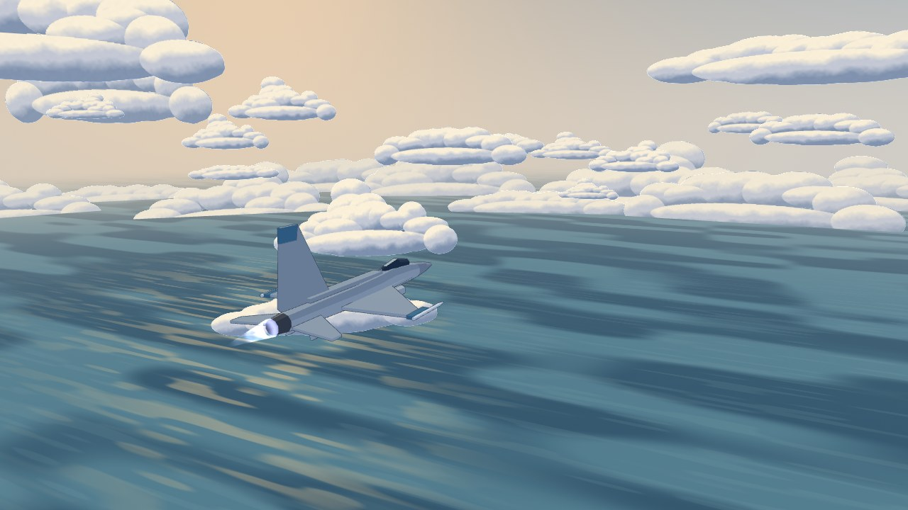
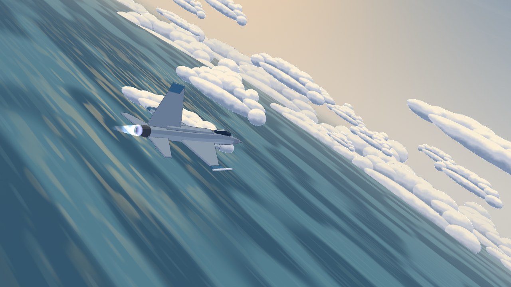

# Ace to Ace 小型風格實驗

**anime film 2D-look / NPR lookdev · 2026-10-18 · 非最終定案**

只影響 `prototypes/ace-to-ace/`。本次以可玩的 3D 空戰搭配背景美術式的海天與雲層，
探索日系動畫電影的 2D 視覺語言；不代表 Unreal / Skyfront Homeland 主專案的美術轉向。

## 視覺選擇

- **飛機**：保留原幾何、輪廓與大小；改用三階冷暖明暗、藍紫陰影、暖色受光邊及局部座艙閃光。
  不用金屬 PBR。外輪廓是約 0.65 CSS px 的灰藍細色線，隨 DPR 維持相同寬度。
  F-16V 使用較淡的灰藍與收斂的藍色識別，J-16 較深、紅色識別偏赭紅，便於區分。
- **雲**：用四種自製程序雲形的 RGBA atlas，取代多面體雲球。中層、低雲海、遠景雲冠
  保有世界位置、高度與視差；畫片朝向攝影機但維持世界向上的投影，側傾會跟著地平線旋轉，
  陡俯衝仍可見。距離約 180–950 m 漸淡以保留穿雲時的戰鬥可讀性。
- **天空**：低飽和藍灰天頂、暖米色地平線、方向性的日光、克制卷雲筆觸。
  噪聲只做非常微量的明度變化，不覆蓋 HUD。
- **海面**：大片藍綠冷色、寬鬆水平色帶與分段金色反光。細節隨像素覆蓋率淡出，
  降低遠處閃爍；遠霧接續天空的受光色。
- **尾煙**：保留原 ribbon 系統與生命週期，只調整色溫與柔邊，減少塑膠條感。

操控、搖桿、油門滑桿、AB/BRK 邏輯、HUD 邏輯、飛行手感、AI、武器與 ACRO 均未修改。
沒有增加玩家按鈕；`tools/lookdev-viewer.html` 僅是作者檢查頁面。

## 實際畫面

以下為相同觸控模擬尺寸的前後畫面，拍攝時間不同，並非同步的像素比較：

| 原版 | 本輪實驗 |
|---|---|
|  |  |

固定藝術檢查視角（使用遊戲的真實 Renderer，不改遊玩鏡頭）：





## 修改位置與素材

| 檔案 | 用途 |
|---|---|
| `src/game/lookdev.js` | 海天、雲與飛機 shader，以及本實驗的色盤與線寬 |
| `src/game/render.js` | 100 張 instanced 雲畫片、材質接線、尾煙視覺、殘骸色調 |
| `src/game/models.js` | 飛機三階明暗材質與識別配色，原幾何不變 |
| `assets/lookdev/cloud-atlas.png` | 新增的 1024 × 512 四格雲圖，約 185 KiB |
| `assets/lookdev/README.md` | 素材來源、生成方式與記憶體預算 |
| `tools/generate-lookdev-clouds.py` | 固定種子，自製色塊、距離場與筆觸噪聲；無外部圖像輸入 |
| `tools/lookdev-viewer.html` | 固定追機、側傾、近雲、海面、陡俯衝視角 |
| `tools/model-viewer.html` | 兩機型四方向檢查，使用相同細描線 |
| `tools/browser-check.mjs` | shader/貼圖/請求檢查、畫面截圖、實際觸控動力條、完整對戰與再戰 |
| `docs/lookdev-validation.json` / `docs/screens/lookdev-*.jpg` | 精簡測試收據與四張前後／固定視角截圖 |
| `.gitignore` / `README.md` / 本文件 | 測試輸出忽略與原型說明 |

遊戲仍然是靜態檔案，不需 build、新 runtime 套件或遠端服務。
生成器只在作者重新產生圖像時需要 Python + Pillow + NumPy。

## 驗證

五項指定測試均通過：

```sh
node tools/test-airbrake-throttle.mjs
node tools/test-power-strip.mjs
node tools/test-brake-trap.mjs
node tools/test-flight-path.mjs
node tools/test-hud-attitude.mjs
```

瀏覽器驗證：

```sh
node tools/browser-check.mjs --scenario all --out tools/out/lookdev-after
node tools/browser-check.mjs --scenario lookdev --out tools/out/lookdev-final-art
```

完整 smoke 包含桌面標題、鍵盤戰鬥、LOOK、飛彈、iPhone 橫向觸控模擬、搖桿放手保持與再觸碰、
雙指搖桿＋油門、油門放手保持、AB 切換、BRK 按住／放開且不清掉 AB／油門、AI 觀戰、
擊墜鏡頭、結算與 Enter 再戰。固定藝術視角另外檢查 atlas 載入、shader 可執行與幾何預算。
最終 LookDev 檢查另用受控的模擬傷害事件觸發殘骸與擊墜鏡頭，確認 cloned shader 的色調正常；
這不是 AI 自行擊墜的統計。最終完整對戰則以時間判定到達結算並成功再戰。
此處的 iPhone 是 Chromium 尺寸／觸控模擬，**沒有實機 Safari 的效能驗證**。

精簡測試收據見 [`lookdev-validation.json`](lookdev-validation.json)。
原始 PNG、完整 report 與每局資料保留在忽略的 `tools/out/`。

## 效能與已知限制

雲使用 **1 draw call、100 instances、200 triangles**，共用一張 atlas；PNG 解碼含 mipmap
約 **2.67 MiB**。保留既有自適應 DPR，沒有新增全螢幕後製、shadow map 或離屏 render target。
既有觸控 smoke 的一個基準樣本為 18 calls / 59,296 triangles；本輪實際戰鬥樣本降到約數千個三角形。
場景與時間不同，這只是幾何預算參考，不能據此宣稱實機 FPS 提升。

主要風險是大雲畫片重疊的 fragment / texture fill cost，及行動裝置上的 MSAA alpha-to-coverage
邊緣差異；天空和海面的程序筆觸也有 fragment 成本。SwiftShader 的 FPS 不代表 iPhone GPU。
這是背景畫片近似，四種雲形仍有重複感，不是體積雲；近距與極端視角可能看出平面性。
尚未加入地形、島嶼或新的大規模特效系統。

建議下一輪先在 iPhone Safari 實玩 5–10 分鐘，確認穿雲、低空海面、敵機辨識、發熱與幀時間，
再決定是否擴充少量更不規則的雲形，或降低雲畫片覆蓋率。先選方向，再做更精細的背景美術。

## 回退

本輪以獨立 commit 提交。可對該 LookDev commit 執行 `git revert <commit>`，恢復前一版視覺與作者工具。
不需資料遷移或重建資產，PR #35 保持 Draft；沒有合併 main。
