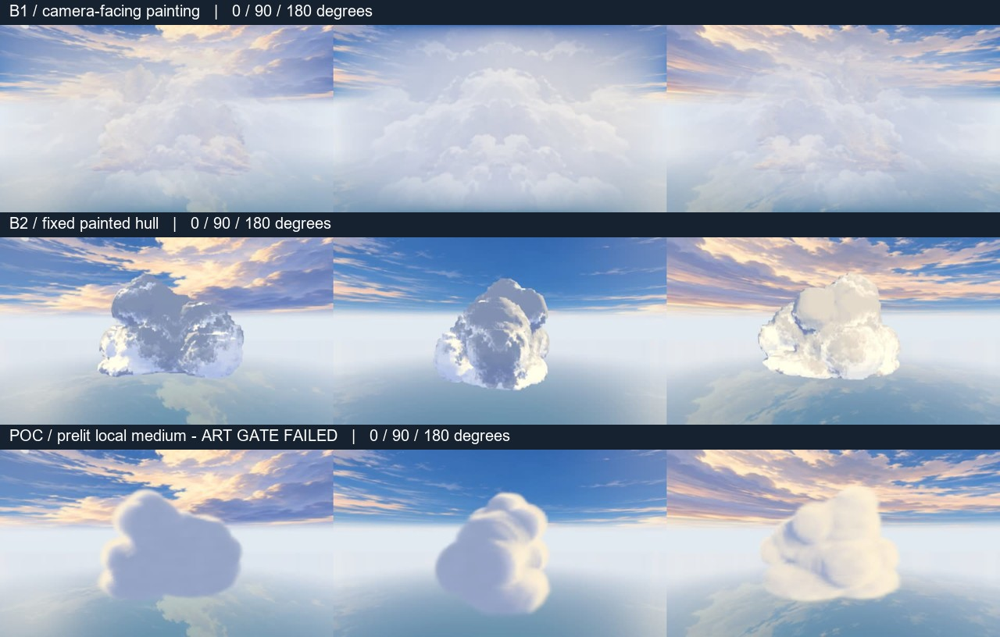

# 單雲 NPR 研究與最小驗證

**研究完成；單雲原型美術 Gate 失敗，已停止擴展。** 固定密度與預烘光讓一朵雲能繞行、接近、穿入及穿出，但這版仍像柔圓泡棉，沒有達成動畫電影手繪感。沒有新增雲海或接入正式遊戲。

[來源、頁碼、根因、兩個候選方案與研究 Gate](research.md)先以 `c04835b77217274a65031d95c01c58a3f85581f9` 獨立提交，之後才實作。[截圖與同步影片比較頁](gallery.html)是主要視覺證據。原始資料：[首輪少量截圖](stills/report.json)、[連續影片逐格狀態](motion/report.json)、[成本與透射率](performance/report.json)。報告中的 `passed` 只代表載入、shader、固定鏡頭／輸入等自動檢查成功，**不代表美術或 iPhone 效能通過**。

## 最值得借用的三項技術

1. **美術先決定雲的大形狀，噪聲只處理侵蝕細節。** Cygames GCC 第 108、113、116 頁，以及 Horizon 的 shape/detail 分工有原始依據。球體應是密度支撐／造形工具，不能直接等同可見的球面。
2. **只在有效區間做前到後的密度積分，累積透射、足夠不透明就停止。** GCC 第 116、119–122 頁有依據；多雲陰影還須沿光方向考慮其他雲。
3. **降低每幀需要重新計算的光照與像素工作。** Horizon 的低成本／完整採樣切換、低解析度與時間重投影有公開依據。這次選用固定光預烘來降低逐步取樣成本，是我們的工程變體，不是 Cygames 或 Horizon 的已證實實裝。

CEDEC 2017 官方頁只證實 NPR 研究範圍；完整簡報尚未取得。Sky 的確切雲 shader／穿雲方法、Xenoblade 的細部採樣與光照配置、AC7 的 trueSKY 內部優化均保留 Unknown。2017 Cygames 研究不能當成最終商業遊戲規格。Afterglow 原碼已閱讀；Cloud Cinema 最新原始 HTML 仍缺。

## 我們原本的設計錯誤

B1 把固定錨點誤當成固定表面：面向眼睛的片與互不對應的方位原畫仍會改變物體。Animfix 修正空間後，平滑橢球支撐與均勻柔邊仍只得到棉花糖。B2 把原畫的明暗變成固定殼上的材質，並用另一個粗方向格霧接手，因而容易讀成覆雪岩石／表面交接。

本輪也暴露另一個錯誤：**手工擺幾顆不對稱橢球，再加噪聲侵蝕和色階，不足以提供手繪造形與邊緣設計。** 色塊經體積積分後被平均，筆觸尺度和輪廓層級沒有成立；不能再靠提高步數解決美術問題。

## 本輪只做了什麼

沿用 Cloud Lab、既有 R2 天空／海面、Three.js 與不透明場景深度。`?oneCloud=1` 才啟用共同單雲輸入與新 renderer。12 個手工安排的橢球支撐一朵雲，固定 seed 73、固定日光；CPU 建立 64³ RGBA8 密度＋預乘色彩，並以 8 個快取密度 probe 預烘自遮蔽。執行時最多 24 個單貼圖 probe，限於相機射線與 AABB 的交集，從雲內積分則從眼睛開始；沒有可見不透明殼、整朵淡出或內外切換開關。

這是 GCC bounded-density 概念的簡化：AABB 仍包含空白，未實作精確球體區間合併，也未逐空區跳步。沒有多雲投影、可變日照、時間重投影或真正畫師製作的 3D 色塊。沒有增加依賴。

四條路線共用同一朵雲／鏡頭：接近與側掠 10 秒、含升降與 roll 的 180° 繞行 12 秒（中點 90°）、穿入 6 秒、穿出 6 秒。入雲結尾和出雲起點位置完全相同。B1、B2 演算法保持原碼，只換成相同單雲輸入；這不是它們原來九團雲場的效能重測。共 1,236 張實際 WebGL 影格，12 支短片，以 12 fps 離線編碼，沒有補幀。畫面 buffer 640×360，影片放大為 960×540。



| Gate | 結果 | 限度 |
|---|---|---|
| 90°／180° 空間穩定性 | 固定密度／色彩，未見 B1 式轉片；相機移動不重建快取 | 局部中間角度仍可能有低解析度／低步數取樣變化，不是任意鏡頭的形式證明 |
| 接近／側掠 | 無整朵中心淡出 | 太柔、形體仍像泡棉，近景缺乏筆觸和輪廓層次 |
| 穿入／穿出 | 同一密度連續遮蔽；沒有雲殼交面 | 雲內大面積單調藍紫，視覺資訊不足 |
| 手繪美術 | **FAIL** | 立即停止擴展；不以工程測試成功取代美術判斷 |
| iPhone Safari | **Unknown / 未測** | 沒有真機啟動、熱負載或 FPS 數據 |

98 個入／出雲中心射線：24 步 GPU 透射相對 2 m CPU 積分，最大絕對誤差 0.03121、平均 0.00411。單雲 2,000 個密度點的 64³ 三線性快取最大誤差 0.19646，顯示輪廓細節有明顯近似；此數值測試不能證明影像連續性或美術成功。

## 成本：SwiftShader 相對測試

Windows / Intel i7-12700 / Chromium 151 / ANGLE Vulkan SwiftShader。每格 3 個暖身後取 7 筆；每筆停止動畫，外部 disjoint timer query，另以 `readPixels` 強制完成像素後記錄同步牆鐘。提交時間、圖形 timer 和讀回牆鐘分列。`gl.finish()` 單獨返回太早，不能當成同步渲染成本，已補讀回重測。

下表為**整個 Lab 該模式管線**的 timer 中位數（括號為 min–max），不是純雲 shader 微基準，不能換算成手機 FPS。

| 場景／640×360 | B1 | B2 | 預烘局部體積 |
|---|---:|---:|---:|
| 接近：雲開啟 | 51.86 ms（40.19–54.65） | 125.49 ms（118.13–128.68） | 66.35 ms（43.12–71.45） |
| 接近：雲關閉控制 | 39.94 ms | 36.32 ms | 14.22 ms |
| 雲內：雲開啟 | 77.48 ms（64.07–80.99） | 90.87 ms（87.39–92.91） | 34.95 ms（23.97–35.98） |
| 雲內：雲關閉控制 | 49.92 ms | 42.70 ms | 15.59 ms |

接近的同步讀回牆鐘中位數 B1 / B2 / 原型為 58.3 / 131.3 / 75.3 ms；雲內為 84.6 / 98.1 / 40.1 ms。預烘體積在這次接近樣本仍比 B1 慢，不能宣稱全面較快。不同模式的 MSAA、深度 pass 與 RT 配置不同，不能把開／關兩個中位數相減當成精確隔離的 shader 成本。每格只有 7 筆，不是長時間統計。

原型 active volume 1 MiB、active color+depth RT 約 1.76 MiB、場景 3 calls（包含天空／海面與合成）；單次預烘桌面約 799 ms。CPU update 接近計時解析度，0 讀數不代表免費。Lab 為比較保留其他 renderer／atlas／快取與 RT，**active 減量不等於整頁 RAM 減量**。未量測首次載入峰值、Safari 記憶體或持續熱負載。

## 推薦與下一步

仍推薦「**遠景 2.5D 原畫 + 中近景局部 3D 密度介質**」作為待驗證的表示法；不推薦本輪直接擴展「固定硬殼＋薄霧」，它會重複 B2 的介質交接問題。這次的預烘實作只能保留為負面研究證據，不能升格為正式方案。

下一步先補齊 Cloud Cinema 最新 HTML／CEDEC 完整資料，並為同一朵雲建立真正有方向對應的美術目標（0°、90°、180° 的輪廓、冷暖大塊面與硬／柔邊設計）。先判斷目前低步數局部介質能否保留那些形與光，再決定是否值得修改這一朵；不要增加雲量、建立新引擎或擴大到整片雲海。美術達標後才用 iPhone Safari 做啟動與持續熱負載測試，最後才談整合。

## 重現

在 `prototypes/ace-to-ace/`，使用既有開發環境提供的 Playwright 與 ffmpeg（無專案依賴新增）：

```text
node tools/test-one-cloud.mjs
node tools/one-cloud-check.mjs --stills
node tools/one-cloud-check.mjs
node tools/one-cloud-check.mjs --perf
node tools/cloud-lab-serve.mjs 8098
```

開啟 `/docs/cloud-commercial-npr/gallery.html` 或 `/tools/cloud-lab.html?oneCloud=1`。數值測試及既有 `test:cloud`、`test:cloud-b1`、`test:cloud-b2` 通過，舊證據檔未納入變更。正式操控、HUD、AI、武器、飛行物理與 Unreal 完全不在本次 diff。
