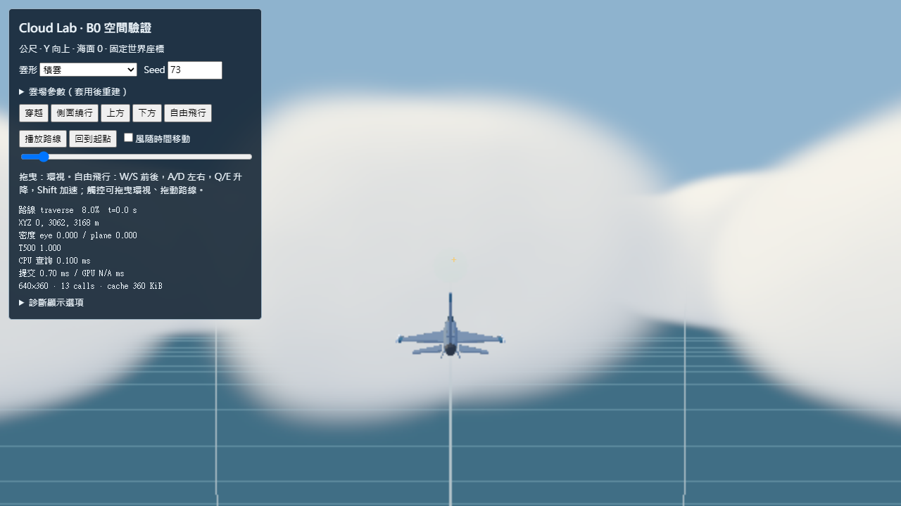
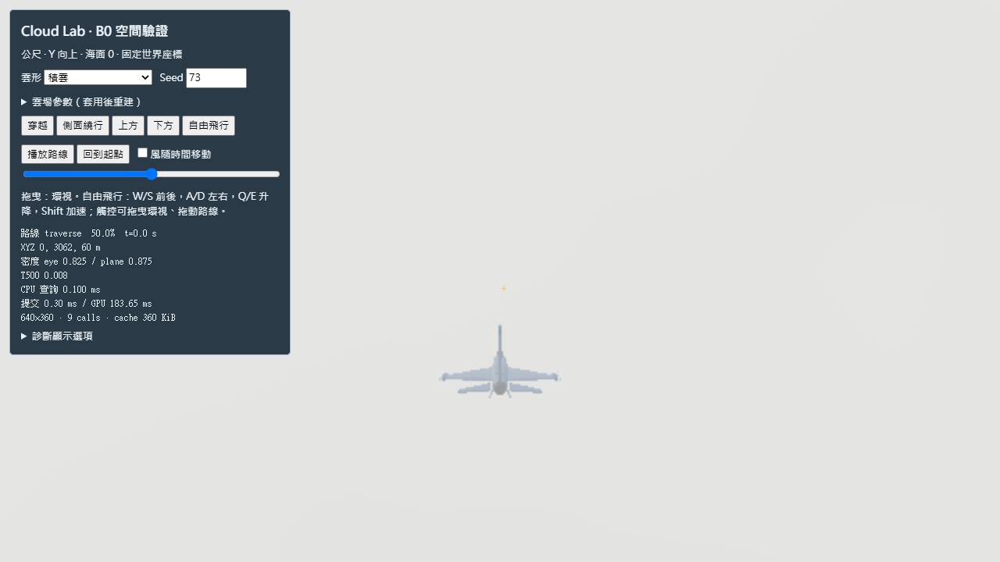
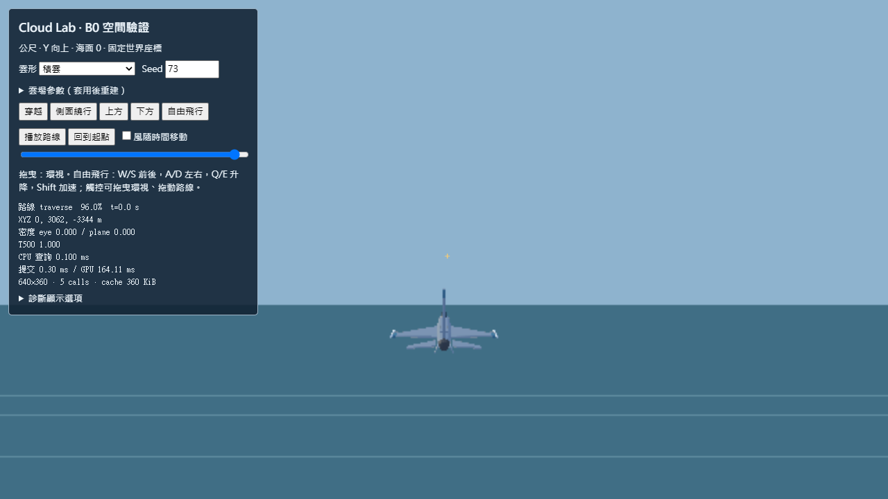

# Ace to Ace — Cloud Engine B0

基準：`0db84b5953eaffd75c3256ad0579f3c098dd0147`，分支 `spike/ace-cloud-engine-b0`。工作與依賴限於 `prototypes/ace-to-ace/`。

## 啟動與操作

在 `prototypes/ace-to-ace/` 用任意靜態伺服器，例如 `python -m http.server 8080`，開啟 [Cloud Lab](../../tools/cloud-lab.html)。不需要 build 或新 runtime 套件，使用現有 vendored Three.js r180。

- **穿越**：F-16 沿固定世界路線以 220 m/s 前進，追機鏡頭跟隨。按播放或拖進度：起點在雲區外，中點在雲內，終點在另一側雲區外。這是診斷路線，不改遊戲飛行模型。
- **側面繞行**：在雲區外繞行，確認雲的水平位置與厚度。
- **上方／下方**：從雲頂上 850 m、雲底下 750 m 觀察。自由飛行可任意接近／繞過單一雲團。
- **環視／自由飛行**：拖曳畫面改方向；W/S 前後，A/D 側移，Q/E 升降，Shift 加速。觸控可環視並拖動路線滑桿。
- 調整 seed、雲底／頂、範圍、雲團尺度、密度與風，按套用。改雲形載入對應預設。啟用風後雲獨立於世界路線移動；暫停播放只暫停路線，取消風勾選可凍結時間。重設回到起點及 t=0。
- T500 顯示鏡頭前方 500 m 的 CPU 透射率；eye／plane 是各自世界位置的密度。彩色信標與海面網格固定在世界中，會被雲依實際距離遮蔽。

## 程式與驗證

| 路徑 | 用途 |
|---|---|
| [cloud-field.js](../../src/cloud/cloud-field.js) | 純密度場、種子幾何、參數與視線積分 |
| [cloud-debug-renderer.js](../../src/cloud/cloud-debug-renderer.js) | Lab 專用密度快取、深度感知的單次合成 |
| [cloud-lab.js](../../tools/cloud-lab.js) | 路線、自由鏡頭、調參與讀數 |
| [research.md](research.md) | 物理來源、簡化假設、B1 建議 |
| [field-validation.json](field-validation.json) | 數值驗證與獨立 CPU benchmark |
| [browser-validation.json](browser-validation.json) | 真 Chromium 操作、視角與 GPU timer 記錄 |
| [verification.md](verification.md) | 驗收結果、R2 保留證據與 CPU 成本 |
| [performance.md](performance.md) | GPU 畫面成本與測量限制 |

```sh
npm test                         # 既有五項 regression + CloudField
npm run test:cloud-browser        # 需環境中有 Playwright / Chromium
node tools/browser-check.mjs --scenario all --out tools/out/cloud-b0-r2-smoke
```

Windows 本機 bundled Playwright 若未在預設搜尋路徑，可設定 `NODE_PATH` 到 Codex runtime 的 node_modules，`PLAYWRIGHT_BROWSERS_PATH` 到本機 ms-playwright。不需要把這些絕對路徑加入專案。

## 實際執行截圖

由 `cloud-lab-check.mjs` 啟動本機 HTTP、Chromium 與 WebGL 擷取，全部來自 runtime，未使用生成圖片。

| 接近雲 | 雲內 | 穿出 |
|---|---|---|
|  |  |  |

另有 [側面](screens/04-side.png)、[上方](screens/05-above.png)、[下方](screens/06-below.png)、[層積雲](screens/07-stratocumulus.png)、[層積雲內](screens/08-stratocumulus-inside.png)、[觸控尺寸](screens/09-touch.png)。

## 範圍與已知限制

R2 的天空畫、雲畫片、背景色、構圖、鏡頭與正式遊戲程式未改動。Cloud Lab 是獨立 HTML，原入口完全沒有載入 CloudField，所以 B0 對 R2 的預設影響為零；沒有新增正式遊戲開關或接線。

雲場為有限 6×5 km、27 個橢球，非無限世界；平流會讓整個雲區移動，不循環重生。沒有降水、結冰、擾流力、浮力、生成消散、日夜變化或天氣預報。

GPU 顯示用 96×48×80 的 8-bit 三維密度快取（360 KiB），約 63×26×63 m 的積雲格距；CPU 查詢仍為原始連續函數。快取以三線性插值，存在量化、平滑及輪廓近似；改參數時同步重建可能短暫卡頓。這個解析度不適用薄於數個格點的雲絲或任意極端參數。

合成 pass 每條有效視線固定 96 個中點樣本，每點加一個日光探針；不使用時間抖動、歷史累積或透明雲片。雲由前向後積分至場景深度，因此不存在多張透明雲片的排序翻轉。粗解析度的像素邊緣、遠處輕微 banding 與過柔輪廓仍可見，這是 Debug renderer，沒有達到 NPR 品質目標。

效能數據分開記錄：Node 的 CPU 密度查詢、瀏覽器 CPU 查詢／render submission、GPU timer 的完整兩 pass 畫面成本。GPU timer 不可用或 disjoint 時回報 N/A。Chromium ANGLE SwiftShader 是 CPU 軟體實作，即使提供 GPU timer 也不等於硬體 GPU 時間；**不能推論 iPhone GPU、Safari 或真機 FPS**。正式效能結論需 B1 的實機測試。
