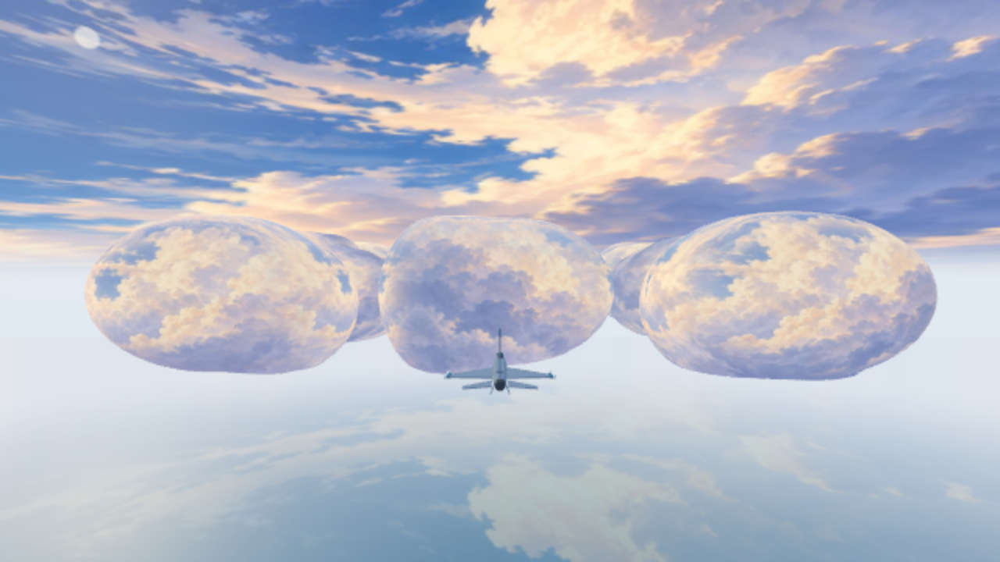
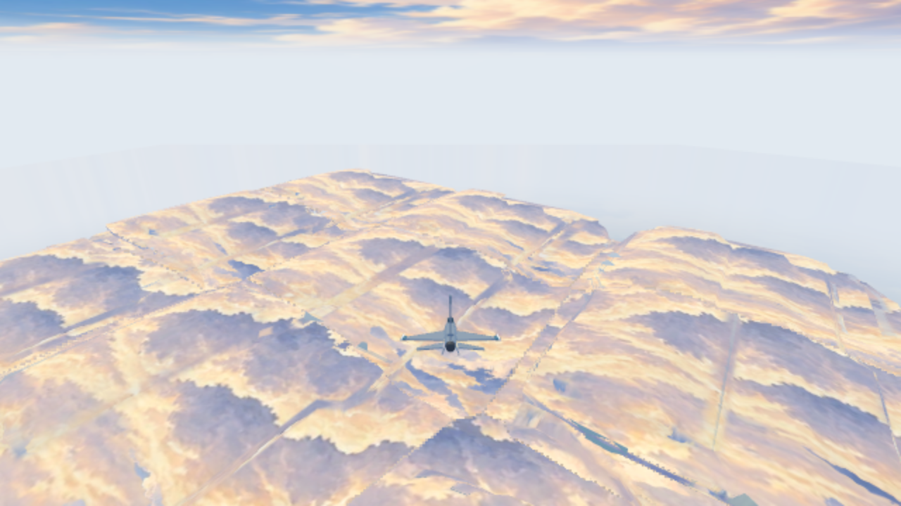
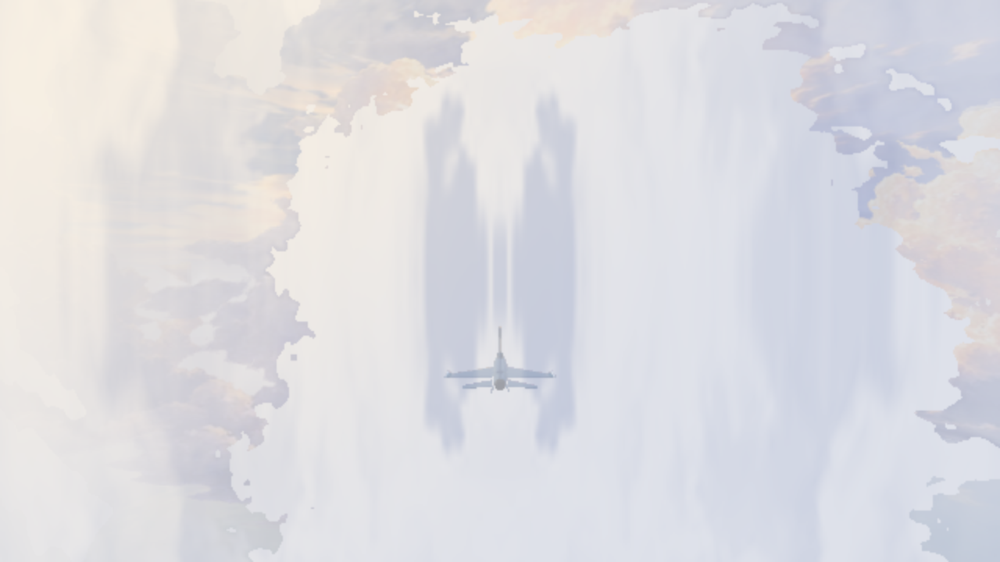
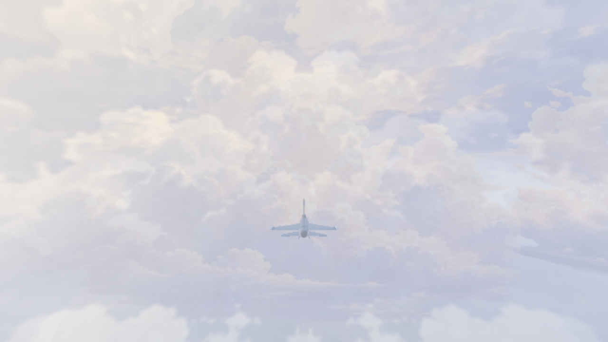

# Runtime 視覺迭代

以下都是本機 WebGL 實際執行畫面。每輪固定相機截圖及穿越畫面均經人工視覺檢查；僅保留代表性失敗與修正版，其他中間輸出留在忽略的 `tools/out/b1-iterations/`。

| 輪次 | 觀察 | 修正／決定 |
|---|---|---|
| r1–r3 | 密度等值殼法線與輪廓過度平滑；即使貼上細膩筆觸仍像球堆 | 修正法線、侵蝕及輪廓後仍不符美術目標，淘汰此方向 |
| r4–r5 | 增加破碎外形及透明投影，雲海出現拼貼縫，幾何成本也提高 | 淘汰等值殼及投影式 alpha 修補，不把球殼留在最終程式 |
| r6 | 改成世界錨定的分層剪影＋浮雕深度，遠景、雲海與雲底改善；雲內出現垂直條帶 | 關閉霧診斷定位到 XZ 筆觸投影，並非 atlas 輪廓問題 |
| r7／final | 三向世界投影去除直條，保留冷暖筆觸；近片由密度霧接手 | 補透明 guard bands、近距離漸退、遠景次要層 LOD；逐張檢查十個視角與連續路線 |

| 球形外觀（淘汰） | 雲殼拼貼縫（淘汰） |
|---|---|
|  |  |

| 雲內直條（修正前） | 三向霧筆觸（修正後） |
|---|---|
|  |  |

最終十視角未看到交叉平面露邊、透明排序翻面或整片硬切；轉頭回到原 pose 的 framebuffer 相同。這不代表所有可能路線都已驗證。雲底和近景仍有 atlas 特徵重複，部分邊緣因 4-sample 覆蓋率可見階梯；水平／垂直視角混合與極頂視的 billboard 基底仍是近似。原型已改善明顯球堆與拼貼破綻，尚不能宣稱完成電影級連續三維筆觸。
