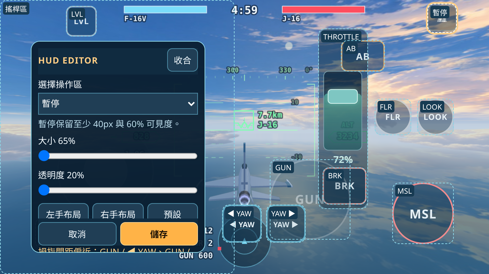
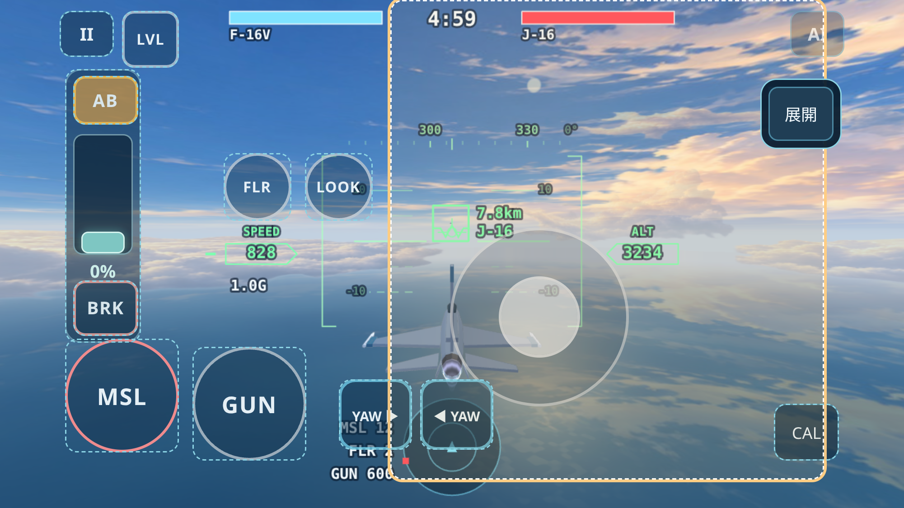

# Mobile Flight Controls v2 — validation notes

Baseline: draft PR #63, `feat/ace-mobile-yaw-controls`, remote HEAD
`dbfbd5deeb1277bcba62de6fd9b8dce68c169afb`. Both baseline CI jobs passed
([run](https://github.com/eddy121384-ui/air-combat-world/actions/runs/39921154163)).
The 16 existing Node commands also passed locally before changes.

## LEVEL

- Tap the 42 CSS px LVL button (or L) to request recovery; tap again or make
  a roll/pitch input above 0.12 to cancel. Pause, blur, hidden page, menus,
  new sorties and results cancel it too.
- `LevelAssist` supplies bounded roll/pitch commands through PlayerController.
  Roll error/rate and nose/flight-path feedback approach level gradually.
  It never writes aircraft pose, velocity, position, power or weapon state.
  Recovery uses at most 3 G and releases after 0.45 s within bank 3°,
  flight-path angle 1.5°, pitch 2° and roll rate 0.08 rad/s.
- Low speed (<110 m/s), low altitude (<500 m in this game's flat ground model)
  or limited available G produces a warning. Recovery times out at 20 s.
  This is an explicitly requested aid, not terrain avoidance or stall rescue.
  Expert neutral controls and the existing Assisted controller are unchanged.
- L06 introduces the limitation without changing its assessment.

Validation: `node tools/test-level-assist.mjs` covers 20 recoveries across all
four modes, including climbs, dives and near-inverted entries. It checks
bounded inputs, untouched aircraft state/power, damping, completion and manual
handover. All 17 Node regression commands passed (including all academy
lessons and the 52 wrong-student cases); established L10 outcomes are retained.
`browser-check.mjs --scenario level` exercises real CDP touch at 812×375 and
667×375 in all four modes, including 34 px side/21 px bottom safe areas,
60° bank entry, recovery, repeat-tap cancellation, manual override and pause.
Zero browser errors. Existing browser scenarios remain in CI.

Chromium touch emulation is not iPhone Safari acceptance. Real-device checks
remain: safe-area placement, multi-finger LVL handover and interrupted touches.

Local full Chromium regression: all seven scenarios passed, including ten lessons
and 50 phase/viewport readability checks. The first remote run exposed a YAW
cancel assertion racing CDP event delivery; the test now waits for the actual
DOM touchcancel before checking exact zero. It does not synthesize release or
change flight outcomes, seeds or tolerances.

## TILT

TILT selects an input device independently of the four flight presets. Enable it
in flight settings with **啟用體感操縱**, hold a comfortable landscape grip, then
save. CAL in flight or the settings button recentres that grip. YAW, weapons,
power and LOOK retain their touch semantics. Choosing the device or tuning it
while paused resumes the same sortie; changing physics/control mode still
restarts the same opening.

`TiltInput` projects DeviceOrientation's gravity vector into screen coordinates,
ignores compass alpha, subtracts the calibrated reference, applies the existing
stick Expo, and supplies Input → PlayerController. Both landscape directions,
legacy `window.orientation`, rotation invalidation and wrapped pitch are handled.
No aircraft state or sim module is modified. The academy adapts device-specific
words at subtitle delivery and in HUD guidance; L01/L02 briefings explain both
neutral conventions. L08's W-to-lead instruction and every judge remain intact.

- Permission is requested synchronously from the click handler, only in a secure
  context. Only DeviceOrientation data is used; requesting separate DeviceMotion
  permission would be unnecessary. Runtime permission state is never saved.
- Defaults: 20° full-scale tilt, 2° deadzone, unchanged Expo, no extra time filter.
  Sensitivity 0.5–2×, deadzone 0–6°, optional smoothing 0–60ms and X/Y inversion
  are saved after validation. Neutral and deliberate full throw bypass smoothing.
- A fixed 50ms filter caused the unchanged student to miss a L09 reversal;
  20ms also changed its outcome. The default therefore avoids extra filter delay;
  deadzone/Expo still reject small noise. This is an input tuning decision, not a
  relaxed judge or altered seed. High smoothing trades response for steadiness.
- Invalid data immediately neutralises input. Missing initial data (2.4s) or a
  stopped stream (1.5s) stops listeners and exposes the real virtual stick.
  Pause, focus/visibility loss, pagehide, menus, new sorties, device change and
  results stop high-rate listeners and require a fresh neutral reference.

Validation: all 19 Node commands pass. `test-tilt-input.mjs` checks secure gesture
permission/races, calibrated grips, both landscapes, inversion, saturation,
deadzone, smoothing, dropout and identical four-mode controller commands.
`test-tilt-academy.mjs` translates the **unchanged** student's desired input into
synthetic sensor angles through the real mapper: L01–09 clear in all four modes;
L10 wins over the same 12 openings remain 8/6/6/12. Only numerical epsilon below
1e-9 at intended neutral is zeroed by that test fixture. The original 52 wrong
students and fixed-stick L10 outcomes also pass.

`browser-check.mjs --scenario tilt` uses controlled synthetic orientation events
and real touch buttons at both mobile sizes with safe areas. It checks permission
from a user gesture, both landscape mappings, calibration, pose non-mutation,
60° bank/neutral Expert-vs-Assisted behavior, LVL override, simultaneous YAW/BRK,
AB/throttle, pause/blur, tuning/inversion, dropout fallback, device changes,
L01/L02 readable source-specific radio, reload and denied/absent hardware.
The harness isolates native headless sensor events from its controlled stream;
it does not emulate Apple hardware or Safari's permission sheet.

Sources checked 2026-10-23:
[MDN requestPermission](https://developer.mozilla.org/en-US/docs/Web/API/DeviceOrientationEvent/requestPermission_static),
[MDN coordinate frames](https://developer.mozilla.org/en-US/docs/Web/API/Device_orientation_events/Orientation_and_motion_data_explained),
[W3C orientation model](https://www.w3.org/TR/orientation-event/#device-orientation-model).

Safari physical-device acceptance still required over HTTPS: actual allow/deny
sheets, left/right landscape sign and comfortable grips, screen rotation,
stationary stream heartbeat versus the conservative watchdog, Home/app switching,
multitouch weapons with TILT, and subjective jitter/latency at 0–60ms.

## HUD EDITOR

Open **操作介面編輯** from the title or pause menu. The real rendered fight/HUD is
frozen; title entry creates a disposable preview without recording academy
progress. Drag an outlined region, or choose it in the selector, then adjust size
and opacity. Collapse the toolbox for a wider preview. Save/Cancel remain pinned
while the toolbox scrolls; Escape cancels. Reset/right-hand layout restore the
legacy arrangement. The left-hand preset swaps thumb jobs and separately places
power, FLR/LOOK and CAL to preserve viewing/operating space.

Editable: GUN/MSL/FLR/LOOK, both YAW keys, LVL, AB, BRK, the whole throttle strip,
stick interaction area, pause and CAL. Moving/scaling the throttle strip carries
AB/BRK until either is independently positioned; such overrides remain separate.
Thumb travel uses the scaled throttle geometry, so top/bottom still mean 100/0%.
Stick area size also scales its throw and visual base; its deadzone/Expo and
flight-controller response are unchanged.

Data: `ace2ace.hud.v1`, `{version:1, items:{id:{x,y,scale,opacity}}}`. Centres are
relative to the **safe area**, never raw pixels. CSS env() notch/home insets are
resolved before clamping. Size is 65–160%, opacity 20–100%; custom pause always
keeps at least 40×40px and 60% visibility above the other controls. Unknown
versions, malformed/missing entries and unavailable storage fall back safely.
No saved overrides means the original CSS layout. Storage failure explicitly
reports that the layout is only valid for this page. TILT hides the live stick
without deleting its layout; the editor exposes it for editing.

Input is disabled and contacts/queued weapons cleared while editing. Dragging a
button cannot activate it. Closing returns to pause/title, with the prior desktop
vs touch presentation preserved. Existing radio is temporarily hidden for the
preview and restored on return. Landscape/safe-area resize clears old contacts;
if TILT was enabled it awaits a fresh neutral sample rather than losing its
selection or applying old axes.

Validation: 20 Node commands pass, including `test-hud-layout.mjs` for version/
numeric validation, denied/broken storage, normalized-coordinate round trips,
notch/home bounds over phone/desktop sizes, and protected menu access. No flight,
AI, weapon, seed, judge or saved-progress migration changes.

`browser-check.mjs --scenario hud-editor` exercises eight four-mode/mobile-size
combinations using **real CDP touch drags**: move, 130% size/40% opacity, cancel,
save/reload, scaled throttle endpoints/latching, independent AB placement, custom
GUN + BRK finger ownership, left/right/reset, stick movement, TILT hide/edit/
restore, safe-area resize and malformed data. 130% is verified after reload;
that deliberately crowded test arrangement is then reduced to 90% before the
independent-button test (the editor warns about its overlap). It also checks
keyboard/weapon suppression and that title preview cannot write academy progress.
An extra desktop case checks restoration of the non-touch presentation.

Spacing warnings are advisory: a player can still deliberately overlap controls.
Pause stays accessible and Reset is available. Presets and geometric checks are
starting points; physical-device thumb reach, grip and accidental taps still need
human acceptance. Chromium screenshots/tests are not iPhone Safari certification.

Prior stack CI: LEVEL `a81e817` passed
[run 40002100750](https://github.com/eddy121384-ui/air-combat-world/actions/runs/40002100750);
TILT `831d68e` passed
[run 40003162805](https://github.com/eddy121384-ui/air-combat-world/actions/runs/40003162805).

The phone editor test also drags the **native** size/opacity sliders by CDP touch,
then checks the rendered result. Final local existing-browser regressions passed:
settings, keyboard/manual, touch/power, four-mode free combat, all academy lessons
and 50 phase/viewport readability checks. The added TILT resize matrix passes at
both sizes in all four modes; it waits for the real resize event before supplying
the new neutral sample, rather than assuming CDP's acknowledgement is delivery.

Menu guard: the pause key renders above AI/debug and weapon controls. The browser
matrix drags it onto the AI key, applies 65% requested size/20% requested opacity,
and still operates Pause after save/reload (actual minimum 40px/60%). A focused
667px Expert rerun passed this guard plus native range drags, desktop restoration
and storage fallback. CI runs the complete unfiltered eight-case matrix.
