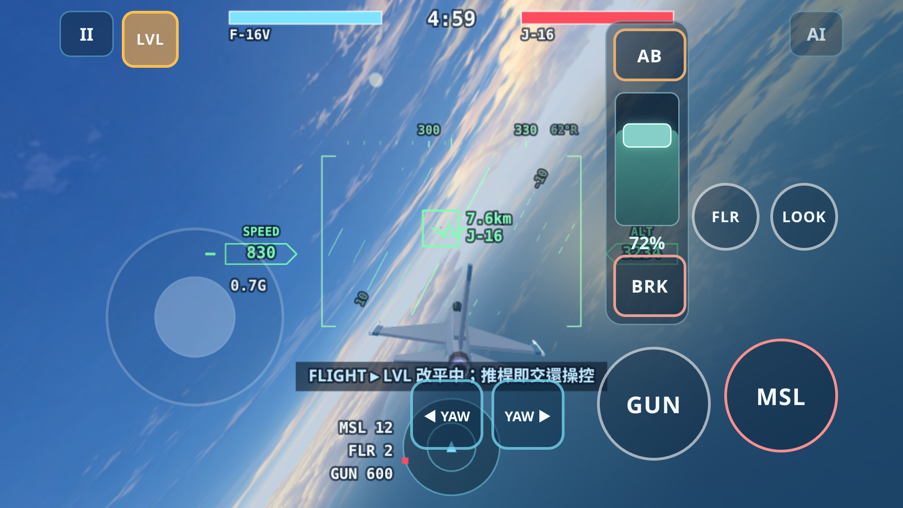
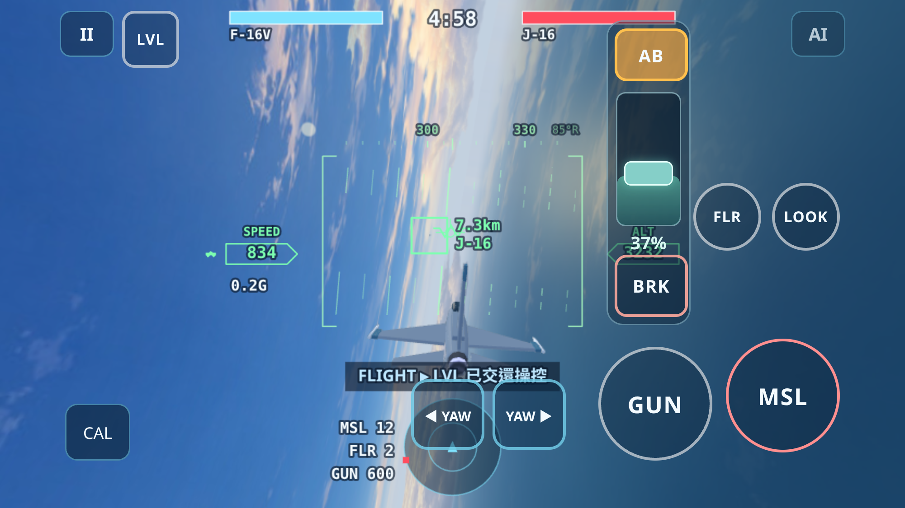
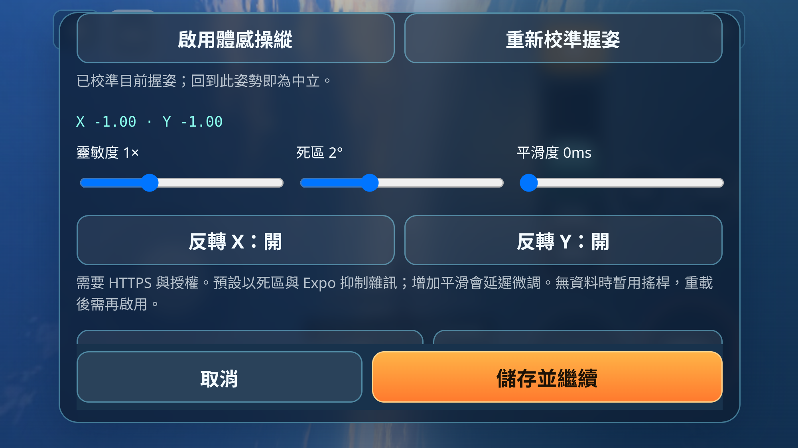

# Mobile Flight Controls v2 — validation notes

Baseline: draft PR #63, `feat/ace-mobile-yaw-controls`, remote HEAD
`dbfbd5deeb1277bcba62de6fd9b8dce68c169afb`. Both baseline CI jobs passed
([run](https://github.com/eddy121384-ui/air-combat-world/actions/runs/39921154163)).
The 16 existing Node commands also passed locally before changes.

## LEVEL

- Tap the 42 CSS px LVL button (or L) to request recovery; tap again or make
  a roll/pitch input above 0.12 to cancel. Pause, blur, hidden page, menus,
  new sorties and results cancel it too.
- `LevelAssist` supplies bounded roll/pitch commands through PlayerController.
  Roll error/rate and nose/flight-path feedback approach level gradually.
  It never writes aircraft pose, velocity, position, power or weapon state.
  Recovery uses at most 3 G and releases after 0.45 s within bank 3°,
  flight-path angle 1.5°, pitch 2° and roll rate 0.08 rad/s.
- Low speed (<110 m/s), low altitude (<500 m in this game's flat ground model)
  or limited available G produces a warning. Recovery times out at 20 s.
  This is an explicitly requested aid, not terrain avoidance or stall rescue.
  Expert neutral controls and the existing Assisted controller are unchanged.
- L06 introduces the limitation without changing its assessment.

Validation: `node tools/test-level-assist.mjs` covers 20 recoveries across all
four modes, including climbs, dives and near-inverted entries. It checks
bounded inputs, untouched aircraft state/power, damping, completion and manual
handover. All 17 Node regression commands passed (including all academy
lessons and the 52 wrong-student cases); established L10 outcomes are retained.
`browser-check.mjs --scenario level` exercises real CDP touch at 812×375 and
667×375 in all four modes, including 34 px side/21 px bottom safe areas,
60° bank entry, recovery, repeat-tap cancellation, manual override and pause.
Zero browser errors. Existing browser scenarios remain in CI.

Chromium touch emulation is not iPhone Safari acceptance. Real-device checks
remain: safe-area placement, multi-finger LVL handover and interrupted touches.

Local full Chromium regression: all seven scenarios passed, including ten lessons
and 50 phase/viewport readability checks. The first remote run exposed a YAW
cancel assertion racing CDP event delivery; the test now waits for the actual
DOM touchcancel before checking exact zero. It does not synthesize release or
change flight outcomes, seeds or tolerances.

## TILT

TILT selects an input device independently of the four flight presets. Enable it
in flight settings with **啟用體感操縱**, hold a comfortable landscape grip, then
save. CAL in flight or the settings button recentres that grip. YAW, weapons,
power and LOOK retain their touch semantics. Choosing the device or tuning it
while paused resumes the same sortie; changing physics/control mode still
restarts the same opening.

`TiltInput` projects DeviceOrientation's gravity vector into screen coordinates,
ignores compass alpha, subtracts the calibrated reference, applies the existing
stick Expo, and supplies Input → PlayerController. Both landscape directions,
legacy `window.orientation`, rotation invalidation and wrapped pitch are handled.
No aircraft state or sim module is modified. The academy adapts device-specific
words at subtitle delivery and in HUD guidance; L01/L02 briefings explain both
neutral conventions. L08's W-to-lead instruction and every judge remain intact.

- Permission is requested synchronously from the click handler, only in a secure
  context. Only DeviceOrientation data is used; requesting separate DeviceMotion
  permission would be unnecessary. Runtime permission state is never saved.
- Defaults: 20° full-scale tilt, 2° deadzone, unchanged Expo, no extra time filter.
  Sensitivity 0.5–2×, deadzone 0–6°, optional smoothing 0–60ms and X/Y inversion
  are saved after validation. Neutral and deliberate full throw bypass smoothing.
- A fixed 50ms filter caused the unchanged student to miss a L09 reversal;
  20ms also changed its outcome. The default therefore avoids extra filter delay;
  deadzone/Expo still reject small noise. This is an input tuning decision, not a
  relaxed judge or altered seed. High smoothing trades response for steadiness.
- Invalid data immediately neutralises input. Missing initial data (2.4s) or a
  stopped stream (1.5s) stops listeners and exposes the real virtual stick.
  Pause, focus/visibility loss, pagehide, menus, new sorties, device change and
  results stop high-rate listeners and require a fresh neutral reference.

Validation: all 19 Node commands pass. `test-tilt-input.mjs` checks secure gesture
permission/races, calibrated grips, both landscapes, inversion, saturation,
deadzone, smoothing, dropout and identical four-mode controller commands.
`test-tilt-academy.mjs` translates the **unchanged** student's desired input into
synthetic sensor angles through the real mapper: L01–09 clear in all four modes;
L10 wins over the same 12 openings remain 8/6/6/12. Only numerical epsilon below
1e-9 at intended neutral is zeroed by that test fixture. The original 52 wrong
students and fixed-stick L10 outcomes also pass.

`browser-check.mjs --scenario tilt` uses controlled synthetic orientation events
and real touch buttons at both mobile sizes with safe areas. It checks permission
from a user gesture, both landscape mappings, calibration, pose non-mutation,
60° bank/neutral Expert-vs-Assisted behavior, LVL override, simultaneous YAW/BRK,
AB/throttle, pause/blur, tuning/inversion, dropout fallback, device changes,
L01/L02 readable source-specific radio, reload and denied/absent hardware.
The harness isolates native headless sensor events from its controlled stream;
it does not emulate Apple hardware or Safari's permission sheet.

Sources checked 2026-10-23:
[MDN requestPermission](https://developer.mozilla.org/en-US/docs/Web/API/DeviceOrientationEvent/requestPermission_static),
[MDN coordinate frames](https://developer.mozilla.org/en-US/docs/Web/API/Device_orientation_events/Orientation_and_motion_data_explained),
[W3C orientation model](https://www.w3.org/TR/orientation-event/#device-orientation-model).

Safari physical-device acceptance still required over HTTPS: actual allow/deny
sheets, left/right landscape sign and comfortable grips, screen rotation,
stationary stream heartbeat versus the conservative watchdog, Home/app switching,
multitouch weapons with TILT, and subjective jitter/latency at 0–60ms.

